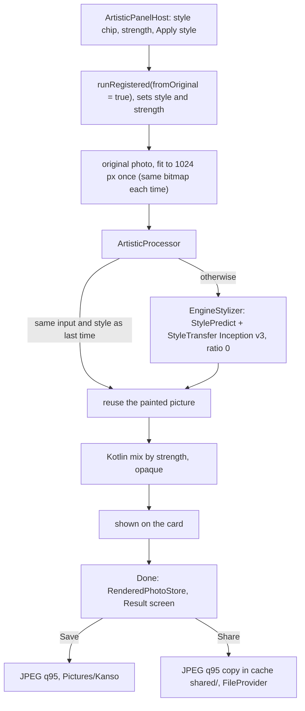

# Artistic: paint the photo in a style

[Back to README](../../README.md)

Code links below point into `app/src/main/java/com/phongkaster/kanso/`; the link text leaves that
prefix out. Test links point into `app/src/test/java/com/phongkaster/kanso/`. The parts every tool
shares (opening the photo, progress, Undo, Replace, Done) are on [The tool screen](tool-screen.md);
Share and Save are on [the Result screen](saving-and-share.md).

---

## What it is

Artistic repaints the photo in one of four styles with a **style-transfer** model: the model looks
at a small "style image" (its colours, marks and patterns) and repaints the photo with them. You
choose:

- a style: **Warm wash**, **Cool wash**, **Mosaic** or **Ink**;
- a **Style strength**, from 0 (the photo) to 1 (fully painted, the starting value);

then tap **Apply style**.

Limits, from the code:

- Works on at most **1024 px** on the longest edge, so the JPEG that Save on Result writes after a
  run is at most 1024 px, even at strength 0.
- Always starts again from the **original** photo: a new style or strength replaces the last
  result instead of painting over it.
- The four style images are Kanso's own drawings, not paintings by anyone else: 256 x 256 WebP
  files in `app/src/main/assets/styles/`, which can also be drawn in code.
- Offline: both models are inside the app.
- The progress ring does not move while the model runs; it jumps from 0 to 90% when the painting
  is done.

## How to use it

- Reach it from the fourth **carousel banner** on Home ("Paint it in a new style", or **Try
  now**), or the **Artistic** shortcut, then pick a photo (or take one with the gallery's camera
  button).
- Tap a style chip, set **Style strength**, tap **Apply style**. All controls are off while it
  works.
- To try another strength, move the slider and tap **Apply style** again: with the same style this
  only re-mixes and does not run the model again. Another style runs the model again.
- **Undo** takes back the whole session of Artistic runs at once. **Done** opens the Result screen
  with the result, where **Save** writes it to `Pictures/Kanso` and **Share** sends it; Back from
  Result returns here unchanged.

**Seen on the Android emulator (API 34, x86_64), 2026-10-14:** each style took about 9 seconds,
with no crash. The same day, the emulator showed that with the earlier `FULL_STYLE_RATIO = 1f`,
Warm wash, Mosaic and Ink gave pixel-identical pictures; the code now passes `0f` (step 5 below).

## How it works

1. **The panel.**
   [`ui/tool/components/toolpanel/ArtisticPanel.kt`](../../app/src/main/java/com/phongkaster/kanso/ui/tool/components/toolpanel/ArtisticPanel.kt):
   `ArtisticPanelHost` keeps the chosen style (Warm wash at first) and the strength (1 at first)
   with `rememberSaveable`, so both survive a rotation and the app being stopped in the background.
   The stateless `ArtisticPanel` draws the chips (scrolling sideways on a narrow screen), the slider
   and the button. **Apply style** calls `onApply(style, strength)`.
2. **Handing over the settings.** `ToolScreen` turns that into
   `viewModel.runRegistered(fromOriginal = true) { processor.style = style; processor.strength = strength }`,
   set only when no edit is running.
3. **Which processor.**
   [`di/AppModule.kt`](../../app/src/main/java/com/phongkaster/kanso/di/AppModule.kt) registers one
   app-wide `ArtisticProcessor(EngineStylizer(androidContext()))` for `Tool.ARTISTIC`.
4. **The input.** With `fromOriginal = true`, `ToolViewModel.apply` uses the original photo, shrunk
   to 1024 px (`WorkingSize.ARTISTIC`) on `Dispatchers.Default`. The shrunk copy is made once per
   screen and the **same bitmap object** is handed over every time, which is what lets the processor
   recognise a repeat.
5. **The processor.**
   [`data/edit/artistic/ArtisticProcessor.kt`](../../app/src/main/java/com/phongkaster/kanso/data/edit/artistic/ArtisticProcessor.kt)
   runs on `Dispatchers.Default`:
   1. reads style and strength once (strength clamped to 0..1), reports 0;
   2. if its remembered result was made from **this very bitmap** (compared with `===`) and this
      style, it reuses that painted picture; otherwise it shrinks to 1024 px again if needed, asks
      the [`Stylizer`](../../app/src/main/java/com/phongkaster/kanso/data/edit/artistic/Stylizer.kt)
      to paint it fully in the style, scales the answer to the input's size if the engine returned
      another size, and remembers it (one result only, guarded by a lock);
   3. reports 0.9, stops if you left the screen;
   4. **mixes** in Kotlin: `out = original + strength x (painted - original)` for red, green and
      blue, rounded, alpha 255; strength 0 gives the 1024 px photo, 1 the painted picture;
   5. marks the result opaque (`setHasAlpha(false)`), reports 1.
6. **The engine call.**
   [`data/edit/artistic/EngineStylizer.kt`](../../app/src/main/java/com/phongkaster/kanso/data/edit/artistic/EngineStylizer.kt)
   is the only file of the app that names the style-transfer engine's classes:
   1. for each run it builds a **new** `StyleTransferInceptionV3BlendUC` around a
      `StylePredictInceptionV3UC` (both in `libs/localml.aar`, through `core/localml`), on the
      application context, and waits for `initModel()` to load the models;
   2. loads the style image with `readStyleImage`: it decodes `assets/styles/<id>.webp`
      (`warm_wash`, `cool_wash`, `mosaic`, `ink`); if the file is missing or will not decode, it
      draws the same style in code with
      [`StyleImages`](../../app/src/main/java/com/phongkaster/kanso/data/edit/artistic/StyleImages.kt)
      (256 x 256, washes of blots, a 16 x 16 tile mosaic, or 40 ink strokes on paper, from a fixed
      random seed per style, so the drawing is the same every time);
   3. calls `invoke(photoCopy, styleImage, FULL_STYLE_RATIO)` on an `ARGB_8888` copy of the photo
      (it is not known whether the engine changes its input).

   **`FULL_STYLE_RATIO = 0f`.** The ratio blends the style image's style with the photo's own. At 1
   the engine keeps the photo's own style and ignores the style image. Run 8 shipped 1, and on the
   emulator (2026-10-14) Warm wash, Mosaic and Ink came out pixel-identical; Retica, where the
   engine comes from, starts its blend slider at 0. The fix sets 0, which paints fully in the
   style; every weaker strength is made by the Kotlin mix in step 5.

   The two models are `image_stylization_inceptionv3_dr_predict.tflite` (sums up the style image as
   a short list of numbers) and `image_stylization_inceptionv3_dr_transfer.tflite` (repaints the
   photo with it), both bundled in the assets of `libs/localml.aar`. Nothing is downloaded.
7. **Undo.** An Artistic run straight after another one replaces it without a new Undo step.
8. **Done, then Save or Share.** Done hands the result (or, with no run or every run undone, the
   original photo) to the Result screen through `RenderedPhotoStore`, at once; it writes nothing.
   The result is opaque, so Save on Result writes a **JPEG at quality 95**, at the size shown (at
   most 1024 px), into `Pictures/Kanso`, and Share sends a JPEG copy from the cache's `shared/`
   folder (see [Done, the Result screen, Save and Share](saving-and-share.md)).

**What happens on failure:**

| What went wrong | Failure | Message |
|---|---|---|
| Out of memory | `OutOfMemory` | This photo is too large to edit on this phone. Try a smaller one. Your photo is unchanged. |
| A model will not load, a native library will not link, or the engine throws | `ModelUnavailable` | This tool could not start on this phone. Your photo is unchanged. |

The photo and Undo stay as they were. Leaving the screen cancels the run.

## Tests

- [`tool/artistic/ArtisticProcessorTest.kt`](../../app/src/test/java/com/phongkaster/kanso/tool/artistic/ArtisticProcessorTest.kt),
  with a fake stylizer that recolours each style its own way: strength 0 gives the original, 1 the
  painted picture, 0.5 a mix; two styles give different pictures; a new strength reuses the
  painted picture (the stylizer is not called again); a very large photo is capped before the
  stylizer; out of memory and engine errors are reported; a cancellation propagates; progress only
  goes forward; there are at least four styles, each with a name and an image; style images are
  deterministic.
- [`tool/artistic/ArtisticPanelTest.kt`](../../app/src/test/java/com/phongkaster/kanso/tool/artistic/ArtisticPanelTest.kt):
  every style chip, the slider and Apply are shown; a chip selects its style; Apply calls back;
  the host applies the chosen style.
- [`tool/ToolPhotoKeyTest.kt`](../../app/src/test/java/com/phongkaster/kanso/tool/ToolPhotoKeyTest.kt):
  the Artistic screen and its photo survive process death.
- [`screenshots/ToolScreenshotTest.kt`](../../app/src/test/java/com/phongkaster/kanso/screenshots/ToolScreenshotTest.kt):
  `tool_artistic_light` and `_dark`.
- `EngineStylizer`, and so the `FULL_STYLE_RATIO` value, is **not** covered by any test on the
  computer: the engine is native code. Only the emulator caught the ratio.

## Known limits and open items

- **Ratio 0 was checked on the emulator, not yet on the Galaxy A13.** On the emulator
  (2026-10-14, API 34, x86_64), Warm wash at full strength painted the photo in warm orange
  washes and Ink turned it into a black ink drawing, each in about 9 s; the two pictures differ
  (mean difference of 261 per pixel over the photo, against 0 before the fix). Run 8 item 13
  under "Awaiting a person" still asks for the same check on the phone, and for strength 0
  giving the photo back, which was not tried.
- **The processor keeps its last painted picture** (it is an app-wide Koin single) until the next
  run (`.harness/ISSUES.md`, Run 8 Phase 3 review).
- **Strength 0 gives the 1024 px copy**, not the photo at its opened size (Phase 3 review).
- **The style WebPs were drawn with PIL**, so the `StyleImages` fallback looks similar but not
  identical to them (Phase 3 review), although `StyleImages`' KDoc says the two are the same picture.

[Back to README](../../README.md)
