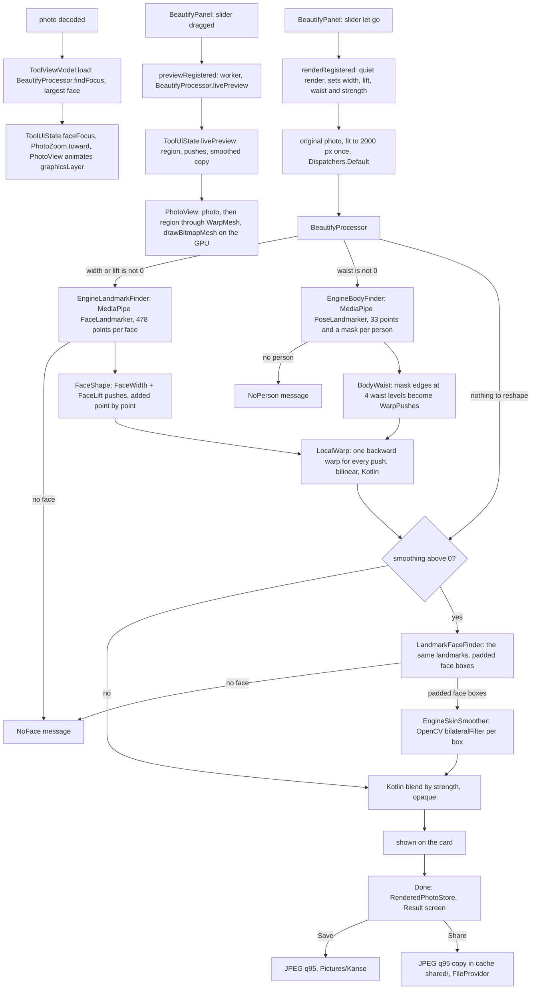

# Beautify: face width, face lift, waist and smooth skin

[Back to README](../../README.md)

Code links below point into `app/src/main/java/com/phongkaster/kanso/`; the link text leaves that
prefix out. Test links point into `app/src/test/java/com/phongkaster/kanso/`. The parts every tool
shares (opening the photo, progress, Undo, Replace, Done) are on [The tool screen](tool-screen.md);
Share and Save are on [the Result screen](saving-and-share.md).

---

## What it is

Beautify reshapes every face and every person's waist in the photo, then smooths the faces' skin:

1. **Face width**, like Meitu's Beautify > Face > Width: the outline of the cheeks and jaw is pulled
   toward the face's centre line (narrower) or pushed away from it (wider). The **Face width**
   slider runs from **-100** (wider) through **0** (unchanged, the default, the thumb in the middle)
   to **+100** (narrower, a smaller face), the same way round as Meitu's Width (measured on the
   Galaxy A13 with the same photo: Meitu's left end widened the jaw from 297 to 331 px, its right
   end narrowed it to 270 px). The slider is coloured from 0 toward the thumb, with a mark at 0.
2. **Face lift**, like Meitu's Beautify > Face > Lift: the lower half of the outline (the jowls and
   the jaw's corners) is raised toward the eyes and drawn a little in toward the centre line, so the
   jawline looks higher and tighter. The **Face lift** slider runs from **-100** (the jaw dropped
   and spread, a heavier face) through **0** (unchanged, the default) to **+100** (lifted the most),
   two-sided like Width, as Meitu's Lift slider is (seen on the vivo V2408A, 2026-10-29). Which
   end of Meitu's slider lifts was not measured; Kanso lifts to the right, as Width narrows to the
   right. Width and Lift are applied together in one warp, and their moves **add up**: a face can
   be narrowed and lifted at once.
3. **Waist**, like Meitu's Body > Reshape > Waist: both sides of the waist are pulled toward the
   body's centre line (slimmer) or pushed away from it (wider). The **Waist** slider runs from
   **-100** (wider) through **0** (unchanged, the default) to **+100** (slimmer), the same way round
   as Meitu's Waist (seen on the Galaxy A13, 2026-10-29: Meitu's right end shortened the belt). It
   is warped in the same pass as the face, from MediaPipe's **pose** model: 33 body points and a
   mask of the person (see step 6 below). Arms, Legs and Chest are the next Body tools, one at a time.
4. **Smoothing**: an **edge-preserving blur**: small differences such as pores, blemishes and noise
   are averaged away, while strong edges such as eyes, lips and hair stay sharp. The **Smoothing**
   slider (0 to 100, starting at 0) sets how much of it you see.

The screen is laid out like the Edit screen: the photo fills everything down to a bottom bar that
holds a row of tools on two levels, as in Meitu (**Face**, **Body** and **Smooth** on top;
**Face** opens its own row, **Width**, **Lift**, then **Back**; **Body** opens **Waist** and
**Back**), and, above it, Edit's fixed-height panel area,
which shows the open tool's slider on a rounded surface (or "Pick a tool to start editing"). The
bar never changes height, so the photo does not jump when a tool opens. **Letting go of a slider applies** every
value, as Meitu does when the finger lifts.

When the photo opens, the card **zooms in on the largest face** (it glides there in under half a
second), so a width change is easy to see; a **double tap** on the photo switches between that and
the whole photo. While **Body** is open the card shows the **whole photo** instead, since the zoom
onto the face would hide the waist; Back returns to the face.

Limits, from the code:

- Face width and Face lift move **everything inside each push's circle** (about a fifth of the face's width
  around each outline point): hair, earrings and the background right beside the cheeks bend with
  the face. Meitu's BG Lock (a person mask that keeps the background still) has no Kanso
  equivalent yet.
- Face width and Face lift reshape at most **5 faces** per photo; Waist at most **3 people**.
- Waist bends the background beside the waist too (no BG Lock yet). Where an arm rests against the
  waist, the mask cannot separate them, so the edge is guessed from the shoulders and hips instead.
- Waist needs the shoulders and the hips in the photo (each at least half visible to the model); a
  portrait cut above the hips gets no waist push. With no person at all it says "No person found
  in this photo. Nothing was changed."

- It works on a **rectangle around each face**, not on a skin mask. Everything inside the box goes
  through the filter (the filter keeps strong edges, so eyes and lips stay sharp); everything
  outside it is never touched.
- Smoothing and the face tools need a face. With none, they say "No face found in this photo.
  Nothing was changed." With smoothing at 0 no face is needed, so Waist alone works on a photo whose
  face is too small to find.
- It always starts again from the **original** photo, so applying again at another width, lift,
  waist or strength **replaces** the last result instead of reshaping or smoothing twice.
- Works on at most **2000 px** on the longest edge; the JPEG that Save on Result writes is at that
  size or smaller.
- Offline: the face model, the pose model and OpenCV are inside the app.
- It only reshapes face width, face lift and waist, and smooths skin. (The original Retica app's "Retouch" screen removed
  objects; Kanso's does not.)

## How to use it

- Reach it from the third **carousel banner** on Home ("Smooth, natural skin", or **Try now**), or
  the **Beautify** shortcut, then pick a photo (or take one with the gallery's camera button).
- Wait a moment for the zoom onto the face (none happens if no face is found).
- The top row shows **Face**, **Body** and **Smooth**. Tap **Face** to swap the row for Face's
  tools: **Width** (its slider opens at once) and **Lift** on the left, and **Back** pinned at the
  right end; Back returns to the top row. Tap **Body** for **Waist** (its slider opens at once,
  and the photo zooms out to show the whole body). Temple joins Face's row, and Arms, Legs and
  Chest join Body's, once they are built.
- Tap **Width**, **Lift**, **Waist** or **Smooth** to open its slider and drag it: the photo changes
  **live while you drag**, as in Meitu, drawn on the graphics chip. Let go and Beautify renders the
  photo from the original at full quality **quietly in the background**: no progress ring, and the
  sliders stay usable, so you can keep adjusting; a newer release replaces an older render. Done
  shows its small spinner and waits until the render is ready, and so does Undo. Tap the open tool
  again to close its slider.
- A tool whose slider is off its default carries a small dot, as on the Edit screen, and so does
  its group (Face) in the top row. Sliders keep their values while you move between the rows.
- Double-tap the photo to see all of it, and again to zoom back onto the face.
- **Undo** takes back the whole slider session at once. **Done** opens the Result screen with the
  result, where **Save** writes it to `Pictures/Kanso` and **Share** sends it; Back from Result
  returns here unchanged.

**Seen on the Android emulator (API 34, x86_64), 2026-10-14**, with test photos of a face (1024 x
1024) and a 4000 x 3000 scene: Beautify took about 20 seconds and gave smoother skin, with no crash.

**Seen on the Galaxy A13 (32-bit `armeabi-v7a`), 2026-10-28**, debug build, a standing portrait
with a small face: Face width +87 with Smoothing 11% took about 13 seconds; the cheeks and jaw came
in visibly while the eyes, nose and mouth kept their shape, and nothing crashed. Not yet compared
side by side with Meitu at the same value. Later the same day, with the row of tools and the zoom:
the card glided onto the face once the photo opened; Face width let go at +91 took about 16
seconds and the narrower jaw was plain to see in the zoom. Later still, with the live look drawn
through a mesh: dragging Face width from 21 to 100, the jaw narrowed frame by frame with no
spinner, and the owner confirmed on the phone that the photo follows the slider while dragging.

**Fixed on the Galaxy A13, 2026-10-28:** a release crashed the app with a native SIGBUS inside
MediaPipe's `Graph.startRunningGraph`, while the engine's `DetectFaceLandmarkUC` (then used for the
smoothing boxes) started a second MediaPipe face graph beside Kanso's own. Beautify now runs one
face model only (see step 9).

## How it works

1. **The panel.**
   [`ui/tool/component/toolpanel/beautifypanel/BeautifyPanel.kt`](../../app/src/main/java/com/phongkaster/kanso/ui/tool/component/toolpanel/beautifypanel/BeautifyPanel.kt)
   is the screen's bottom bar (`ToolContent` puts the Beautify panel in the `Scaffold`'s `bottomBar`
   and lets the photo card fill the body, as on Edit). Its row is
   [`BeautifyToolRow`](../../app/src/main/java/com/phongkaster/kanso/ui/tool/component/toolpanel/beautifypanel/BeautifyToolRow.kt),
   on two levels: the top row is
   [`BeautifyEntry.TOP_ROW`](../../app/src/main/java/com/phongkaster/kanso/ui/tool/model/BeautifyEntry.kt)
   (the [`BeautifyGroup`](../../app/src/main/java/com/phongkaster/kanso/ui/tool/model/BeautifyGroup.kt)
   Face and Body, then the [`BeautifyTool`](../../app/src/main/java/com/phongkaster/kanso/ui/tool/model/BeautifyTool.kt)
   Smooth); tapping Face shows Face's tools (every `BeautifyTool` whose `group` is `FACE`; Body's
   likewise, `BODY`: Waist) in a
   `LazyRow` on the left and Back pinned at the right end behind a divider, as Edit pins Compare,
   and opens the group's first tool. The rows slide sideways with `AnimatedContent`. A new face
   tool joins the group by naming it in `BeautifyTool`. Every entry is the Edit screen's own
   `EditToolEntry`; Face's and Body's icons (`ic_face_group.xml`, `ic_body_group.xml`) are drawn for Kanso. Above the row, in Edit's own panel area
   (`EditSheet`, generic over the kind of tool, 136 dp tall, cross-fading), the open tool's slider, a [`BeautifySlider`](../../app/src/main/java/com/phongkaster/kanso/ui/tool/component/toolpanel/beautifypanel/BeautifySlider.kt):
   its name on a line of its own and the slider the panel's full width under it, its number at the
   right end (width, lift and waist -100..100, smoothing
   0..100). The open group, the open tool and every value are kept with `rememberSaveable` (they survive a
   rotation). Every move calls `onPreview(amounts)` (step 7) and the slider's
   `onValueChangeFinished` (the finger lifts) calls `onApply(amounts)`, where `amounts` is a
   [`BeautifyAmounts`](../../app/src/main/java/com/phongkaster/kanso/ui/tool/model/BeautifyAmounts.kt)
   holding every slider's value by name (smoothing, face width, face lift, waist). Opening or
   leaving a group calls `onGroupChange`; `ToolScreen` turns Body into
   `ToolViewModel.showWholePhoto(true)` (`ToolUiState.wholePhoto`), so the card drops the face zoom
   while Body is open. Width's, Lift's and Waist's icons, `res/drawable/ic_face_width.xml`,
   `ic_face_lift.xml` and `ic_body_waist.xml`, are drawn for Kanso; Smooth uses `ic_face_retouching_natural`.
2. **Handing over the values.** `ToolScreen` turns `onApply` into
   `viewModel.renderRegistered { processor -> processor.use(amounts) }`, a helper in `ToolScreen.kt`
   that sets `strength`, `width`, `lift` and `waist` on the
   `BeautifyProcessor`: a **quiet** render. It sets `ToolUiState.rendering` (Done's small spinner, Done
   and Undo wait) instead of the progress ring, leaves the sliders on, and cancels a render still
   running from an earlier release, so the newest release wins. Its result becomes the edit and
   clears the live look, unless the person dragged again meanwhile; a failure shows its message and
   clears the live look.
3. **Which processor.**
   [`di/AppModule.kt`](../../app/src/main/java/com/phongkaster/kanso/di/AppModule.kt) registers one
   app-wide `BeautifyProcessor(finder = LandmarkFaceFinder(landmarks), landmarks = landmarks, smoother = EngineSkinSmoother(), bodies = EngineBodyFinder(androidContext()))`
   for `Tool.BEAUTIFY`, with one `EngineLandmarkFinder` as `landmarks`: one face model and one pose
   model for the tool.
4. **The input.** `renderRegistered` uses the **original** photo as opened, shrunk to 2000 px (`WorkingSize.BEAUTIFY`) on `Dispatchers.Default`. That shrunk copy is
   made once per screen and reused for every later run.
5. **The processor.**
   [`data/edit/beautify/BeautifyProcessor.kt`](../../app/src/main/java/com/phongkaster/kanso/data/edit/beautify/BeautifyProcessor.kt)
   runs on `Dispatchers.Default`:
   1. reads the strength once (a NaN counts as 1; clamped to 0..1; the panel starts it at 0) and
      the width, the lift and the waist once (a NaN counts as 0; each clamped to -1..1), reports 0;
   2. shrinks to 2000 px again if needed, reports 0.05;
   3. collects the pushes and **warps once** (step 6 below), reports 0.25: the faces' only when
      width or lift is not 0 (no face → `NoFace`), the waists' only when the waist is not 0 (no
      person → `NoPerson`). A model whose sliders are all at 0 is never loaded;
   4. **with smoothing at 0, stops here**: the reshaped photo, made opaque, is the result, and no
      face is needed. Otherwise it asks the [`FaceFinder`](../../app/src/main/java/com/phongkaster/kanso/data/edit/beautify/FaceFinder.kt)
      for face rectangles on the reshaped photo, cuts each to the photo and drops empty ones,
      reports 0.4. No face → `NoFace`;
   5. smooths each face, one after another, with the
      [`SkinSmoother`](../../app/src/main/java/com/phongkaster/kanso/data/edit/beautify/SkinSmoother.kt),
      moving progress from 0.4 to 0.9; the copies between faces are freed;
   6. **blends** the fully smoothed copy over the reshaped photo, pixel by pixel in Kotlin:
      `out = reshaped + strength x (smoothed - reshaped)` for red, green and blue, rounded, alpha
      forced to 255. Strength 0 gives the reshaped photo back exactly. Outside the faces the two are
      equal, so those pixels never change;
   7. marks the result opaque (`setHasAlpha(false)`), frees the working copies, reports 1.
6. **Reshaping the faces (Face width and Face lift).** All in
   [`data/edit/face/`](../../app/src/main/java/com/phongkaster/kanso/data/edit/face/), the four steps
   a face editor such as Meitu runs, of which Width and Lift need the first three:
   1. **Detect, align, refine** —
      [`EngineLandmarkFinder.kt`](../../app/src/main/java/com/phongkaster/kanso/data/edit/face/EngineLandmarkFinder.kt)
      calls MediaPipe's `FaceLandmarker` (`RunningMode.IMAGE`, up to 5 faces, detection confidence
      0.5) on `face_landmarker.task`, which already ships in the app's assets through
      `libs/localml.aar`. That file is a zip of `face_detector.tflite` (BlazeFace, finds each face's
      box) and `face_landmarks_detector.tflite` (478 points per box, with the eyes, lips and irises
      refined). The landmarker is built on first use and kept; the points come back as fractions and
      are turned into pixels. The app declares `mediapipe-tasks-vision` itself (`app/build.gradle.kts`)
      because `core/localml` keeps it to itself. The fourth step, **parse** (a per-pixel mask of skin,
      hair, lips), is not needed for width or lift and not built;
   2. **Where the outline goes** —
      [`FaceWidth.kt`](../../app/src/main/java/com/phongkaster/kanso/data/edit/face/FaceWidth.kt):
      7 outline points per side ([`FaceMeshIndex.kt`](../../app/src/main/java/com/phongkaster/kanso/data/edit/face/FaceMeshIndex.kt):
      234, 93, 132, 58, 172, 136, 150 and their mirrors 454, 323, 361, 288, 397, 365, 379) move along
      the shortest path to the centre line (between the eyes, 168, to the chin, 152), by
      `width × 0.12 × weight` of their distance to it, weights 0.5, 0.8, 1, 1, 0.9, 0.7, 0.4 from the
      cheek at eye height down to near the chin. Each move is a `WarpPush` reaching 0.22 of the face's
      width (cheek 234 to cheek 454). Everything is measured on the face, so it works at any photo
      size and on a tilted head.
      [`FaceLift.kt`](../../app/src/main/java/com/phongkaster/kanso/data/edit/face/FaceLift.kt) uses
      the same 14 outline points and the same 0.22 reach. "Up" is the centre line from the chin
      toward between the eyes, so a tilted head is lifted along its tilt. Each point rises
      `lift × 0.05 × rise weight` of the eyes-to-chin length (rise weights 0, 0.25, 0.6, 1, 1, 0.8,
      0.5) and moves in `lift × 0.06 × tighten weight` of its distance to the centre line (tighten
      weights 0, 0.2, 0.5, 0.8, 0.9, 0.7, 0.4). A negative lift turns both moves round: down the
      face and outward. The cheek at eye height gets no push at all, so the
      eyes stay put (an empty push would still count in `LocalWarp`'s weights and damp its
      neighbours).
      [`FaceShape.kt`](../../app/src/main/java/com/phongkaster/kanso/data/edit/face/FaceShape.kt)
      joins the two: pushes on the same point become one push whose move is Width's plus Lift's,
      with the larger reach. Listing them side by side would not work, because `LocalWarp` averages
      overlapping pushes (below) and would halve each;
   3. **Moving the pixels** —
      [`LocalWarp.kt`](../../app/src/main/java/com/phongkaster/kanso/data/edit/face/LocalWarp.kt), plain
      Kotlin on an `IntArray`: for each result pixel inside the pushes' box, it sums every push's
      move weighted by `f²`, `f = (r² − d²) / (r² − d² + |move|²)` (Gustafsson 1993), divides by the
      total weight when it is above 1 (so overlapping pushes do not add up), and copies the input
      colour from `pixel − move` with bilinear sampling. All faces and all waists are warped in
      one pass.

   **The waist (Body > Waist)**, all in
   [`data/edit/body/`](../../app/src/main/java/com/phongkaster/kanso/data/edit/body/):
   1. **Find each person** —
      [`EngineBodyFinder.kt`](../../app/src/main/java/com/phongkaster/kanso/data/edit/body/EngineBodyFinder.kt)
      calls MediaPipe's `PoseLandmarker` (`RunningMode.IMAGE`, up to 3 people, detection confidence
      0.5, `setOutputSegmentationMasks(true)`) on `pose_landmarker_full.task` (9.4 MB, in
      `app/src/main/assets/`; a zip of `pose_detector.tflite` and `pose_landmarks_detector.tflite`).
      It gives 33 points per person as fractions (turned into pixels, each with its visibility,
      [`BodyPoint`](../../app/src/main/java/com/phongkaster/kanso/data/edit/body/BodyPoint.kt)) and
      a float mask per person, read with `ByteBufferExtractor` in native byte order into a
      [`BodyMask`](../../app/src/main/java/com/phongkaster/kanso/data/edit/body/BodyMask.kt). The
      landmarker is built on first use and kept, behind a `Mutex`. It runs beside the face
      landmarker on the same `mediapipe-tasks-vision` library; on the Galaxy A13 (2026-10-29) the
      two ran together without the SIGBUS above;
   2. **Find the waist's edges** —
      [`BodyWaist.kt`](../../app/src/main/java/com/phongkaster/kanso/data/edit/body/BodyWaist.kt):
      the torso's centre line runs from between the shoulders (points 11, 12,
      [`PoseIndex`](../../app/src/main/java/com/phongkaster/kanso/data/edit/body/PoseIndex.kt)) to
      between the hips (23, 24). If any of the four is less than 0.5 visible, the person gets no
      push. At 0.45, 0.6, 0.75 and 0.9 of the way down (weights 0.4, 0.85, 1, 0.55), it walks
      sideways from the line, one pixel at a time, until the mask drops below 0.5
      ([`BodyEdges.kt`](../../app/src/main/java/com/phongkaster/kanso/data/edit/body/BodyEdges.kt)).
      An edge it cannot find, or one nearer than 0.5 or further than 1.8 times the guess, is
      replaced by the guess: from 0.4 of the shoulders' spread at the top to 0.8 of the hips' spread
      at the bottom;
   3. **Push the edges** — each edge gets a `WarpPush` toward the centre line by
      `waist × 0.12 × weight` of its distance to it (away from it for a negative waist), reaching
      0.3 of the torso's length, and `LocalWarp` moves the pixels with the faces' pushes.
7. **The live look while dragging, on the graphics chip.** Each slider move calls
   `onPreview(amounts)`; `ToolScreen` hands it to `ToolViewModel.previewRegistered`, which
   sets the values on the processor and rings a one-slot `MutableSharedFlow` (`DROP_OLDEST`); one
   worker coroutine asks `BeautifyProcessor.livePreview` (the
   [`LivePreviewSource`](../../app/src/main/java/com/phongkaster/kanso/data/edit/LivePreviewSource.kt)
   contract) for one look at a time, so positions it could not keep up with are skipped, never
   queued. A look is not a picture but a recipe,
   [`LivePreview`](../../app/src/main/java/com/phongkaster/kanso/data/edit/LivePreview.kt): the
   region it changes (every face box and push circle), the same `FaceShape` and `BodyWaist` pushes
   the full render uses (the bodies are looked for only while the waist is not 0, then kept for
   the photo), and, when smoothing is on, the shown photo smoothed inside the faces, made once per photo.
   The landmarks are the ones found for the zoom, so a look costs almost nothing. It goes into
   `ToolUiState.livePreview`; the card draws the original photo as it is, then the region, cut out
   once, through a [`WarpMesh`](../../app/src/main/java/com/phongkaster/kanso/data/edit/face/WarpMesh.kt)
   (an even 32 x 32 grid whose points moved by `LocalWarp.moveAt`, the same rule as the full
   render) with `Canvas.drawBitmapMesh`, and the smoothed region through the same mesh on top, as
   opaque as the smoothing. `drawBitmapMesh` always cuts its picture into an even grid, so the grid
   covers only the face region, where it is fine enough; the region's edges do not move, so there
   is no seam. Undo clears the look, and the processor forgets its kept copies when the screen's
   ViewModel is cleared (`releasePreview`).
8. **Zooming onto the face.** In `ToolViewModel.load`, once the photo is decoded and shown, a tool
   whose processor is a
   [`FaceFocusSource`](../../app/src/main/java/com/phongkaster/kanso/data/edit/face/FaceFocusSource.kt)
   (Beautify) is asked for `findFocus(photo)`: the landmarks' box of the largest face, as fractions of
   the photo ([`FaceFocus`](../../app/src/main/java/com/phongkaster/kanso/data/edit/face/FaceFocus.kt)),
   or null with no face or a failing model. It goes into `ToolUiState.faceFocus`.
   [`PhotoZoom.toward`](../../app/src/main/java/com/phongkaster/kanso/ui/tool/model/PhotoZoom.kt) turns
   it into a scale that makes the face fill 60% of the frame (between 1 and 4 times) and a shift that
   brings it to the centre, held so the photo's edge never comes into view.
   [`PhotoView`](../../app/src/main/java/com/phongkaster/kanso/ui/tool/component/photocard/PhotoView.kt)
   glides there with `animateFloatAsState` (450 ms) and `graphicsLayer`, clipped to the photo's own
   frame; a double tap toggles the whole photo. The edited result has the same shape as the
   original, so the zoom stays on the face after each run.
9. **Finding faces for smoothing.**
   [`data/edit/beautify/LandmarkFaceFinder.kt`](../../app/src/main/java/com/phongkaster/kanso/data/edit/beautify/LandmarkFaceFinder.kt)
   asks the same `EngineLandmarkFinder` as Face width and Face lift for the landmarks and turns each face into
   [`paddedFaceBox`](../../app/src/main/java/com/phongkaster/kanso/data/edit/face/FaceBox.kt): the
   smallest box holding its points, widened by **10%** of its size on every side (so forehead and
   chin are included), cut to the photo. `EngineLandmarkFinder` builds its MediaPipe landmarker once
   and lets only one call at a time use it (a `Mutex`), since the zoom, a live look and a render can
   each ask. The engine's own `DetectFaceLandmarkUC` is no longer used by Beautify: loading it beside
   Kanso's landmarker started a second MediaPipe graph and crashed the A13 (see above).
10. **Smoothing.**
   [`data/edit/beautify/EngineSkinSmoother.kt`](../../app/src/main/java/com/phongkaster/kanso/data/edit/beautify/EngineSkinSmoother.kt):
   1. `OpenCVLoader.initLocal()` loads OpenCV from the app (`opencv/`), or the call throws;
   2. copies the photo into a mutable `ARGB_8888` bitmap and into an OpenCV `Mat`;
   3. takes a window (`submat`) onto the face box, converts RGBA to RGB, and runs
      `Imgproc.bilateralFilter` with a neighbourhood of a fiftieth of the face's shorter side
      (between 5 and 15 px), colour sigma 40 and space sigma 8;
   4. converts back to RGBA, writes it into the window, and turns the `Mat` back into the bitmap;
   5. releases every `Mat` in `finally` (their memory is native, outside Java's garbage collector).

   OpenCV is used instead of the engine's GL beauty shader because that shader needs a thread with
   an OpenGL context, which a background coroutine does not have.
11. **Undo.** A Beautify run straight after another Beautify run replaces it without a new Undo step,
   so Undo goes back to the photo before the first slider was let go.
12. **Done, then Save or Share.** Done hands the result (or, with no run or every run undone, the
   original photo) to the Result screen through `RenderedPhotoStore`, at once; it writes nothing.
   The result is opaque, so Save on Result writes a **JPEG at quality 95**, at the size shown, into
   `Pictures/Kanso`, and Share sends a JPEG copy from the cache's `shared/` folder (see
   [Done, the Result screen, Save and Share](saving-and-share.md)).

**What happens on failure:**

| What went wrong | Failure | Message |
|---|---|---|
| No face found | `NoFace` | No face found in this photo. Nothing was changed. |
| Out of memory, in the finder or the smoother | `OutOfMemory` | This photo is too large to edit on this phone. Try a smaller one. Your photo is unchanged. |
| The face model or OpenCV will not load, a native library will not link, or either throws | `ModelUnavailable` | This tool could not start on this phone. Your photo is unchanged. |

The no-face message also sits in a node tagged `beautify-no-face` for tests. The photo and Undo
stay as they were.

## Tests

- [`tool/beautify/BeautifyProcessorTest.kt`](../../app/src/test/java/com/phongkaster/kanso/tool/beautify/BeautifyProcessorTest.kt),
  with fake finders and a fake smoother: strength 0 leaves every pixel as it was; strength 1
  smooths the face and nothing else; half strength is half way; no face is reported and nothing
  changes; the input is not changed and the result is opaque; a very large photo is capped before
  the finder and the smoother; out of memory and errors in either are reported; a cancellation
  propagates; progress only goes forward, to 1; width 0 never looks for landmarks; a width with no
  face is reported; a width reshapes the outline and leaves the photo's corners alone; a lift with
  no face is reported; a lift reshapes the outline and leaves the photo's corners alone; waist 0
  never looks for bodies; a waist with no person is reported; with smoothing off a waist works on a
  photo with no face and leaves the corners alone; the focus is the largest face; no face or a
  failing model gives no focus.
- [`tool/beautify/BeautifyToolTest.kt`](../../app/src/test/java/com/phongkaster/kanso/tool/beautify/BeautifyToolTest.kt):
  through the real screen, no face changes nothing and shows the message; tapping a tool opens its
  slider; Face opens its own row with Width's slider ready and Back; Back returns to the top row
  keeping the values; letting go of a slider hands over its value with the others at their
  defaults; Lift sits in Face's row and opens its own slider; letting go of Lift left of 0 hands
  over the negative value and keeps the width set before it; Body opens its own row with Waist's
  slider ready and Back; letting go of Waist hands over its value with every other one at 0.
- [`tool/face/FaceWidthTest.kt`](../../app/src/test/java/com/phongkaster/kanso/tool/face/FaceWidthTest.kt):
  on a made-up oval face, 0 gives no pushes, positive pulls inward, negative pushes outward, both
  sides mirror, values beyond 1 clamp, the moves scale with the face.
- [`tool/face/FaceLiftTest.kt`](../../app/src/test/java/com/phongkaster/kanso/tool/face/FaceLiftTest.kt):
  on the same oval, 0 and NaN give no pushes; the cheek top stays and every other point rises;
  the jaw is drawn inward; a negative lift is the same pushes turned round; both sides mirror;
  values beyond ±1 clamp; the moves scale with the face.
- [`tool/face/FaceShapeTest.kt`](../../app/src/test/java/com/phongkaster/kanso/tool/face/FaceShapeTest.kt):
  each alone is unchanged; together the moves add up point by point; merging keeps the larger
  radius and the first order.
- [`tool/body/BodyWaistTest.kt`](../../app/src/test/java/com/phongkaster/kanso/tool/body/BodyWaistTest.kt):
  on a made-up upright figure (`SampleBody`), 0 and NaN give no pushes; a positive waist pulls both
  edges in and a negative one pushes them out; with a mask the pushes sit on its edges; without one
  the guessed edges are even; a hidden torso gets nothing; values beyond ±1 clamp; the moves scale
  with the body.
- [`tool/body/BodyEdgesTest.kt`](../../app/src/test/java/com/phongkaster/kanso/tool/body/BodyEdgesTest.kt):
  the walk finds the first background pixel, gives up past its limit or outside the person, and a
  mask smaller than the photo is read in the photo's pixels.
- [`tool/face/LocalWarpTest.kt`](../../app/src/test/java/com/phongkaster/kanso/tool/face/LocalWarpTest.kt):
  no pushes copies exactly, a push moves a black/white edge, nothing outside the circle changes.
- [`tool/face/PhotoZoomTest.kt`](../../app/src/test/java/com/phongkaster/kanso/tool/face/PhotoZoomTest.kt):
  a centred face zooms without sliding, an off-centre one is brought to the middle, a corner face
  never shows past the edge, the scale stays between 1 and 4.
- [`screenshots/ToolScreenshotTest.kt`](../../app/src/test/java/com/phongkaster/kanso/screenshots/ToolScreenshotTest.kt):
  `tool_beautify_light` and `_dark`.
- [`tool/face/WarpMeshTest.kt`](../../app/src/test/java/com/phongkaster/kanso/tool/face/WarpMeshTest.kt):
  the grid has one point per line, no pushes moves nothing, only points inside a push move and the
  one at its centre moves as `LocalWarp.moveAt` says.
- `BeautifyProcessorTest` also covers the live look: at rest it changes nothing, it carries the same
  pushes as the full render and finds the face once, it merges width and lift, it carries the
  waist and finds the body once, it smooths inside the face once and only its
  opacity changes, and no face or a failing model gives no look.
- `EngineLandmarkFinder`, `EngineBodyFinder` and `EngineSkinSmoother` are native code and are **not** run by any test
  on the computer, nor is the GPU drawing in `PhotoView`; only the device runs above exercised
  them.

## Known limits and open items

- Each quiet render (a slider let go) runs face finding, the reshape and smoothing again in full,
  about 13 to 16 s on the Galaxy A13; only the shrunk input is reused. Done waits for it.
- The live look moves mesh points forward (`point + move`) while the saved picture samples
  backward (`pixel − move`); for face-sized moves they match closely but not to the pixel.
- How many live frames a second the A13 draws has not been measured.
- No BG Lock: the background right beside the cheeks bends with them.
- The width numbers (0.12, the weights, 0.22) are first guesses, not yet tuned against Meitu.
- The lift numbers (0.05, 0.06 and both weight lists) are first guesses too, and **Face lift has
  not been tried on a phone yet**: only the JVM tests cover it.
- The waist numbers (the four levels and weights, 0.12, 0.3, the guesses 0.4 and 0.8) are first
  guesses. On the Galaxy A13 (2026-10-29), Waist at +92 on a standing portrait narrowed the belt
  from about 56 to 41 screen pixels, rendered in about 15 s, with no crash; whether it looks right
  next to Meitu at the same value is for the owner to judge.
- Waist bends what lies beside the waist (background, an arm resting on it), like Width and Lift.
- The pose model adds 9.4 MB to the app.
- **Whether the face boxes and the OpenCV settings look right has not been judged by a person**
  (`.harness/ISSUES.md`, Run 8 Phase 3 review).
- **Awaiting a person, Run 8:** item 11 (a one-face portrait at maximum strength: smoother skin
  with the eyes still sharp; a landscape gives the no-face message).

[Back to README](../../README.md)
