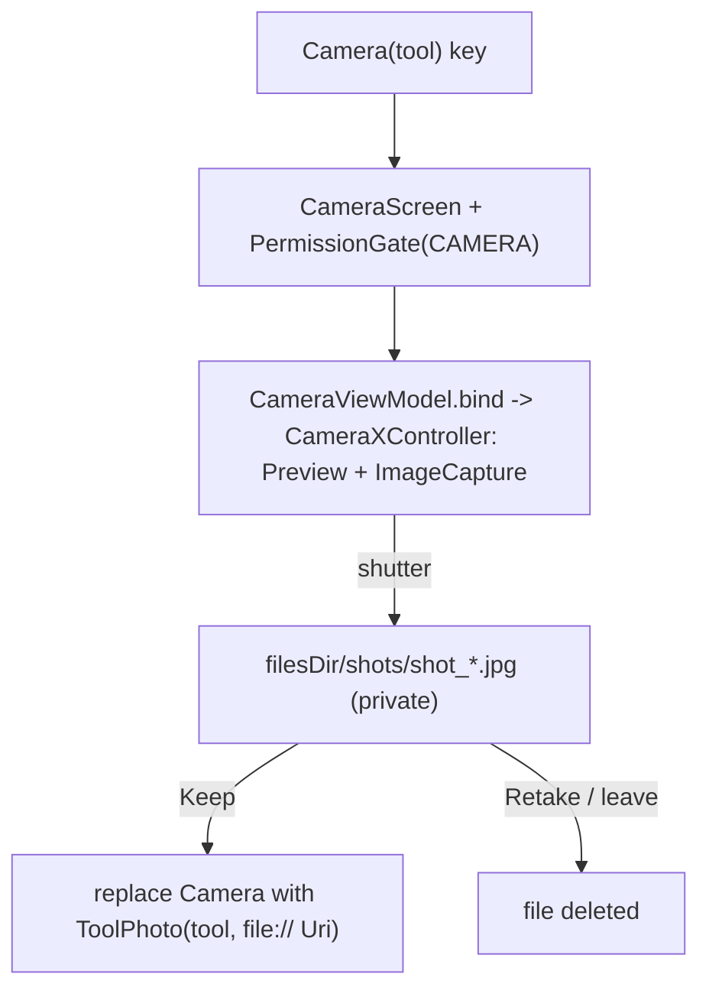

# Camera: take a photo to edit

[Back to README](../../README.md)

Code links below point into `app/src/main/java/com/phongkaster/kanso/`; the link text leaves that
prefix out. Test links point into `app/src/test/java/com/phongkaster/kanso/`.

---

## What it is

A simple camera for taking a new photo straight into a tool. It shows the live picture with a
round shutter, a lens switch (back/front), a flash button (auto, on, off) and pinch to zoom. After
a shot you choose **Keep** (it opens in the tool) or **Retake**.

Limits, from the code:

- The shot is **not** added to the phone's gallery. It lives in Kanso's private storage until you
  save the finished photo with Save in a tool.
- Shots older than a day are deleted the next time you take one; a shot you leave without keeping
  is deleted at once.
- The lens switch only shows when the phone has both a back and a front camera; the flash button
  only when the current lens has a flash.
- The camera is not required: Kanso installs on a phone without one (`uses-feature ...
  required="false"`), and the screen then says "The camera could not be started."

## How to use it

- Tap the round **Camera** button beside the floating tab bar (on Home, My edits or Settings). A
  kept shot opens in **Edit**.
- Or tap the camera button at the top right of any tool's gallery. A kept shot opens in **that
  tool**.
- The first time, Android asks for camera access. After a refusal the screen shows "Camera access
  is off" with **Open settings**.
- Tap the shutter; then **Keep** or **Retake**. Back leaves without keeping.

## How it works

1. **Opening.** The tab bar's Camera button pushes `Camera(Tool.EDIT)`, only while a tab is on top;
   a gallery's camera button pushes `Camera(<that gallery's tool>)`
   ([`navigation/KansoNavHost.kt`](../../app/src/main/java/com/phongkaster/kanso/navigation/KansoNavHost.kt),
   [`navigation/Camera.kt`](../../app/src/main/java/com/phongkaster/kanso/navigation/Camera.kt)).
2. **Permission.** [`ui/camera/CameraScreen.kt`](../../app/src/main/java/com/phongkaster/kanso/ui/camera/CameraScreen.kt)
   wraps the screen in the same `PermissionGate` as the gallery, with `CAMERA`. Launching the app
   asks for nothing; only opening the camera does.
3. **The camera.** Koin builds a **new**
   [`CameraXController`](../../app/src/main/java/com/phongkaster/kanso/ui/camera/CameraXController.kt)
   for each camera screen (a `factory`), behind the
   [`CameraController`](../../app/src/main/java/com/phongkaster/kanso/ui/camera/CameraController.kt)
   interface so tests can use a fake. `bind` gets CameraX's `ProcessCameraProvider` and binds a
   `Preview` (drawn into a `PreviewView`) and an `ImageCapture` with
   `CAPTURE_MODE_MINIMIZE_LATENCY` and the chosen flash mode to the screen's lifecycle, so the
   camera closes by itself when the screen is not in front. If the chosen lens is missing it uses
   the other; with neither, or if binding throws (the camera is busy), the status becomes
   `Unavailable` and the screen says "The camera could not be started."
4. **Controls.** [`ui/camera/CameraViewModel.kt`](../../app/src/main/java/com/phongkaster/kanso/ui/camera/CameraViewModel.kt):
   switching lens rebinds to the other lens (not while a shot is being taken; zoom goes back to 1);
   flash cycles auto → on → off; a pinch multiplies the zoom by the spread factor, clamped to the
   lens's range, through `cameraControl.setZoomRatio`.
5. **Taking a shot.** `takePicture` does nothing while a shot is being taken or waiting. On
   `Dispatchers.IO` it creates `filesDir/shots/` if needed, deletes files there older than 24
   hours, and creates a new file `shot_<random>.jpg` (`File.createTempFile`). CameraX writes the
   JPEG into it (`ImageCapture.OutputFileOptions`). CameraX may record the rotation in the JPEG's
   EXIF tag rather than turning the pixels; the tool screen's loader and the saver both honour the
   tag. A failure deletes the half-written file and shows "The photo could not be taken. Try
   again."
6. **Keep.** `keep()` marks the shot kept and returns its `file://` Uri; the navigation host
   **replaces** the camera with `ToolPhoto(tool, uri)`, so Back from the tool goes to where the
   camera was opened from. The kept file is not deleted while the tool screen shows it.
7. **Retake.** The shot leaves the screen at once, and the file is deleted on a background thread,
   retrying for up to about two seconds; the shutter stays off until it is gone.
8. **Leaving.** When the camera's ViewModel is cleared it releases the camera and deletes a shot
   that was not kept.

## Tests

All with a fake `CameraController` that needs no hardware.

- [`camera/CameraScreenTest.kt`](../../app/src/test/java/com/phongkaster/kanso/camera/CameraScreenTest.kt):
  the shutter writes a shot into private storage; Keep hands over the Uri and keeps the file; Retake
  deletes the shot and shows the shutter again; buttons are labelled and at least 48 dp.
- [`camera/CameraControlsTest.kt`](../../app/src/test/java/com/phongkaster/kanso/camera/CameraControlsTest.kt):
  lens switch toggles (and is absent with one camera); flash cycles auto, on, off (and is absent
  without a flash); zoom stays within limits; a pinch zooms in; a gallery's camera button opens the
  camera for its tool; the loading indicator shows while the camera opens.
- [`camera/CameraFlowTest.kt`](../../app/src/test/java/com/phongkaster/kanso/camera/CameraFlowTest.kt):
  Keep opens the Edit tool on the shot; Retake stays and deletes the shot.
- [`camera/CameraPermissionTest.kt`](../../app/src/test/java/com/phongkaster/kanso/camera/CameraPermissionTest.kt):
  launch asks for nothing; opening the camera asks once; a refusal explains, opens settings and
  does not ask again.
- [`navigation/SavedNavigationTest.kt`](../../app/src/test/java/com/phongkaster/kanso/navigation/SavedNavigationTest.kt):
  a gallery's camera, then Keep, opens that gallery's own tool.
- Screenshots: `CameraControlsScreenshotTest`, `CameraRefusedScreenshotTest`.

## Known limits and open items

- `CameraXController` itself only runs on a device; the tests use the fake.
- **Awaiting a person, Run 7:** item 29c notes the camera's title sits left beside its Back, where
  the other screens centre theirs.

[Back to README](../../README.md)
