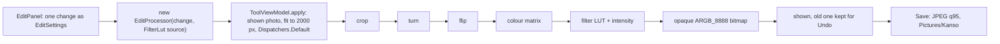

# Edit: crop, turn, flip, colour and filters

[Back to README](../../README.md)

Code links below point into `app/src/main/java/com/phongkaster/kanso/`; the link text leaves that
prefix out. Test links point into `app/src/test/java/com/phongkaster/kanso/`. The parts every tool
shares (opening the photo, progress, Undo, Replace, Save) are on [The tool screen](tool-screen.md).

---

## What it is

Edit is Kanso's general editor. Everything runs in plain Kotlin on the phone's processor: no
model, no engine code, no network. You can:

- **Crop** to a fixed shape, 1:1, 4:3, 3:4, 16:9 or 9:16 (the largest centred rectangle of that
  shape), or **Free**, where two range sliders (Width and Height) set the rectangle to keep.
- **Turn left** or **Turn right** a quarter turn, **Flip across** (left to right) or **Flip upside
  down**.
- Move four colour sliders: **Brightness**, **Contrast**, **Saturation**, **Warmth**.
- Apply one of seven **filters**, Light, 1977, Kelvin, Nashville, Walden, Hudson and Amaro, at the
  **Intensity** the slider under the chips shows.

Limits, from the code:

- Edit works on at most **2000 px** on the longest edge. The saved file is a **JPEG at quality 95**
  at the size shown, so a 4000 x 3000 photo saves as 2000 x 1500 once you edit it.
- Each change is applied on its own, as one step Undo can take back. There is **no live preview**
  while you drag a slider: the change is applied when you let go, then the slider springs back to
  the middle.
- Changes **add up**. Two filter taps apply the second filter on top of the first; two crops crop
  twice. There is no "None" filter chip: Undo removes a filter.
- The Intensity slider only sets the strength of the **next** filter tap. Moving it afterwards
  does not change a filter already applied.
- The free crop has no handles on the photo; the rectangle is set only with the two range
  sliders, and it can be no narrower than 5% of the photo on either side.
- Fixed shapes are always centred; you cannot move them.

## How to use it

- Reach it from the **Edit** shortcut on Home (then pick a photo in the gallery), by tapping a
  **Recent edits** card on Home, from the round **Camera** button on the tab bar (a kept shot opens
  in Edit), or with **Edit** in the My edits photo viewer. Edit has no carousel banner.
- On the Edit screen the controls sit under the photo and scroll if they do not fit (the panel is
  at most 260 dp tall):
  1. tap a shape chip to crop at once, or tap **Free**, set Width and Height, and tap **Crop**;
  2. tap **Turn left**, **Turn right**, **Flip across** or **Flip upside down**;
  3. drag a colour slider and let go;
  4. set **Intensity**, then tap a filter chip.
- Tap **Save** when done.

**Seen on the Android emulator (API 34, x86_64), 2026-10-14:** crop 16:9, a turn, a brightness
change and Save as a JPEG all worked, with no crash.

## How it works

1. **The panel builds one change.**
   [`ui/tool/EditPanel.kt`](../../app/src/main/java/com/phongkaster/kanso/ui/tool/EditPanel.kt)
   keeps what its controls show in an `EditSettings` (with `remember`). For each action it builds a
   fresh `EditSettings` holding **only that change** and wraps it in an `EditProcessor`, which it
   hands to `ToolViewModel.apply` (`ToolPanel` passes `viewModel::apply`):
   - a shape chip: `EditSettings(cropRatio = ratio)`; Free's **Crop**: the free rectangle, as
     fractions of the photo (skipped when it is still the whole photo);
   - a turn: `quarterTurns = -1` or `+1`; a flip: `flipHorizontal` or `flipVertical`;
   - letting go of a colour slider: the four slider values, only if one is away from the middle;
     then all four go back to the middle;
   - a filter chip: the filter and the Intensity value at that moment.

   Why only the change: the ViewModel runs each processor on the photo as now shown, which already
   holds every earlier edit, so handing over the whole history would apply it twice.
2. **The ViewModel runs it.** `ToolViewModel.apply` (see [The tool screen](tool-screen.md#3-running-an-edit))
   takes the photo as shown (the last edit, or the original), shrinks it to 2000 px
   (`WorkingSize.EDIT`) on `Dispatchers.Default`, and calls the processor.
3. **The processor edits the pixels.**
   [`data/edit/edit/EditProcessor.kt`](../../app/src/main/java/com/phongkaster/kanso/data/edit/edit/EditProcessor.kt)
   switches to `Dispatchers.Default`, shrinks to 2000 px again if needed (so it is safe whoever
   calls it), and works on the pixels as one `IntArray`, in this order:
   1. **Crop**: copies only the kept rectangle out of the bitmap. A fixed shape is the largest
      centred rectangle of that ratio
      ([`data/edit/edit/CropRatio.kt`](../../app/src/main/java/com/phongkaster/kanso/data/edit/edit/CropRatio.kt));
      Free turns the fractions into pixels, at least 1 x 1. Progress 0.25.
   2. **Turn** by moving every pixel (no blurring; four turns give back the same pixels), then the
      **flips**. Progress 0.5.
   3. **Colour**: when any slider is off the middle, one Android `ColorMatrix` is built and every
      pixel goes through it once. In order: contrast scales each channel around mid-grey 128 (up to
      x2 at the top, down to x0.2 at the bottom); saturation uses `setSaturation(1 + s)` (0 is black
      and white, 2 is vivid); warmth adds up to 40 (of 255) to red and takes it from blue;
      brightness adds up to 80 to every channel. Values are rounded and clamped to 0..255.
      Progress 0.75.
   4. **Filter**: each pixel goes through the filter's look-up, then is mixed with its unfiltered
      colour by the intensity (1 = fully filtered).
   5. Every pixel's alpha is set to 255, the result is a new `ARGB_8888` bitmap with
      `setHasAlpha(false)`, so Save writes a JPEG. Progress 1.
4. **Where the filters come from.**
   [`data/edit/edit/FilterPreset.kt`](../../app/src/main/java/com/phongkaster/kanso/data/edit/edit/FilterPreset.kt)
   names seven images that ship inside the engine's prebuilt libraries and are merged into the
   app's assets at build time (no download):
   - **Light**: `lookup/lookup_light.png` from `libs/imageprocessor.aar`, a 512 x 512 colour cube
     (64 levels per channel in 8 x 8 tiles);
   - **1977, Kelvin, Nashville, Walden, Hudson, Amaro**: `filter_materials/map/<name>Map.png` from
     `libs/editimage.aar`, curve strips 256 pixels wide.

   [`data/edit/edit/FilterLut.kt`](../../app/src/main/java/com/phongkaster/kanso/data/edit/edit/FilterLut.kt)
   tells the two kinds apart by shape. A cube is read as a 3D table (blue picks the tile, red and
   green the pixel inside it, each rounded to the nearest level). A strip is read as three tone
   curves, red from the row at 1/6 of its height, green at 1/2, blue at 5/6. `FilterLut.fromAssets`
   decodes each image the first time it is asked for (as `ARGB_8888`, unscaled) and keeps it for as
   long as the Edit panel is on screen. No engine code runs.
5. **Result and Undo.** The ViewModel shows the new bitmap and keeps the one before for Undo.
6. **Save.** `MediaStorePhotoSaver.save(bitmap)` writes the shown bitmap as a JPEG at quality 95,
   at its size, into `Pictures/Kanso` (see [Saving and Share](saving-and-share.md)).

**What happens on failure:**

- Running out of memory gives the "too large to edit on this phone" message.
- A filter image that cannot be read gives `EditFailure.Other`: "Something went wrong and the edit
  was not made. Your photo is unchanged." Any other exception gives the same.
- In every case the photo and the Undo history stay as they were.

## Tests

- [`tool/edit/EditProcessorTest.kt`](../../app/src/test/java/com/phongkaster/kanso/tool/edit/EditProcessorTest.kt):
  no change gives the same pixels; each ratio crops to its shape around the middle; a free crop
  keeps its rectangle; turn right and left move the corners correctly; four turns give the photo
  back; both flips mirror; sliders in the middle change nothing; brightness, contrast, saturation
  and warmth each move the measure they should; a very large photo is worked on at 2000 px; the
  result is opaque; running out of memory is reported.
- [`tool/edit/EditFilterTest.kt`](../../app/src/test/java/com/phongkaster/kanso/tool/edit/EditFilterTest.kt):
  reads the **real** filter images from the app's merged assets and checks that each one changes
  the colours; None and intensity 0 give the photo back; half intensity lies between; an identity
  cube keeps colours and an inverting strip inverts them; a missing image fails plainly.
- [`tool/edit/EditToolTest.kt`](../../app/src/test/java/com/phongkaster/kanso/tool/edit/EditToolTest.kt):
  through the real screen, brightness brightens the shown photo, a crop ratio changes its shape and
  a filter changes its colours.
- [`screenshots/ToolScreenshotTest.kt`](../../app/src/test/java/com/phongkaster/kanso/screenshots/ToolScreenshotTest.kt):
  `tool_edit_free_crop_light` and `_dark` record the panel with Free open.

## Known limits and open items

- **The Edit panel stays enabled while an edit runs.** A quick second tap, or a slider let go
  during a run, is dropped by `ToolViewModel.apply`, and the slider still springs back to the
  middle, so the change is lost without a message (`.harness/ISSUES.md`, Run 8 Phase 2 review, not
  fixed).
- The limits under "What it is": no live preview, edits stack, Intensity applies only to the next
  filter tap, no on-photo crop handles.
- **Awaiting a person, Run 8:** item 24 (layout in light and dark), item 35 (Edit, Save and My
  edits on the Galaxy A13).

[Back to README](../../README.md)
