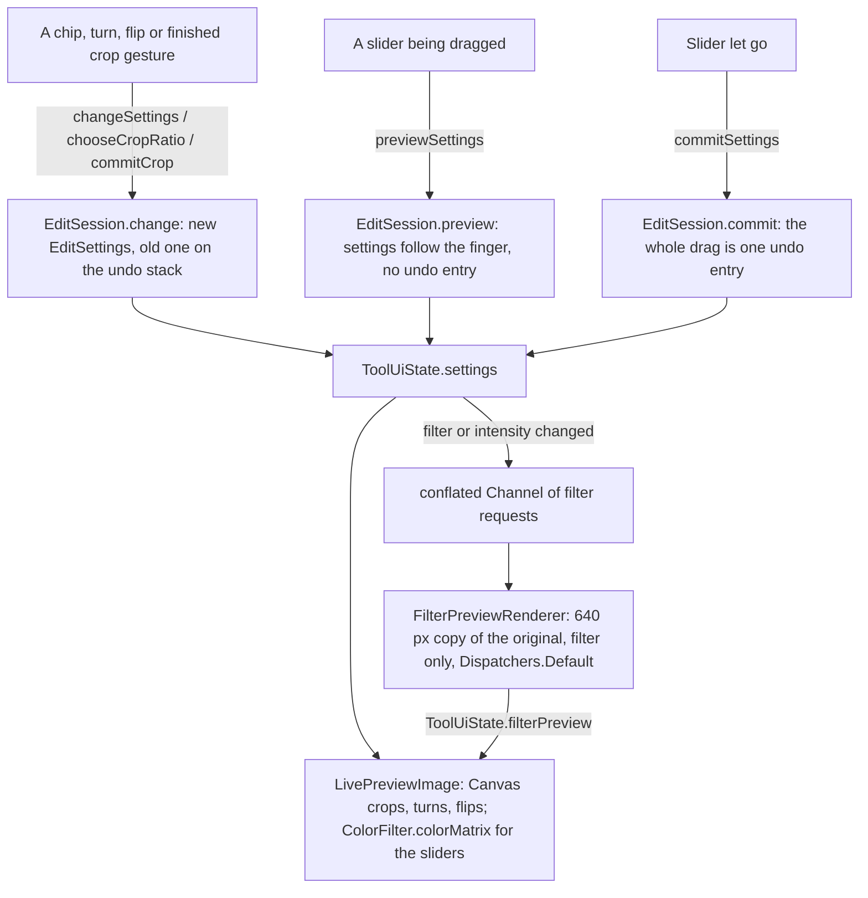
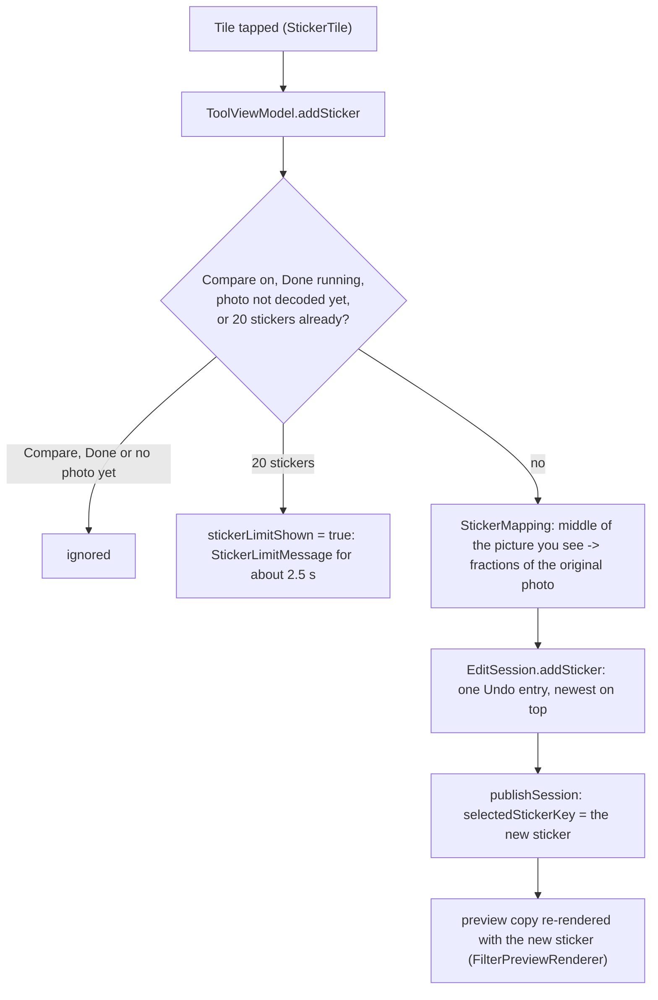
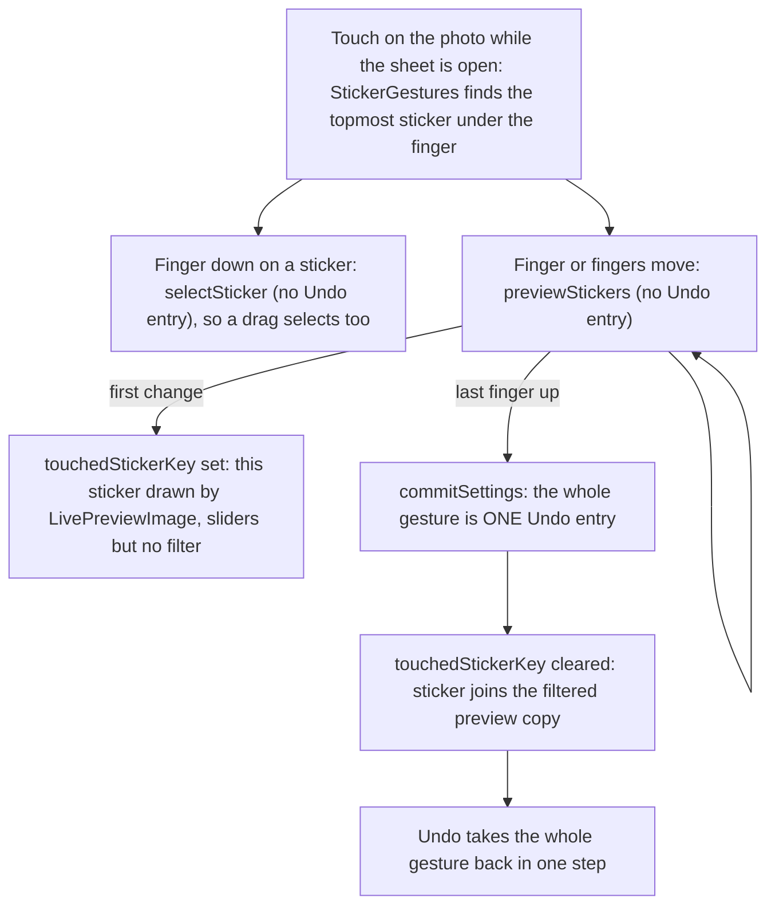
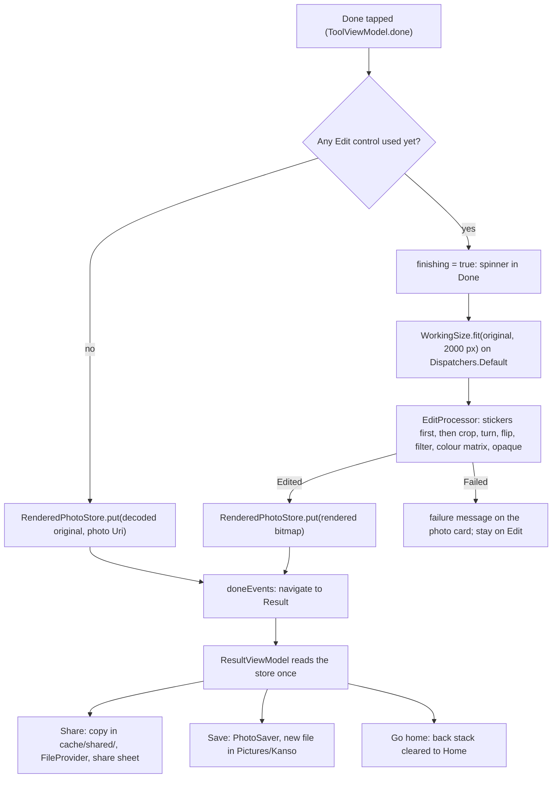

# Edit: crop, rotate, adjust, filters and stickers

[Back to README](../../README.md)

Code links below point into `app/src/main/java/com/phongkaster/kanso/`; the link text leaves that
prefix out. Test links point into `app/src/test/java/com/phongkaster/kanso/`. The parts every tool
shares (opening the photo, the top bar, failures, Done) are on [The tool screen](tool-screen.md);
what happens after Done is on [Saving, the Result screen and Share](saving-and-share.md).

---

## What it is

Edit is Kanso's general editor. At the bottom of the screen sits a row of five tools, **Crop**,
**Rotate**, **Adjust**, **Filters** and **Stickers**; tapping one opens its sheet just above the row, as in Adobe
Lightroom (tapping it again closes it). The Stickers sheet is the exception: it takes the row's place
(see below). Each tool is 60 dp wide with a 28 dp icon, so all five fit beside Compare on a
411 dp wide phone without scrolling; the row scrolls sideways only on a narrower screen, where a
tool past the edge is reached with a swipe. **Compare** stays
pinned at the right, behind a thin divider, and never scrolls away. **Undo** sits at the top right,
next to **Done**, as on the other tools.
While you edit, the photo on screen is a live preview drawn by Compose; the full picture is
rendered once, in plain Kotlin on the phone's processor, when you tap **Done** (with no control
used there is nothing to render, and the decoded original is handed over). No model and no
network are used. You can:

- **Crop**: choose Free, 1:1, 4:3, 3:4, 16:9 or 9:16. While the Crop sheet is open the photo becomes
  a cropper (from the `core/imagecrop` module): drag a handle to move an edge or a corner, drag inside
  the rectangle to move it, pinch to zoom. The cropper shows the decoded photo with the stickers
  drawn in, without the turns, flips, filter or slider colours. A fixed shape sets the largest centred rectangle of that
  shape and locks the handles to it; Free unlocks them and keeps the rectangle as it is.
- **Rotate**: Turn left or Turn right a quarter turn, Flip across (left to right) or Flip upside
  down (a second tap flips back).
- **Adjust**: four chips, **Brightness**, **Contrast**, **Saturation** and **Warmth**, and one
  slider for the chosen chip, as in Adobe Lightroom. Each runs from -100 through 0 (no change) to
  +100, with the number beside the name. Choosing a chip changes nothing in the photo; the chip
  chosen last is shown again when Adjust is reopened. The photo follows the finger
  while it drags, and the slider stays where it is let go.
- **Filters**: None or one of seven looks, Light, 1977, Kelvin, Nashville, Walden, Hudson and Amaro,
  with an **Intensity** slider (0 to 100) that is usable while a filter is chosen. Choosing a filter
  **replaces** the one before; filters never pile up.
- **Stickers** (decision record: [ADR-004](../adr/ADR-004-sticker-is-part-of-the-photo.md)): a sheet that replaces the row of tools, with a cross at the left of a
  tick in its top row, four category tabs (Food 17, Mood 17, Quote 6, Emoji 20 bundled pictures)
  and a grid of three columns that scrolls. A tap on a picture adds that sticker at the middle of
  the picture you see (after the crop, turns and flips), a third of its width, selected; each tap
  is one Undo step and a photo holds at most 20 ("A photo can hold 20 stickers at most" appears when you try a 21st).
  The tick keeps the changes; the cross, and the system **Back**, throw away everything done since
  the sheet opened, Undo steps included. The stickers are drawn on the photo on screen. While the
  sheet is open a finger put down on one selects it (a touch on empty photo selects none): a frame with four corner
  buttons, top-left delete, top-right duplicate (a copy 4 percent of the shown width right and
  down), bottom-left mirror, bottom-right a handle that resizes and turns it together. One finger
  drags, two fingers pinch and twist; a newer sticker lies on top. Each add, delete, duplicate,
  mirror and each whole drag, pinch or handle pull is one Undo step; selecting is not. Closing the
  sheet by tick or cross selects none. Done draws them into the saved picture. The live preview
  shows them with the filter and colour sliders (the one you are moving follows your finger with
  the sliders but no filter, and joins the filtered picture when you let go), the cropper shows
  them, and Compare shows the photo without them.
- **Undo** (top right, next to Done, in reach whatever sheet is open) and **Compare** (pinned at the
  right of the tool row; the Stickers sheet replaces the row while it is open, so Compare is out of
  reach until the sheet closes). Undo takes back one action at a time; Compare is a switch that shows the untouched
  photo while it is on and disables the row of tools, the sheet's controls, the cropper and Undo.
  Done stays usable while comparing and renders the edit, not the original.
- **Done** at the top right renders the picture (with no control used, it hands over the decoded
  original) and opens the Result screen (Share, Save, Go home).
  Nothing is written to the gallery until Save is tapped there.

Each tool with a change carries a small dot on its entry in the row.

## How to use it

- Reach it from the **Edit** shortcut on Home (then pick a photo in the gallery), by tapping a
  **Recent edits** card on Home, from the round **Camera** button beside the tab bar (a kept shot opens
  in Edit), or with **Edit** in the My edits photo viewer. Edit has no carousel banner and no
  Replace chip.
- Tap a tool in the row to open its sheet, change what you like, open another tool; the photo never changes
  size: the sheet area above the row keeps one fixed height whether a tool is open or not (with
  none open it says "Pick a tool to start editing").
- Switch **Compare** on to see the original, and off again to go on editing.
- Tap **Done**. While it renders, a small spinner shows in the Done button, which ignores taps, and
  the row of tools, the sheet and the cropper are disabled (with no control used yet there is
  nothing to render and Result opens at once). Then the Result screen opens; **Back** from Result returns to Edit with every setting and Undo step
  as it was left.
- **Back** on Edit first closes an open sheet. With changes made, it then asks "Discard your
  changes?" with **Discard** and **Keep editing**; with no changes it leaves at once.

## How it works

### The session and the live preview

1. **The screen and its state.** The Edit screen is
   [`ui/tool/ToolScreen.kt`](../../app/src/main/java/com/phongkaster/kanso/ui/tool/ToolScreen.kt)
   (`ToolScreen`, `ToolContent`) with
   [`ui/tool/components/editbottombar/EditBottomBar.kt`](../../app/src/main/java/com/phongkaster/kanso/ui/tool/components/editbottombar/EditBottomBar.kt)
   for its layout: `EditPhotoArea`
   ([`ui/tool/components/EditPhotoArea.kt`](../../app/src/main/java/com/phongkaster/kanso/ui/tool/components/EditPhotoArea.kt)),
   which draws the photo card
   ([`ui/tool/components/photocard/PhotoCard.kt`](../../app/src/main/java/com/phongkaster/kanso/ui/tool/components/photocard/PhotoCard.kt))
   or the cropper, filling the `Scaffold`'s body; and `EditBottomBar`, the `Scaffold`'s `bottomBar`, holding the
   [`ui/tool/components/editbottombar/edittoolrow/EditToolRow.kt`](../../app/src/main/java/com/phongkaster/kanso/ui/tool/components/editbottombar/edittoolrow/EditToolRow.kt)
   at the very bottom and the open tool's sheet just above it. The sheet area is one fixed
   height (136 dp), open or not, so the photo above never changes size; every tool's controls fit
   it (Adjust shows four sub-tool chips and one slider, see
   [`ui/tool/AdjustSlider.kt`](../../app/src/main/java/com/phongkaster/kanso/ui/tool/AdjustSlider.kt);
   the chosen chip is `ToolUiState.adjustSlider`, set by `ToolViewModel.chooseAdjustSlider`), and
   very large text scrolls inside it. It is an ordinary `Surface` cross-faded with
   `AnimatedContent`, not a
   Material `ModalBottomSheet`, because a modal sheet dims the photo and swallows touches, and the
   row of tools must stay usable. Its ViewModel is
   [`ui/tool/ToolViewModel.kt`](../../app/src/main/java/com/phongkaster/kanso/ui/tool/ToolViewModel.kt),
   which exposes one `StateFlow<ToolUiState>`
   ([`ui/tool/ToolUiState.kt`](../../app/src/main/java/com/phongkaster/kanso/ui/tool/ToolUiState.kt)).
2. **The photo.** `ToolViewModel.load` decodes the photo with
   [`data/photo/PhotoLoader.kt`](../../app/src/main/java/com/phongkaster/kanso/data/photo/PhotoLoader.kt),
   upright, on `Dispatchers.IO`, with its longest edge at most twice the screen's longest edge
   (`displayMaxEdgePx`). This decoded bitmap is "the original" for the rest of the visit; the file
   itself is never touched.
3. **One settings value for the whole visit.** Everything the person has done is one immutable
   [`data/edit/edit/EditSettings.kt`](../../app/src/main/java/com/phongkaster/kanso/data/edit/edit/EditSettings.kt):
   the crop rectangle (fractions of the original), the locked crop shape, quarter turns, the two
   flips, four sliders from -1 to 1 (0 is no change), the filter and its intensity (0 to 1). It is
   held, with its undo stack, by
   [`data/edit/edit/EditSession.kt`](../../app/src/main/java/com/phongkaster/kanso/data/edit/edit/EditSession.kt).
   No control ever asks for a change on top of the last result: each re-renders from the original
   photo. What a control hands the ViewModel differs, though. A turn, a flip, a filter chip and a
   slider move pass a complete new `EditSettings`; a crop chip passes only a `CropRatio`, which
   `EditSession.cropRatioChosen` turns into the rectangle; the cropper passes a `CropRect`; and a
   slider release (`commitSettings`) passes nothing, it just closes the drag as one undo step:
   - [`ui/tool/components/toolpanel/editpanel/EditPanel.kt`](../../app/src/main/java/com/phongkaster/kanso/ui/tool/components/toolpanel/editpanel/EditPanel.kt)
     draws the open sheet from the session's settings (it keeps no state of its own, so a slider
     reopens where it was left). A turn, a flip or a filter chip calls `changeSettings`; a crop
     shape calls `chooseCropRatio`; a slider calls `previewSettings` while it moves and
     `commitSettings` when let go.
   - [`ui/tool/components/EditCropper.kt`](../../app/src/main/java/com/phongkaster/kanso/ui/tool/components/EditCropper.kt)
     wraps `core/imagecrop`'s `CropperPreview` (package `com.mr0xf00.easycrop`,
     [`core/imagecrop/src/main/java/com/mr0xf00/easycrop/ui/CropperPreview.kt`](../../core/imagecrop/src/main/java/com/mr0xf00/easycrop/ui/CropperPreview.kt)).
     It always shows the decoded photo with the stickers drawn into a copy of it (on the main
     thread, inside composition), un-turned, un-flipped and unfiltered, because the crop is stored as
     fractions of the original and the render crops before it turns. When the last finger lifts,
     the rectangle becomes fractions and, if it differs from the session's crop by more than a tenth
     of a percent, goes to `commitCrop` once. A session crop or shape that changes (a chip, Undo)
     moves the cropper's rectangle to match, and a fixed shape locks its aspect (`CropState.aspectLock`,
     switched off while the rectangle is moved so the new shape is not bent back to the old one).
     While Compare is on the cropper is not drawn at all (the plain photo shows); while Done is
     rendering, a layer on top of the cropper takes every touch, so it ignores them. The cropper, the sheets and the row all run on the main thread, as Compose draws;
     none of them touches pixels.
   - `EditSession.change` pushes the old settings on the undo stack (an unchanged value adds
     nothing); `preview` follows the finger without an entry and `commit` turns the whole drag into
     one entry; `cropRatioChosen` sets the largest centred rectangle of the shape, fitted on its
     side when the photo has an odd number of quarter turns, so the turned picture comes out in the
     shape chosen; `undo` goes back to the last entry. There is no redo.
4. **The live preview.** The photo card draws
   `LivePreviewImage` (in `ui/tool/components/photocard/LivePreviewImage.kt`) whenever Compare is off and the Crop sheet
   is closed. It is a Compose `Canvas` that, every frame, takes only the crop rectangle from the
   bitmap (rounded exactly as the final render rounds it), turns it, mirrors it, fits it inside the
   card, and draws it through `ColorFilter.colorMatrix` with the four sliders' matrix from
   [`data/edit/edit/EditColourMatrix.kt`](../../app/src/main/java/com/phongkaster/kanso/data/edit/edit/EditColourMatrix.kt),
   the same numbers Done uses. With every slider at 0 no colour filter is set. No pixel is
   recomputed on the CPU for crop, turn, flip or the sliders.
5. **The filter preview.** A filter is a look-up per pixel that Compose cannot draw, so the
   ViewModel computes it. When the filter or its intensity changes (`requestPreview`), the settings
   go into a `Channel(Channel.CONFLATED)`: one collector coroutine renders one request at a time,
   and a newer request replaces one still waiting, so a fast intensity drag never queues up work.
   [`data/edit/edit/FilterPreviewRenderer.kt`](../../app/src/main/java/com/phongkaster/kanso/data/edit/edit/FilterPreviewRenderer.kt)
   runs the real `EditProcessor` with the filter, its intensity and every sticker except the one
   being touched, on `Dispatchers.Default`, on a copy of
   the original shrunk once to at most 640 px (`PREVIEW_EDGE`). It also renders when there is no
   filter but there are stickers. `requestPreview` is called from `addSticker`, `deleteSticker`,
   `duplicateSticker`, `flipSticker`, `commitSettings`, `confirmStickers` and `cancelStickers`.
   The result becomes
   `ToolUiState.filterPreview`, and `LivePreviewImage` draws that bitmap instead of the original,
   cropping, turning and colouring it as above. A crop, turn or slider change keeps the same filter
   preview. A preview that fails shows the plain photo, with no message.

### The Stickers sheet

Tapping Stickers calls `ToolViewModel.openTool(EditTool.STICKERS)`. Opening it keeps a snapshot
of the whole `EditSession` (settings and Undo steps; it is immutable, so keeping it costs nothing).
`EditBottomBar` then draws the sheet in place of the row, as tall as the row plus the fixed
sheet area, so the photo's bounds do not change. `ToolScreen` fills it with `EditPanel`, which
shows `StickersPanel`: `StickersSheetTopBar` (cross left, tick right, 48 dp targets),
`StickerCategoryChips` (a `LazyRow` of `FilterChip`s, the chosen one `selected`) and a
`LazyVerticalGrid` of `StickerTile`s, three columns, from `StickerCatalog.inCategory`. All on the
main thread; no pixel is computed.

Adding a sticker:

One gesture, one Undo entry:

- **Add.** `addSticker` asks `StickerMapping` for the sticker at the shown picture's centre (the
  mapping inverts what Done does: crop, then turn, then flip), adds it with `EditSession.addSticker`
  (one Undo step) and selects it (`selectedStickerKey`). The processor recipe passed in is the one
  from `editProcessorFor(context)` and becomes the recipe Done renders with. At 20 stickers the
  settings are untouched and `stickerLimitShown` shows `StickerLimitMessage`
  (`ui/tool/components/StickerLimitMessage.kt`) on the photo's top edge with the text "A photo can
  hold 20 stickers at most" (`stickers_limit_message`, `res/values/strings_stickers.xml`) for
  about 2.5 s, then `onStickerLimitMessageShown` clears it.
- **Tick** (`confirmStickers`): forgets the snapshot, closes the sheet, clears the selection.
- **Cross and system Back** (`cancelStickers`; `onBackPressed` calls it first when the sheet is open):
  publishes the snapshot again, so settings and Undo steps are exactly as at opening, closes the
  sheet and clears the selection. Back does not ask "Discard your changes?" here.
- **While Compare is on or Done renders** (`comparing`, `finishing`) the tick, the cross and Back
  do nothing: Back is consumed (the screen stays) but cancels nothing, so Done draws the stickers
  as they were when it was tapped.
- **Undo** clears `selectedStickerKey` when the undone step removed the selected sticker.
- **On the photo.** `PhotoCard` draws a `StickerOverlay` over the live picture (not while Compare
  is on). Touches work only while the sheet is open, Compare is off and Done is not running
  (`stickerEditingOpen`). `StickerGestures` picks the topmost sticker under the finger and calls
  `selectSticker`; a drag, pinch or handle pull calls `previewStickers` (no Undo entry) and its last
  finger up calls `commitSettings` (one Undo entry). `StickerFrame` and `StickerCornerButton` call
  `deleteSticker`, `duplicateSticker` (offset 4 percent of the shown width, via `StickerMapping`)
  and `flipSticker`; the handle resizes and turns about the centre. `selectedStickerKey` lives in
  `ToolUiState`, and `publishSession` clears it when its sticker is gone.
- **Drawing.** Done draws the saved picture's stickers (`EditProcessor`, `DrawableStickerPictures`),
  see below. On screen, `StickerOverlay` draws no pictures (frame, buttons, touches only).
  `FilterPreviewRenderer.render(requested)` is called after `ToolViewModel.requestPreview` leaves
  the touched sticker out of the settings; it draws every other sticker into
  the small preview copy before the filter (so filter and Intensity act on them; it renders with
  no filter when stickers exist, null when nothing to draw). The request key is filter, intensity
  and untouched stickers. The first `previewStickers` that changes a sticker sets
  `ToolUiState.touchedStickerKey`; `LivePreviewImage` draws that sticker in the same crop, turn
  and flip, clipped to the photo, with the slider colour matrix and no filter, so it follows the
  finger. `commitSettings`, the tick or cross, `openTool` and `setComparing` clear the key
  (`publishSession` clears it only when that sticker is gone) and it joins the
  filtered copy (one small re-render at gesture start, one at finger up, none during the drag).
  `EditCropper` (`withStickersDrawn`) bakes stickers into a copy of the original, same mirror,
  turn and scale as `EditProcessor`, so they show while cropping. Compare shows none.

### Done, the full render and the Result screen

1. **Done.** `ToolViewModel.done` does nothing while a Done is already rendering, before the photo
   is shown, or while an edit runs. If no Edit control has been used yet on this visit (the
   ViewModel has no processor recipe yet), the decoded original goes to the hand-off store with the
   photo's Uri, at once. Otherwise it reads the settings at the tap, sets `finishing` (the Done
   button shows a small spinner and ignores taps; the row of tools, the sheet's controls and the
   cropper are disabled) and renders. Changes that were all undone still count as used, so Done
   then renders the neutral settings (a fresh picture of at most 2000 px, which Save writes as a
   JPEG) rather than handing over the file. Compare does not stop Done: it renders the settings,
   not the original.
2. **The full render.** Its input is the decoded original ("The photo", in the section above: at
   most twice the screen's longest edge, not the file at full size). `renderFull` shrinks it once
   to at most 2000 px on its longest edge (`WorkingSize.EDIT` in
   [`data/edit/WorkingSize.kt`](../../app/src/main/java/com/phongkaster/kanso/data/edit/WorkingSize.kt))
   and runs
   [`data/edit/edit/EditProcessor.kt`](../../app/src/main/java/com/phongkaster/kanso/data/edit/edit/EditProcessor.kt),
   all on `Dispatchers.Default`. The processor always works from the original with the whole
   settings, so nothing is stacked. On the pixels as one `IntArray`, in this order:
   0. **Stickers** (new in Run 10; the Stickers sheet adds them, see "The Stickers sheet" above,
      and [ADR-004](../adr/ADR-004-sticker-is-part-of-the-photo.md) for why they go first): the settings hold up to 20
      (`EditSettings.stickers`, `MAX_STICKERS`), placed as fractions of the original photo. They
      are drawn first, right after the kept rectangle is read out, so the crop cuts them and the
      turns, flips, filter and sliders act on them with the photo (order: stickers, crop, turns,
      flips, filter, sliders). Each add, delete, duplicate, flip or whole drag is one Undo step
      (`EditSession`); a 21st add or duplicate changes nothing.
   1. **Crop**: copies only the kept rectangle (fractions turned into pixels, rounded, edges put in
      order, at least 1 x 1). A fixed shape is no special case: choosing it already set the
      rectangle. Progress 0.25.
   2. **Turn** by moving every pixel (no blurring; four turns give the same pixels back), then the
      **flips**. Progress 0.5.
   3. **Filter**, when one is chosen at an intensity above 0: each pixel goes through the filter's
      look-up, then is mixed with its own colour by the intensity (`filterPixel`, shared with the
      preview). Progress 0.75. The filter comes before the sliders so the sliders fine-tune the
      filtered look.
   4. **Colour**, when a slider is away from 0: one 4 x 5 matrix from `EditColourMatrix.of`, in this
      order: contrast scales each channel around mid-grey 128 (up to x2, down to x0.2), saturation
      uses `setSaturation(1 + s)`, warmth adds up to 40 (of 255) to red and takes it from blue,
      brightness adds up to 80 to every channel. Values are rounded and clamped to 0..255.
   5. Every pixel's alpha is set to 255 and the result is a new `ARGB_8888` bitmap with
      `setHasAlpha(false)`. Progress 1. (Done shows no progress ring; only the spinner.)

   The turn and flip loops check for cancellation on every row, and the filter and colour loops
   every 65,536 pixels, so leaving Edit (which clears its ViewModel and cancels its coroutines)
   stops a render early.
3. **Where the filters come from.**
   [`data/edit/edit/FilterPreset.kt`](../../app/src/main/java/com/phongkaster/kanso/data/edit/edit/FilterPreset.kt)
   names seven images that ship inside the engine's prebuilt libraries and are merged into the
   app's assets at build time (no download): Light is lookup/lookup_light.png from
   `libs/imageprocessor.aar`, a 512 x 512 colour cube; 1977, Kelvin, Nashville, Walden, Hudson and
   Amaro are curve strips under filter_materials/map/ from `libs/editimage.aar`.
   [`data/edit/edit/FilterLut.kt`](../../app/src/main/java/com/phongkaster/kanso/data/edit/edit/FilterLut.kt)
   tells the two kinds apart by shape (a cube is read as a 3D table, a strip as three tone curves).
   `FilterLut.fromAssets` decodes each image the first time it is asked for and keeps it in that
   source's cache. No engine code runs.
4. **The hand-off.** The picture goes into
   [`data/edit/RenderedPhotoStore.kt`](../../app/src/main/java/com/phongkaster/kanso/data/edit/RenderedPhotoStore.kt),
   a Koin single that holds one bitmap (a navigation key is saved as text and cannot carry one), and
   `doneEvents` (a `Channel`, so it fires once) tells the screen to push
   [`navigation/Result.kt`](../../app/src/main/java/com/phongkaster/kanso/navigation/Result.kt) on
   the back stack above Edit
   ([`navigation/KansoNavHost.kt`](../../app/src/main/java/com/phongkaster/kanso/navigation/KansoNavHost.kt)).
   Done does not end the session.
5. **Result.** [`ui/result/ResultViewModel.kt`](../../app/src/main/java/com/phongkaster/kanso/ui/result/ResultViewModel.kt)
   reads the store once when it is built and
   [`ui/result/ResultScreen.kt`](../../app/src/main/java/com/phongkaster/kanso/ui/result/ResultScreen.kt)
   shows it under the title "Your edit" with Share, Save and Go home:
   - **Save** is the only gallery write. `ResultViewModel.save` calls
     [`data/photo/MediaStorePhotoSaver.kt`](../../app/src/main/java/com/phongkaster/kanso/data/photo/MediaStorePhotoSaver.kt)
     on `Dispatchers.IO`: a rendered Edit picture is opaque, so it is written as a new JPEG at
     quality 95, at its size, into `Pictures/Kanso`. A photo on which no Edit control was used (Done with
     no control touched) is saved from its own file instead (its bytes copied unchanged, or turned upright and
     written as a new JPEG at quality 95 if it carries an EXIF turn; a
     turned photo too large to turn in memory is copied as it is with its tag kept, and Result
     shows the "kept orientation" message). Such a save is always named `.jpg` and typed
     `image/jpeg`, whatever the photo's own format, so an untouched PNG, WebP or HEIC photo
     copied byte for byte is saved as that PNG, WebP or HEIC data under a `.jpg` name and the
     `image/jpeg` type (a known defect, not fixed yet). A
     picture is saved at most once; the button then reads "Saved". On Android 8.1 and 9 the
     storage-write permission is asked first.
   - **Share** writes a copy of the picture on screen in the cache's `shared/` folder (JPEG
     quality 95 for an opaque picture, PNG for one with an alpha channel; for an untouched photo
     this is the decoded, screen-sized copy, not the file) on `Dispatchers.IO` and sends it through FileProvider and Android's share sheet with
     a one-off read grant ([`ui/result/SharePhoto.kt`](../../app/src/main/java/com/phongkaster/kanso/ui/result/SharePhoto.kt)).
   - **Go home** clears the back stack down to Home, which ends the session; leaving Result also
     clears the store.

**What happens on failure:**

- Done running out of memory shows "This photo is too large to edit on this phone. Try a smaller
  one. Your photo is unchanged."; a filter image that cannot be read, or any other exception,
  shows "Something went wrong and the edit was not made. Your photo is unchanged." The message sits
  at the top of the photo card and a tap hides it. The failure stays in the screen's state until
  that tap or the next Done (changing a setting, Undo and closing a sheet leave it in place). With the Crop sheet open
  the cropper replaces the photo card, so at first no message is visible: the spinner stops and
  Done can be tapped again. The message appears as soon as the photo card is shown again: when
  the Crop sheet is closed, or at once when Compare is turned on (Compare shows the photo card in
  place of the cropper). In every case the person stays on Edit with every setting and Undo step
  kept, and nothing is handed over.
- A filter preview that fails shows the photo without the filter, silently; Done reports a real
  failure.
- A photo that cannot be decoded shows "This photo cannot be opened. Go back and pick another one."
- A failed Save shows "The photo could not be saved. Try again."; a refused storage permission
  shows that nothing was saved.
- After the process is killed, Result's store is empty and it shows "Nothing to show"; the Edit
  session lived only in the ViewModel's memory, so Edit reopens on the photo with no changes.

## Limits, from the code

- **Size.** The photo is decoded at most twice the screen's longest edge, and Done renders at most
  **2000 px** on the longest edge, so a 4000 x 3000 photo comes out at most 2000 x 1500. The saved
  file is a **JPEG at quality 95**. Done with no control used saves the original file instead (its
  bytes copied unchanged, or re-encoded upright as a JPEG when it carries an EXIF turn; if it is
  too large to turn in memory, copied as it is with its tag kept and Result shows the "kept
  orientation" message). That save is always named `.jpg` and typed `image/jpeg`, so an untouched
  PNG, WebP or HEIC photo keeps its own format inside a file named `.jpg` (a known defect). Once a control was used, even if
  every change was undone, Done renders a new JPEG of at most 2000 px.
- **Preview size.** The filter preview is computed on a copy at most **640 px** on its longest
  edge, so on screen a filtered photo holds less detail than the picture Done renders.
- **One filter at a time.** Choosing a filter replaces the earlier one. Moving from one filter to
  another keeps the intensity; coming from None it starts at 100; None resets it.
- **Crop.** The cropper always shows the photo, with the stickers drawn in, un-turned, un-flipped
  and unfiltered. A turn after a crop turns
  the cropped picture with it (a 16:9 crop turned once comes out 9:16).
- **Stickers.** At most **20** (`EditSettings.MAX_STICKERS`); a 21st add or duplicate changes
  nothing and shows a message for about 2.5 seconds. A sticker's width stays between 5 and 100
  percent of the shown width. While a sticker is being moved it shows no filter in the preview
  (it does in the saved picture). A sticker wholly outside the crop draws nothing in the saved
  picture. A picture that cannot be decoded is skipped in Done. The sheet's cross and system Back
  throw away what was done since it opened, Undo steps included.
- **Undo** takes back one action at a time (a chip, a turn, a flip, a crop ratio, one finished crop
  gesture, one whole slider drag, or one sticker added, deleted, duplicated, mirrored or whole
  gesture), whichever sheet it came from. There is no redo.
- **Back with changes** asks before discarding; the check is on the current settings, so undoing
  every change leaves without asking.
- **No session across restarts.** Settings and Undo steps are not saved; they live as long as the
  Edit screen's ViewModel.
- **Removed in Run 9.** The old one-step-at-a-time Edit panel is gone: sliders no longer return to
  the middle after each change, the free crop no longer uses two Width and Height sliders, and
  filters no longer stack on top of each other.

## Tests

The Edit tests live in `app/src/test/java/com/phongkaster/kanso/tool/edit/`:
[`EditProcessorTest.kt`](../../app/src/test/java/com/phongkaster/kanso/tool/edit/EditProcessorTest.kt),
[`EditFilterTest.kt`](../../app/src/test/java/com/phongkaster/kanso/tool/edit/EditFilterTest.kt),
[`EditSessionTest.kt`](../../app/src/test/java/com/phongkaster/kanso/tool/edit/EditSessionTest.kt),
[`ColourMatrixParityTest.kt`](../../app/src/test/java/com/phongkaster/kanso/tool/edit/ColourMatrixParityTest.kt),
[`FilterPreviewRendererTest.kt`](../../app/src/test/java/com/phongkaster/kanso/tool/edit/FilterPreviewRendererTest.kt),
[`LivePreviewTest.kt`](../../app/src/test/java/com/phongkaster/kanso/tool/edit/LivePreviewTest.kt),
[`EditCropTest.kt`](../../app/src/test/java/com/phongkaster/kanso/tool/edit/EditCropTest.kt),
[`EditUndoTest.kt`](../../app/src/test/java/com/phongkaster/kanso/tool/edit/EditUndoTest.kt),
[`CompareTest.kt`](../../app/src/test/java/com/phongkaster/kanso/tool/edit/CompareTest.kt),
[`AdjustSheetTest.kt`](../../app/src/test/java/com/phongkaster/kanso/tool/edit/AdjustSheetTest.kt),
[`FiltersSheetTest.kt`](../../app/src/test/java/com/phongkaster/kanso/tool/edit/FiltersSheetTest.kt),
[`EditToolRowTest.kt`](../../app/src/test/java/com/phongkaster/kanso/tool/edit/EditToolRowTest.kt),
[`EditLayoutTest.kt`](../../app/src/test/java/com/phongkaster/kanso/tool/edit/EditLayoutTest.kt),
[`StickersPanelTest.kt`](../../app/src/test/java/com/phongkaster/kanso/tool/edit/StickersPanelTest.kt)
(chips, three-column grid, 17/17/6/20 tiles),
[`StickerAddTest.kt`](../../app/src/test/java/com/phongkaster/kanso/tool/edit/StickerAddTest.kt)
(add at the shown centre, the limit, tick, cross and Back, the shared recipe),
and the other sticker tests in the same folder: `StickerCatalogTest.kt`, `StickerSessionTest.kt`,
`StickerMappingTest.kt`, `StickerGeometryTest.kt`, `StickerSelectionTest.kt`,
`StickerGestureTest.kt`, `StickerFrameTest.kt`, `StickerOverlayTest.kt`,
`StickerLivePreviewTest.kt`, `StickerPreviewRendererTest.kt`, `StickerCropperTest.kt`,
`StickerCompareTest.kt` and `EditProcessorStickerTest.kt` (the order and the blend in Done). The
Stickers screenshots (pictures 69 to 82 in `app/src/test/screenshots/`) are recorded by
[`screenshots/StickerScreenshotTest.kt`](../../app/src/test/java/com/phongkaster/kanso/screenshots/StickerScreenshotTest.kt),
[`DiscardDialogTest.kt`](../../app/src/test/java/com/phongkaster/kanso/tool/edit/DiscardDialogTest.kt)
and [`EditToolTest.kt`](../../app/src/test/java/com/phongkaster/kanso/tool/edit/EditToolTest.kt).
Done and the Result screen are covered by
[`tool/DoneResultTest.kt`](../../app/src/test/java/com/phongkaster/kanso/tool/DoneResultTest.kt),
[`result/ResultViewModelTest.kt`](../../app/src/test/java/com/phongkaster/kanso/result/ResultViewModelTest.kt)
and [`result/ResultScreenTest.kt`](../../app/src/test/java/com/phongkaster/kanso/result/ResultScreenTest.kt).

## Known limits and open items

- The limits above.
- Not yet checked on the owner's phone, a Galaxy A13 (32-bit, `armeabi-v7a`).

[Back to README](../../README.md)
