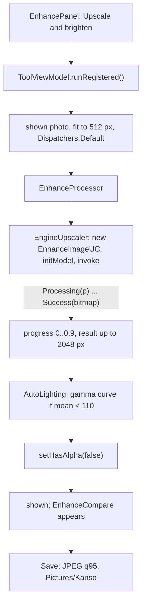

# Enhance: upscale and brighten

[Back to README](../../README.md)

Code links below point into `app/src/main/java/com/phongkaster/kanso/`; the link text leaves that
prefix out. Test links point into `app/src/test/java/com/phongkaster/kanso/`. The parts every tool
shares (opening the photo, progress, Undo, Replace, Save) are on [The tool screen](tool-screen.md).

---

## What it is

One button, **Upscale and brighten**, runs two steps:

1. a super-resolution model, **Real-ESRGAN**, makes a small copy of the photo four times wider and
   taller while trying to keep it sharp;
2. a lighting step brightens the result **if it is dark**, and leaves a well-lit photo alone.

After it runs, a small before/after picture appears above the button with a **Hold to see the
original** control.

Limits, from the code:

- **The output is at most 2048 px on its longest edge.** The photo is first shrunk to 512 px, and
  4 x 512 = 2048. So a photo **larger** than 2048 px comes out **smaller** than it went in: a
  4000 x 3000 photo becomes about 2048 x 1536. Enhance helps small or soft photos most; on a large
  photo it trades resolution for the model's sharpening and the lighting.
- The detail the model adds is invented from a 512 px copy, not recovered from the original pixels.
- Offline: the model file is inside the app; nothing is downloaded.
- The lighting step only ever brightens, never darkens, and does nothing to a photo whose average
  brightness is already 110 or more (of 255).

## How to use it

- Reach it from the second **carousel banner** on Home ("Sharper, brighter photos", or **Try
  now**), or the **Enhance** shortcut, then pick a photo (or take one with the gallery's camera
  button).
- Tap **Upscale and brighten**. The progress ring fills while the model runs.
- Press and hold **Hold to see the original** under the small comparison picture to see the photo
  before; let go to see the result again. With a screen reader, a double tap switches between the
  two.
- **Undo** takes the result back; **Save** writes it.

**Seen on the Android emulator (API 34, x86_64), 2026-10-14:** on a 4000 x 3000 photo the progress
indicator showed, the result came after about 15 seconds, and there was no out-of-memory error or
crash.

## How it works

1. **The button.**
   [`ui/tool/EnhancePanel.kt`](../../app/src/main/java/com/phongkaster/kanso/ui/tool/EnhancePanel.kt)
   draws the button; its tap calls `ToolViewModel.runRegistered()`. The button itself is not
   disabled during a run, but the ViewModel ignores a tap while an edit runs.
2. **Which processor.**
   [`di/AppModule.kt`](../../app/src/main/java/com/phongkaster/kanso/di/AppModule.kt) registers
   `EnhanceProcessor(EngineUpscaler(androidContext()))` for `Tool.ENHANCE`.
3. **The input.** `ToolViewModel.apply` takes the photo **as now shown** (so Enhance can run on top
   of an earlier Enhance) and shrinks it to 512 px (`WorkingSize.ENHANCE`) on
   `Dispatchers.Default`.
4. **The processor.**
   [`data/edit/enhance/EnhanceProcessor.kt`](../../app/src/main/java/com/phongkaster/kanso/data/edit/enhance/EnhanceProcessor.kt)
   runs on `Dispatchers.Default`:
   1. reports 0 and shrinks to 512 px again (an unshrunk 4000 x 3000 photo upscaled four times would
      ask for about 768 MB);
   2. calls the [`Upscaler`](../../app/src/main/java/com/phongkaster/kanso/data/edit/enhance/Upscaler.kt),
      passing its progress on scaled into the first 90% of the ring; progress only ever moves
      forward, even if the engine's numbers jump back;
   3. reports 0.9, stops here if you left the screen, then runs `AutoLighting`;
   4. frees the upscaled copy if lighting made a new one, marks the result opaque
      (`setHasAlpha(false)`, so Save writes a JPEG), reports 1.
5. **The engine call.**
   [`data/edit/enhance/EngineUpscaler.kt`](../../app/src/main/java/com/phongkaster/kanso/data/edit/enhance/EngineUpscaler.kt)
   is the only file of the app that names the Enhance engine's classes:
   1. it builds a **new** `EnhanceImageUC` (in `libs/localml.aar`, through `core/localml`) for each
      run, on the application context;
   2. waits for `initModel()` to finish loading the model;
   3. calls `invoke(photo)`, which answers with a Flow of `ProgressStatus` values, and collects it
      with `first { }` until a final answer: each `Processing(progress)` goes to the ring,
      `Success(result)` ends with the picture, `Error(message)` throws. A finish without a picture
      also throws.

   The model is `realesrgan_64x64_float16.tflite`, bundled in the assets of `libs/localml.aar` and
   run by TensorFlow Lite (LiteRT, which `core/localml` declares). It makes the picture four times
   wider and taller.
6. **The lighting step.**
   [`data/edit/enhance/AutoLighting.kt`](../../app/src/main/java/com/phongkaster/kanso/data/edit/enhance/AutoLighting.kt)
   is plain Kotlin:
   1. builds a histogram of luminance, `0.299 R + 0.587 G + 0.114 B`, one row at a time;
   2. if the mean is 110 or more, returns the picture unchanged;
   3. otherwise searches (24 halvings between 0.4 and 1) for the gamma `g` that brings the mean to
      128, but never below 0.4, so a nearly black photo is not blown out;
   4. sends red, green and blue of every pixel through `255 * (v / 255)^g`, a curve that lifts
      shadows most, keeps black and white, and never makes a value darker. Alpha is kept.
7. **The comparison.** Once there is a result,
   [`ui/tool/EnhanceCompare.kt`](../../app/src/main/java/com/phongkaster/kanso/ui/tool/EnhanceCompare.kt)
   shows it in a 120 dp strip above the button. Holding the control (`detectTapGestures` with
   `onPress`, `tryAwaitRelease`) shows the original instead; `AnimatedContent` fades between the two
   in 150 ms. The "original" is the photo as it was opened on this screen, not the photo just
   before the last Enhance.
8. **Save.** The result is opaque, so Save writes a **JPEG at quality 95**, at the size shown (up
   to 2048 px), into `Pictures/Kanso`.

**What happens on failure:**

| What went wrong | Failure | Message |
|---|---|---|
| Out of memory | `OutOfMemory` | This photo is too large to edit on this phone. Try a smaller one. Your photo is unchanged. |
| The model will not load, a native library will not link, the engine reports `Error`, or ends with no picture | `ModelUnavailable` | This tool could not start on this phone. Your photo is unchanged. |

The photo and Undo stay as they were. Leaving the screen cancels the run.

## Tests

- [`tool/enhance/EnhanceProcessorTest.kt`](../../app/src/test/java/com/phongkaster/kanso/tool/enhance/EnhanceProcessorTest.kt),
  with a fake upscaler that doubles the size: the output is the upscaler's size; a very large photo
  is capped before the upscaler; a dark photo is brightened toward the mid-tones and a flat dark
  patch is lifted; a well-lit photo is left alone; a flat photo is never darkened; out of memory and
  an engine error are reported; a cancellation propagates; progress goes only forward, to 1.
- [`tool/enhance/EnhanceCompareTest.kt`](../../app/src/test/java/com/phongkaster/kanso/tool/enhance/EnhanceCompareTest.kt):
  the comparison shows the enhanced photo first, holding shows the original and releasing shows the
  enhanced one, and the button runs Enhance.
- [`screenshots/ToolScreenshotTest.kt`](../../app/src/test/java/com/phongkaster/kanso/screenshots/ToolScreenshotTest.kt):
  `editor_enhance_*` (before a run) and `tool_enhance_done_*` (with the comparison).
- `EngineUpscaler` is native code and is **not** run by any test on the computer; only the emulator
  run above exercised it.

## Known limits and open items

- **The engine object is never closed**, and an `initModel` failure may not reach
  `ModelUnavailable` (`.harness/ISSUES.md`, Run 8 Phase 2 review; device check DoD 9).
- `AutoLighting.meanLuminance` is unused (Run 8 Phase 2 review).
- The output-size limit and the "original" in the comparison, described above.
- **Awaiting a person, Run 8:** item 9 (on a 4000 x 3000 photo: a saved file larger than 512 px,
  and the detail looked at with the compare control; the emulator run did not record the output
  size), item 26 (the compare control easy to find).

[Back to README](../../README.md)
