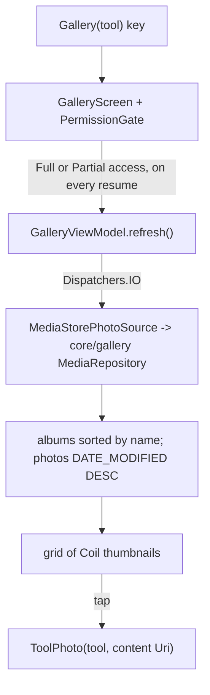

# Gallery and albums: picking a photo

[Back to README](../../README.md)

Code links below point into `app/src/main/java/com/phongkaster/kanso/`; the link text leaves that
prefix out. Test links point into `app/src/test/java/com/phongkaster/kanso/`.

---

## What it is

Every tool opens its own photo gallery first, titled "*Tool*: choose a photo" (for example
"Enhance: choose a photo"). It shows the phone's photos in a grid of rounded square cells, newest
first, with a row of album chips above it: **All photos**, then one chip per album, sorted by
name. Tapping a photo opens it in that tool. A camera button in the top bar takes a new photo for
the same tool.

Limits, from the code:

- Photos only (MediaStore images); no videos.
- Kanso only ever reads photos. Picking one never changes it.
- On Android 14 and later you may share only some photos; the gallery then shows only those.
- The grid is not sorted or filtered any other way: newest change first, by album.

## How to use it

1. On Home, tap a carousel banner, its **Try now** button, or a round tool shortcut. Replace on a
   tool screen also brings you back here.
2. The first time, Android asks for photo access:
   - **Allow all**: every photo shows.
   - **Select photos** (Android 14+): only the chosen ones show, under the notice "You have shared
     only some of your photos with Kanso." with a **Share more photos** button that asks again.
   - **Don't allow**: the gallery shows "Photo access is off" with an explanation and an **Open
     settings** button that opens Kanso's page in the system settings.
3. Tap an album chip to see only that album; **All photos** shows them all.
4. Tap a photo to open it in the tool. Or tap the camera button (top right) to take one; see
   [Camera](camera.md).

## How it works

1. **Opening.** A tap on Home pushes the key `Gallery(tool)`
   ([`navigation/Gallery.kt`](../../app/src/main/java/com/phongkaster/kanso/navigation/Gallery.kt))
   in [`navigation/KansoNavHost.kt`](../../app/src/main/java/com/phongkaster/kanso/navigation/KansoNavHost.kt),
   only while Home is on top (a double tap opens one gallery). Koin builds a `GalleryViewModel`
   with that tool, scoped to the entry.
2. **Permissions.**
   [`ui/permission/PhotoPermissions.kt`](../../app/src/main/java/com/phongkaster/kanso/ui/permission/PhotoPermissions.kt)
   picks what to ask for by Android version:

   | Android | Asked for | Full access means |
   |---|---|---|
   | 8.1 to 12 (API 27 to 32) | `READ_EXTERNAL_STORAGE` | that permission |
   | 13 (API 33) | `READ_MEDIA_IMAGES` | that permission |
   | 14 and later (API 34+) | `READ_MEDIA_IMAGES` + `READ_MEDIA_VISUAL_USER_SELECTED` | `READ_MEDIA_IMAGES`; the second alone is partial |

   [`ui/permission/PermissionGate.kt`](../../app/src/main/java/com/phongkaster/kanso/ui/permission/PermissionGate.kt)
   asks once per visit (the "already asked" flag is kept with `rememberSaveable`, so a rotation does
   not ask again), reads the answer with `ContextCompat.checkSelfPermission`, and shows the granted,
   partial, refused or waiting face. The refused face is
   [`ui/permission/AccessRefusedPanel.kt`](../../app/src/main/java/com/phongkaster/kanso/ui/permission/AccessRefusedPanel.kt);
   its button opens `ACTION_APPLICATION_DETAILS_SETTINGS` for Kanso.
3. **Reading the library.** With full or partial access,
   [`ui/gallery/GalleryScreen.kt`](../../app/src/main/java/com/phongkaster/kanso/ui/gallery/GalleryScreen.kt)
   calls `viewModel.refresh()` in a `LifecycleResumeEffect`: now, and every time the screen comes
   back to the front (after the system settings, the camera or another app), so new photos and new
   access show up.
4. **The ViewModel.**
   [`ui/gallery/GalleryViewModel.kt`](../../app/src/main/java/com/phongkaster/kanso/ui/gallery/GalleryViewModel.kt)
   cancels any read in progress, then on `Dispatchers.IO` reads the albums and the chosen album's
   photos. If the chosen album no longer exists, it falls back to All photos. The photos already
   shown stay on screen until the new list arrives. A failed read shows the empty message ("No
   photos to show yet. Take one with the camera or add some to your phone."). Choosing another
   album clears the grid at once so old photos never show under the new album's name.
5. **The query.**
   [`data/media/MediaStorePhotoSource.kt`](../../app/src/main/java/com/phongkaster/kanso/data/media/MediaStorePhotoSource.kt)
   calls the engine's `MediaRepository` in
   `core/gallery/src/main/java/com/photo/gallery/data/repository/MediaRepository.kt`:
   `getImageBuckets` for the albums (sorted by name) and `getBucketImages(context, bucket)` for the
   photos (filtered by `BUCKET_ID` when an album is chosen, sorted `DATE_MODIFIED DESC`). Only each
   photo's `content://` Uri is passed on, never its file path, which may be unreadable under scoped
   storage.
6. **The grid.** `PhotoGrid` uses `LazyVerticalGrid` with `GridCells.Adaptive(110.dp)` (as many
   columns as fit), keyed by the photo's MediaStore id. Each cell is a `PhotoThumbnail` loaded by
   **Coil** (`AsyncImage`) on a background thread at about the cell's size. While the first read
   runs, a loading indicator shows.
7. **Choosing.** A tap pushes `ToolPhoto(tool, uri)`, only while the gallery is on top. The camera
   button pushes `Camera(tool)`; see [Camera](camera.md).

## Tests

- [`gallery/GalleryGridTest.kt`](../../app/src/test/java/com/phongkaster/kanso/gallery/GalleryGridTest.kt),
  with a fake photo source: newest first; an album shows only its photos and All photos the union;
  only the chosen chip is selected; a tap reports the tool and Uri; 5,000 photos stay light and load
  off the main thread; a reload keeps the same photo in view; empty and failing sources show the
  empty message; the loading indicator shows until the photos arrive, and not on a reload.
- [`gallery/GalleryPermissionTest.kt`](../../app/src/test/java/com/phongkaster/kanso/gallery/GalleryPermissionTest.kt):
  the permissions asked on old versions, Android 13, and Android 14+.
- [`gallery/GalleryTopBarTest.kt`](../../app/src/test/java/com/phongkaster/kanso/gallery/GalleryTopBarTest.kt):
  Back is named, 48 dp and works; the title is centred for every tool.
- [`navigation/PhotoToToolNavigationTest.kt`](../../app/src/test/java/com/phongkaster/kanso/navigation/PhotoToToolNavigationTest.kt):
  each shortcut, banner and Try now opens its gallery and then its own tool; a double tap opens one
  tool screen.
- Screenshots: `GalleryGridScreenshotTest`, `GalleryLoadingScreenshotTest`,
  `GalleryRefusedScreenshotTest` in [`screenshots/`](../../app/src/test/java/com/phongkaster/kanso/screenshots/).

## Known limits and open items

- **Home and My edits never ask for photo access.** On Android 8.1 and 9, and after a reinstall on
  Android 10+, they show their empty message until access is granted here
  (`.harness/ISSUES.md`, Run 7, assumption A-011).
- **Awaiting a person, Run 7:** item 29c (gallery pictures, rounded tiles under album chips).

[Back to README](../../README.md)
