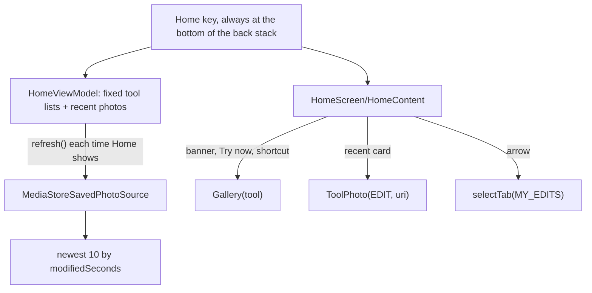

# Home: carousel, shortcuts, Recent edits and the tab bar

[Back to README](../../README.md)

Code links below point into `app/src/main/java/com/phongkaster/kanso/`; the link text leaves that
prefix out. Test links point into `app/src/test/java/com/phongkaster/kanso/`.

---

## What it is

Home is the first screen. In one scrolling column it shows:

1. the title **Kanso** and the greeting "What will you edit today?";
2. a **carousel** of four banners, one per AI tool, each with its name, a line about it and a
   **Try now** button: Remove background ("Cut out the subject"), Enhance ("Sharper, brighter
   photos"), Retouch ("Smooth, natural skin"), Artistic ("Paint it in a new style"), with page dots
   under it;
3. a row of **five round shortcuts**: Edit, Remove background, Enhance, Retouch, Artistic, so every
   tool is one tap away without swiping;
4. the **Recent edits** strip: the newest ten photos Kanso saved, as cards you can swipe sideways,
   with a round arrow that opens My edits.

A **floating tab bar** over the bottom of Home, My edits and Settings holds the three tabs (Home,
My edits, Settings) and a round **Camera** button beside it.

Limits, from the code:

- The carousel never moves on its own; only your swipes move it, one banner per swipe.
- Banners have no pictures; their colours come from the theme (primary, secondary, tertiary
  containers in turn), so they follow the theme colour.
- Recent edits shows at most 10 photos; My edits has them all. It never asks for a permission (see
  [My edits](my-edits.md#known-limits-and-open-items)).

## How to use it

- Tap a banner, its **Try now**, or a shortcut: that tool's gallery opens; pick a photo.
- Tap a **Recent edits** card: it opens in **Edit**.
- Tap the arrow beside "Recent edits", or **My edits** on the bar: the My edits tab.
- Tap **Settings** on the bar for [Settings](settings-and-theme.md); the round **Camera** button for
  the [Camera](camera.md) (a kept shot opens in Edit).
- Back on Home closes the app.

## How it works

1. **The back stack.** [`navigation/KansoNavHost.kt`](../../app/src/main/java/com/phongkaster/kanso/navigation/KansoNavHost.kt)
   starts the Navigation 3 back stack with `Home` (`rememberNavBackStack(Home)`, saved across
   rotation and process death). Home is never popped: Back on Home finishes the activity.
2. **The state.** [`ui/home/HomeViewModel.kt`](../../app/src/main/java/com/phongkaster/kanso/ui/home/HomeViewModel.kt)
   holds one [`HomeUiState`](../../app/src/main/java/com/phongkaster/kanso/ui/home/HomeUiState.kt):
   `carouselTools = [REMOVE_BACKGROUND, ENHANCE, RETOUCH, ARTISTIC]`, `shortcutTools =
   Tool.entries` (all five, in the enum's order), the recent photos and whether they are loading.
   `HomeUiState.kt` is also where the app explains what a UiState is.
3. **Recent edits.** [`ui/home/HomeScreen.kt`](../../app/src/main/java/com/phongkaster/kanso/ui/home/HomeScreen.kt)
   calls `refresh()` in a `LaunchedEffect` each time Home is shown (so a photo just saved is first
   when you come back). `refresh` reads the same `SavedPhotoSource` as My edits (see
   [My edits](my-edits.md#how-it-works)), keeps the cards already shown while it reads, sorts by
   modification time and keeps the newest 10 (`RECENT_LIMIT`). A failure gives an empty strip with
   "Your edits will show up here." While the first read runs, four placeholder cards pulse. Cards
   are 120 x 160 dp in a `LazyRow`, loaded by Coil through the gallery's `PhotoThumbnail`.
4. **The carousel.** `HeroCarousel` is Material 3's `HorizontalUncontainedCarousel`: each banner is
   the strip's width minus a peek so a slice of the next one shows, clipped with `maskClip`, with
   `CarouselDefaults.singleAdvanceFlingBehavior` so a swipe settles on exactly one banner. Page dots
   follow it.
5. **Taps.** The screen only reports taps; the navigation host acts, and only while Home is on top
   (so a double tap opens one screen): a tool → `Gallery(tool)`; a recent card →
   `ToolPhoto(Tool.EDIT, uri)`; the arrow → `selectTab(KansoTab.MY_EDITS)`.
6. **The tab bar.** [`navigation/KansoTabShell.kt`](../../app/src/main/java/com/phongkaster/kanso/navigation/KansoTabShell.kt)
   floats [`KansoTabBar`](../../app/src/main/java/com/phongkaster/kanso/navigation/KansoTabBar.kt)
   over the screen while a tab key (Home, MyEdits, Settings) is on top and no keyboard is open.
   Picking a tab runs `selectTab` ([`navigation/BackStackActions.kt`](../../app/src/main/java/com/phongkaster/kanso/navigation/BackStackActions.kt)):
   the stack is cleared to `[Home]` and the tab's key added, so tabs never pile up and Back from
   any tab lands on Home. Each tab screen leaves room at its bottom for the bar. The Camera button
   pushes `Camera(Tool.EDIT)`.
7. **Moving between screens.** `NavDisplay` slides and fades screens with the theme's expressive
   springs ([`navigation/KansoTransitions.kt`](../../app/src/main/java/com/phongkaster/kanso/navigation/KansoTransitions.kt));
   tabs cross-fade ([`navigation/KansoTabTransitions.kt`](../../app/src/main/java/com/phongkaster/kanso/navigation/KansoTabTransitions.kt)).
   The manifest's `enableOnBackInvokedCallback` turns on predictive back.

## Tests

- [`home/HomeViewModelTest.kt`](../../app/src/test/java/com/phongkaster/kanso/home/HomeViewModelTest.kt):
  the carousel and shortcut tools in order; the camera is not a tool; the strip starts loading;
  a read lists the newest ten, newest first; photos stay while reading again; empty or failing
  sources give the empty strip.
- [`home/HomeScreenTest.kt`](../../app/src/test/java/com/phongkaster/kanso/home/HomeScreenTest.kt):
  the four banners in order with name, description, icon and Try now; four dots; a swipe settles on
  banner two; ten seconds without a touch leave banner one in front; five round shortcuts, evenly
  spaced, named, that never scroll sideways; taps report their tool.
- [`home/HomeRecentTest.kt`](../../app/src/test/java/com/phongkaster/kanso/home/HomeRecentTest.kt):
  the strip scrolls sideways; the newest card opens Edit and Back returns Home; the arrow selects
  My edits; an empty source shows the message; a photo just saved is first when Home returns.
- [`home/HomeReachTest.kt`](../../app/src/test/java/com/phongkaster/kanso/home/HomeReachTest.kt):
  on a small phone and a normal one, fresh or with edits, every target is on screen and one tap
  from launch.
- [`navigation/NavBarTest.kt`](../../app/src/test/java/com/phongkaster/kanso/navigation/NavBarTest.kt),
  [`navigation/BackStackActionsTest.kt`](../../app/src/test/java/com/phongkaster/kanso/navigation/BackStackActionsTest.kt),
  [`navigation/NavigationTest.kt`](../../app/src/test/java/com/phongkaster/kanso/navigation/NavigationTest.kt),
  [`navigation/PredictiveBackGestureTest.kt`](../../app/src/test/java/com/phongkaster/kanso/navigation/PredictiveBackGestureTest.kt):
  the bar, tab moves, Back and predictive back.
- [`screenshots/HomeScreenshotTest.kt`](../../app/src/test/java/com/phongkaster/kanso/screenshots/HomeScreenshotTest.kt):
  empty, loading and small-phone Home in light and dark.

## Known limits and open items

- **Awaiting a person, Run 7:** item 20 (motion on the phone, with and without Remove animations),
  item 28 (the carousel's snap, peek and readability), item 29a (Home pictures). Worth a look from
  Run 7: the peeking second banner shows a cut word.

[Back to README](../../README.md)
