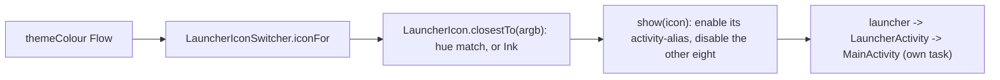

# Launcher icon that follows the theme colour

[Back to README](../../README.md)

Code links below point into `app/src/main/java/com/phongkaster/kanso/`; the link text leaves that
prefix out. Test links point into `app/src/test/java/com/phongkaster/kanso/`.

---

## What it is

Kanso's home-screen icon, an "enso lens" mark, changes its background colour to match the theme
colour chosen in [Settings](settings-and-theme.md). It ships on **nine** backgrounds: Kanso blue,
teal, green, amber, orange, red, pink, purple, and a near-black "ink" for greys, black and white.

Limits, from the code:

- Android cannot repaint an app icon at run time, so the icon can only be one of the nine; a
  custom colour gets the nearest one **by hue**, not the exact colour.
- The launcher usually takes a few seconds to redraw the icon.
- With From wallpaper, the icon follows the wallpaper's main accent colour (Android 12+), checked
  each time Kanso's window is created (a start, or a rotation) and whenever the theme colour
  changes; a wallpaper change while Kanso is open is picked up only then.

## How to use it

Pick a theme colour in Settings, then look at the home screen. Nothing else to do.

## How it works

1. **Nine launcher entries.** `app/src/main/AndroidManifest.xml` declares nine `<activity-alias>`
   entries, `.LauncherKansoBlue` (enabled) and eight disabled ones, each with its own
   `@mipmap/ic_launcher_<colour>` icon (`app/src/main/res/mipmap-anydpi/`). Exactly one is enabled
   at a time.
2. **Choosing the icon.** [`launcher/LauncherIconSwitcher.kt`](../../app/src/main/java/com/phongkaster/kanso/launcher/LauncherIconSwitcher.kt)
   `iconFor`: Kanso blue gives the Kanso blue icon; Custom gives `LauncherIcon.closestTo(seed)`;
   Wallpaper gives `closestTo(system_accent1_500)` on Android 12+, Kanso blue below.
   [`launcher/LauncherIcon.kt`](../../app/src/main/java/com/phongkaster/kanso/launcher/LauncherIcon.kt)
   `closestTo` turns the colour into hue, saturation and brightness: below 0.18 saturation or 0.15
   brightness it is Ink; otherwise the icon whose background hue is nearest, the short way round
   the colour wheel.
3. **Switching.** `show(icon)` enables the wanted alias **first** (so the launcher never has no
   Kanso icon), then disables the others, with `PackageManager.setComponentEnabledSetting(...,
   DONT_KILL_APP)` so Kanso keeps running. Entries already in the wanted state are left alone.
4. **When.** [`MainActivity.kt`](../../app/src/main/java/com/phongkaster/kanso/MainActivity.kt)
   collects `settings.themeColour` in `lifecycleScope` and calls `show(iconFor(colour))` at start and
   on every change.
5. **Why `LauncherActivity`.** Android closes every screen started through an entry that is being
   disabled, and removes a task whose root entry is disabled. So every alias opens
   [`LauncherActivity.kt`](../../app/src/main/java/com/phongkaster/kanso/LauncherActivity.kt), which
   starts `MainActivity` with `NEW_TASK | CLEAR_TOP | SINGLE_TOP` in MainActivity's own task
   (`taskAffinity="com.phongkaster.kanso.main"`, never disabled) and finishes at once. Changing the
   colour therefore never closes the app under your finger.

## Tests

- [`launcher/LauncherIconTest.kt`](../../app/src/test/java/com/phongkaster/kanso/launcher/LauncherIconTest.kt):
  each icon's own colour picks that icon; picked colours match their colour family; colours without
  a hue get Ink.
- `LauncherIconSwitcher.show` and the manifest switching are not run by a test on the computer.

## Known limits and open items

- The switching (`show`) and the redraw delay have no test on the computer, and no item in
  `.harness/ISSUES.md` records the icon being checked on a phone.

[Back to README](../../README.md)
