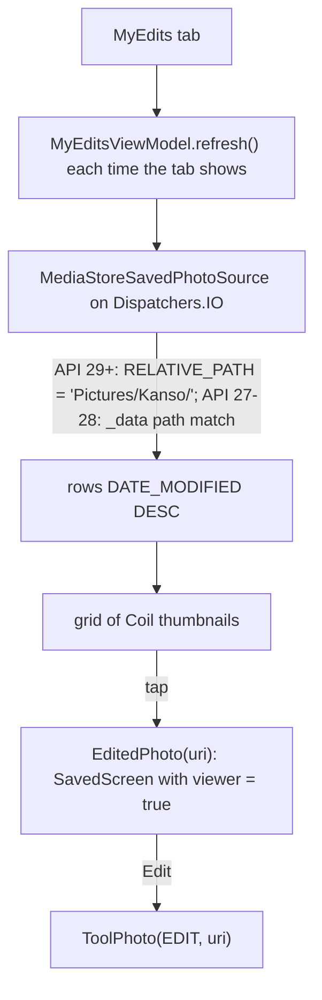

# My edits and the photo viewer

[Back to README](../../README.md)

Code links below point into `app/src/main/java/com/phongkaster/kanso/`; the link text leaves that
prefix out. Test links point into `app/src/test/java/com/phongkaster/kanso/`.

---

## What it is

**My edits** is the middle tab of the floating tab bar. It lists every photo Kanso has saved in
`Pictures/Kanso`, newest first, as a grid of rounded tiles. Tapping one opens the **photo viewer**:
the photo over a blurred copy of itself, titled "My edits", with **Share**, **Edit** and a close
button.

Limits, from the code:

- It lists only what is in `Pictures/Kanso` (the folder itself, not sub-folders). A photo deleted
  or moved out of that folder by another app disappears from the list.
- It cannot delete or rename a photo.
- It never asks for a permission. On Android 8.1 and 9 the list needs photo-read access, which only
  the gallery asks for; without it the list is empty.

## How to use it

1. Tap **My edits** on the tab bar (or the round arrow next to "Recent edits" on Home).
2. Scroll the grid; tap a tile.
3. In the viewer: **Share** sends the photo; **Edit** opens it in the Edit tool; close goes Home;
   Back returns to the grid.

While the list is read the first time, placeholder tiles with a moving band show. With nothing
saved: "No edits yet. Photos you save in Kanso will show up here."

## How it works

1. **The tab.** Picking the tab runs `selectTab(MY_EDITS)` in
   [`navigation/BackStackActions.kt`](../../app/src/main/java/com/phongkaster/kanso/navigation/BackStackActions.kt):
   the stack becomes `[Home, MyEdits]`, so Back from it goes Home.
2. **Reading.** [`ui/myedits/MyEditsScreen.kt`](../../app/src/main/java/com/phongkaster/kanso/ui/myedits/MyEditsScreen.kt)
   calls `refresh()` in a `LaunchedEffect` each time the tab appears.
   [`ui/myedits/MyEditsViewModel.kt`](../../app/src/main/java/com/phongkaster/kanso/ui/myedits/MyEditsViewModel.kt)
   cancels an older read, keeps the photos already shown while it reads, sorts the answer by
   modification time, newest first, and turns a failure into an empty list.
3. **The query.**
   [`data/media/MediaStoreSavedPhotoSource.kt`](../../app/src/main/java/com/phongkaster/kanso/data/media/MediaStoreSavedPhotoSource.kt)
   queries `MediaStore.Images.Media.EXTERNAL_CONTENT_URI` on `Dispatchers.IO`, sorted
   `DATE_MODIFIED DESC`:
   - **Android 10+ (API 29+):** `RELATIVE_PATH = 'Pictures/Kanso/'`. Reading the app's own rows
     needs no permission.
   - **Android 8.1 and 9 (API 27, 28):** the file path column `_data` must contain
     `/Pictures/Kanso/`, must start with `/storage/emulated/<user number>/Pictures/Kanso/` (a
     case-sensitive `GLOB`), and must have no further folder below it. Without read permission
     Android throws a `SecurityException`, which gives an empty list.

   Each row becomes a `Photo` whose Uri is the row's `content://` address.
4. **The grid.** `LazyVerticalGrid` with `GridCells.Adaptive(110.dp)`, 6 dp gaps; each tile is the
   gallery's `PhotoThumbnail`, loaded by Coil and decoded at about 160 dp.
5. **The viewer.** A tap pushes `EditedPhoto(uri)`
   ([`navigation/EditedPhoto.kt`](../../app/src/main/java/com/phongkaster/kanso/navigation/EditedPhoto.kt)),
   only while My edits is on top. The navigation host draws it with the Saved screen and a
   `SavedViewModel` built with `viewer = true`: titled "My edits", no success mark, no saved line,
   and **Edit** instead of Edit another. Share works as on the Saved screen (see
   [Saving and Share](saving-and-share.md#share)).
6. **Edit.** Pushes `ToolPhoto(Tool.EDIT, uri)` above the viewer; Replace there goes to the Edit
   gallery and then back to the viewer.

## Tests

- [`myedits/MyEditsTest.kt`](../../app/src/test/java/com/phongkaster/kanso/myedits/MyEditsTest.kt):
  forty photos show as tiles, newest first, with their names; scrolling reaches the fortieth tile
  above the bar; a tap reports its Uri; the empty message; placeholders until the photos arrive.
- [`myedits/MyEditsViewModelTest.kt`](../../app/src/test/java/com/phongkaster/kanso/myedits/MyEditsViewModelTest.kt):
  starts loading, newest first, picks up a newly saved photo, keeps photos while reading again,
  empty and throwing sources give the empty state.
- [`myedits/EditsSourceTest.kt`](../../app/src/test/java/com/phongkaster/kanso/myedits/EditsSourceTest.kt):
  the query on Android 8.1 (by file path, and empty without access), 11 and 15 (by folder).
- [`navigation/MyEditsViewerNavigationTest.kt`](../../app/src/test/java/com/phongkaster/kanso/navigation/MyEditsViewerNavigationTest.kt):
  a tile opens the viewer with Share, Edit, close and no bar; Share starts the chooser; Edit opens
  the Edit tool; close shows Home; Back shows the grid with the tile still on screen.
- [`home/EditsLoadingTest.kt`](../../app/src/test/java/com/phongkaster/kanso/home/EditsLoadingTest.kt),
  [`screenshots/MyEditsScreenshotTest.kt`](../../app/src/test/java/com/phongkaster/kanso/screenshots/MyEditsScreenshotTest.kt).

## Known limits and open items

- **No permission is asked here** (assumption A-011, `.harness/ISSUES.md`, Run 7): on Android 8.1
  and 9, and after a reinstall on Android 10+, the list stays empty until photo access is granted
  in a gallery.
- **Awaiting a person, Run 7:** item 29b (My edits pictures), item 29e (viewer pictures).

[Back to README](../../README.md)
