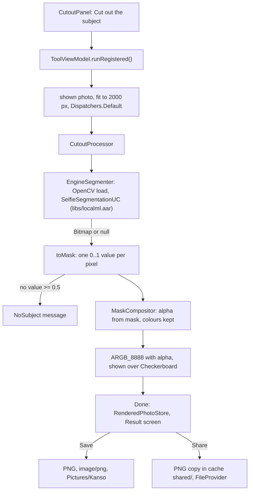

# Remove background: cut the person out

[Back to README](../../README.md)

Code links below point into `app/src/main/java/com/phongkaster/kanso/`; the link text leaves that
prefix out. Test links point into `app/src/test/java/com/phongkaster/kanso/`. The parts every tool
shares (opening the photo, progress, Undo, Replace, Done) are on [The tool screen](tool-screen.md);
Share and Save are on [the Result screen](saving-and-share.md).

---

## What it is

One button, **Cut out the subject**, finds the person in the photo and makes everything else fully
transparent. The result is shown over a grey-and-white checkerboard, so you can see what is now
see-through. **Done** hands it to the Result screen, where Save writes it as a **PNG** that keeps
the transparency and Share sends a PNG copy.

Limits, from the code:

- **People only, in practice.** The model is ML Kit's *selfie segmentation*, trained on people. A
  photo with no person usually gives an empty result, and the screen says "No person or object
  stood out in this photo, so nothing was cut out. Your photo is unchanged." Objects, pets and
  products are not what it was trained for.
- **Offline.** The model ships inside the app; nothing is downloaded. The engine's other cut-out
  paths, which use a Google Play services model that downloads on first use, are never called.
- Works on at most **2000 px** on the longest edge; the saved PNG is at that size or smaller.
- The edge is a fixed soft ramp; there is no brush to fix the outline, and no way to put a new
  background behind the person. The background is only made transparent.

## How to use it

- Reach it from the first **carousel banner** on Home ("Cut out the subject", or its **Try now**
  button), or from the **Remove background** shortcut. Pick a photo in the gallery, or tap the
  gallery's camera button and keep a shot.
- Tap **Cut out the subject**. The progress ring fills while it works.
- When it has finished the person stands on a checkerboard. **Undo** brings the background back.
- Tap **Done** to open the Result screen: **Save** writes the PNG to `Pictures/Kanso`, **Share**
  sends it, **Go home** ends the session, and Back returns here with the cut-out and Undo intact.

**Seen on the Android emulator (API 34, x86_64), 2026-10-14**, with test photos of a face (1024 x
1024) and a 4000 x 3000 scene: the cut-out took about 5 seconds, showed the person over the
checkerboard, and saved as a PNG in `Pictures/Kanso`, with no crash. That run used the Save of
Run 8 (a bar on the tool screen), before Run 9 moved Save to the Result screen; no device run of
the Done-to-Result path is recorded here.

## How it works

1. **The button.**
   [`ui/tool/components/toolpanel/CutoutPanel.kt`](../../app/src/main/java/com/phongkaster/kanso/ui/tool/components/toolpanel/CutoutPanel.kt)
   draws one button, disabled while an edit runs. Its tap calls `ToolViewModel.runRegistered()`.
2. **Which processor.**
   [`di/AppModule.kt`](../../app/src/main/java/com/phongkaster/kanso/di/AppModule.kt) registers
   `CutoutProcessor(EngineSegmenter())` for `Tool.REMOVE_BACKGROUND` in the app-wide
   `ProcessorRegistry`, so one segmenter serves every Remove background screen.
3. **The input.** `ToolViewModel.apply` takes the photo **as now shown** (the last edit, or the
   original), shrinks it to 2000 px (`WorkingSize.REMOVE_BACKGROUND`) on `Dispatchers.Default`, and
   runs the processor (see [The tool screen](tool-screen.md#3-running-an-edit)).
4. **The processor.**
   [`data/edit/cutout/CutoutProcessor.kt`](../../app/src/main/java/com/phongkaster/kanso/data/edit/cutout/CutoutProcessor.kt)
   runs on `Dispatchers.Default`:
   1. reports progress 0.1 and shrinks to 2000 px again, so the engine is never handed a larger
      photo whoever calls it;
   2. asks the [`Segmenter`](../../app/src/main/java/com/phongkaster/kanso/data/edit/cutout/Segmenter.kt)
      for the mask: one foreground probability (0 = background, 1 = subject) per pixel, row by row;
   3. no mask → `NoSubject`. A mask of the wrong length is a broken engine result →
      `ModelUnavailable`. No value at 0.5 or above → `NoSubject`;
   4. reports 0.8, cuts the subject out with `MaskCompositor`, reports 1.
5. **The engine call.**
   [`data/edit/cutout/EngineSegmenter.kt`](../../app/src/main/java/com/phongkaster/kanso/data/edit/cutout/EngineSegmenter.kt)
   is the only file of the app that names the cut-out engine's classes:
   1. `OpenCVLoader.initLocal()` loads OpenCV's native library packed in the app (`opencv/`); if it
      returns false the call throws, which becomes `ModelUnavailable`. The engine converts pictures
      through OpenCV, so it must be loaded first.
   2. On the first photo it builds the engine's `SelfieSegmentationUC` (in `libs/localml.aar`,
      reached through `core/localml`) and keeps it for the rest of the app's life.
   3. It calls `invoke(photo, true)`. Behind it is ML Kit's selfie segmentation;
      `core/localml/build.gradle.kts` depends on `com.google.mlkit:segmentation-selfie`, the variant
      that bundles its model in the APK.
   4. `toMask` scales the returned picture to the photo's size if needed, then reads one
      probability per pixel: from its **alpha** when any pixel is see-through, otherwise from its
      **brightness** (the largest of red, green and blue), as a black-and-white mask. The AAR ships
      no source, so which of the two the engine really returns is not documented; the code accepts
      either.
6. **Cutting out.**
   [`data/edit/cutout/MaskCompositor.kt`](../../app/src/main/java/com/phongkaster/kanso/data/edit/cutout/MaskCompositor.kt)
   keeps every pixel's red, green and blue exactly and sets only its alpha: 0 at a probability of
   0.4 or below, 255 at 0.6 or above, a straight ramp between (a soft outline). A broken value (NaN)
   counts as background. The result is a new `ARGB_8888` bitmap with `setHasAlpha(true)`.
7. **On screen.** `PhotoCard` in
   [`ui/tool/ToolScreen.kt`](../../app/src/main/java/com/phongkaster/kanso/ui/tool/ToolScreen.kt)
   sees the tool is Remove background and the shown bitmap has alpha, and draws a
   [`Checkerboard`](../../app/src/main/java/com/phongkaster/kanso/ui/tool/components/Checkerboard.kt) behind it
   (12 dp squares in two theme colours) instead of the blurred backdrop.
8. **Done, then Save or Share.** Done hands the cut-out (or, with no cut-out made or every one
   undone, the original photo) to the Result screen through `RenderedPhotoStore`; it writes
   nothing. Result shows the cut-out over a blurred copy of itself, not over a checkerboard. Its
   **Save** calls `MediaStorePhotoSaver.save(bitmap)`, which sees `hasAlpha()` and writes a
   lossless **PNG**, named `Kanso_<yyyyMMdd_HHmmss>.png`, type `image/png`, at the size shown.
   **Share** writes a PNG copy into the cache's `shared/` folder and sends it as `image/png`
   through FileProvider, without touching the gallery (see
   [Done, the Result screen, Save and Share](saving-and-share.md)).

**What happens on failure:**

| What went wrong | Failure | Message |
|---|---|---|
| No mask, or nothing at 0.5 or above | `NoSubject` | No person or object stood out in this photo, so nothing was cut out. Your photo is unchanged. |
| Out of memory | `OutOfMemory` | This photo is too large to edit on this phone. Try a smaller one. Your photo is unchanged. |
| OpenCV will not load, a native library will not link, the engine throws, or the mask has the wrong size | `ModelUnavailable` | This tool could not start on this phone. Your photo is unchanged. |

The photo and Undo stay as they were. Leaving the screen cancels the run.

## Tests

- [`tool/cutout/CutoutProcessorTest.kt`](../../app/src/test/java/com/phongkaster/kanso/tool/cutout/CutoutProcessorTest.kt),
  with a fake `Segmenter` that returns a mask the test drew: the background becomes transparent and
  the subject keeps its colour; no mask and an all-background mask are `NoSubject`; out of memory
  and another exception are reported; a cancellation is passed on; a huge photo is shrunk before the
  segmenter sees it.
- [`tool/cutout/CutoutPreviewTest.kt`](../../app/src/test/java/com/phongkaster/kanso/tool/cutout/CutoutPreviewTest.kt):
  the screen shows a two-tone checkerboard.
- [`save/SaveEditedTest.kt`](../../app/src/test/java/com/phongkaster/kanso/save/SaveEditedTest.kt):
  a bitmap with alpha is saved as a PNG in `Pictures/Kanso`, with the right type and extension.
- [`result/SharePhotoTest.kt`](../../app/src/test/java/com/phongkaster/kanso/result/SharePhotoTest.kt):
  a PNG is shared as `image/png`, and a picture with alpha is written as a PNG in the `shared`
  cache folder.
- [`tool/DoneResultTest.kt`](../../app/src/test/java/com/phongkaster/kanso/tool/DoneResultTest.kt):
  Done on each tool other than Edit hands over its edited result.
- [`screenshots/ToolScreenshotTest.kt`](../../app/src/test/java/com/phongkaster/kanso/screenshots/ToolScreenshotTest.kt):
  `tool_cutout_light` and `_dark`.
- `EngineSegmenter` itself is native code and is **not** run by any test on the computer; only the
  emulator run above exercised it.

## Known limits and open items

- **Which mask form the engine returns is not recorded.** If it returns an opaque picture, the
  mask comes from brightness (`.harness/ISSUES.md`, Run 8 Phase 2 review, device check DoD 7). The
  emulator run shows the result works; it did not note which branch ran.
- **The checkerboard also fills the letterbox margins** around the photo (Run 8 Phase 2 review).
- **Awaiting a person, Run 8:** item 7 (a real person on the Galaxy A13: the cut edge around hair
  and shoulders, transparent corners in the saved PNG), item 26 (progress on a large photo and the
  checkerboard clearly visible).

[Back to README](../../README.md)
