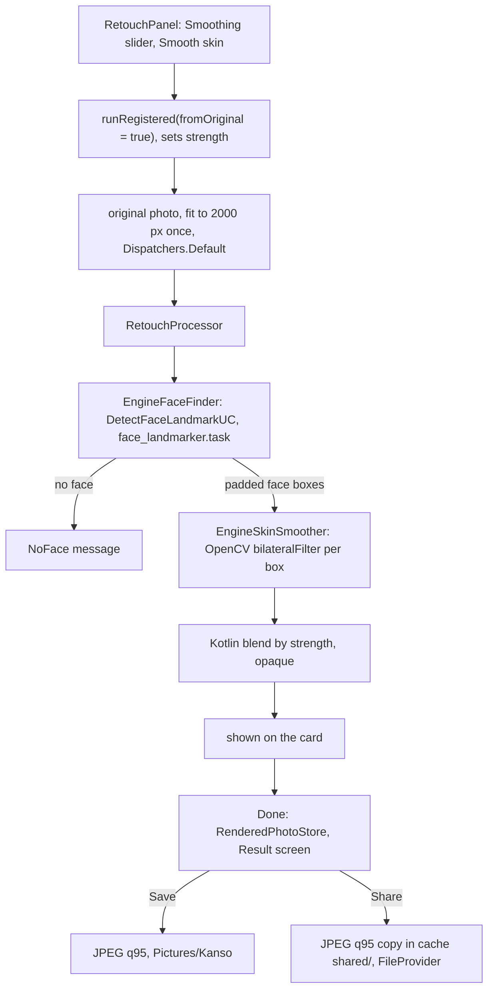

# Retouch: smooth the skin on faces

[Back to README](../../README.md)

Code links below point into `app/src/main/java/com/phongkaster/kanso/`; the link text leaves that
prefix out. Test links point into `app/src/test/java/com/phongkaster/kanso/`. The parts every tool
shares (opening the photo, progress, Undo, Replace, Done) are on [The tool screen](tool-screen.md);
Share and Save are on [the Result screen](saving-and-share.md).

---

## What it is

Retouch finds every face in the photo and smooths it with an **edge-preserving blur**: small
differences such as pores, blemishes and noise are averaged away, while strong edges such as eyes,
lips and hair stay sharp. A **Smoothing** slider (0% to 100%, starting at 100%) sets how much of
the smoothing you see, and **Smooth skin** applies it.

Limits, from the code:

- It works on a **rectangle around each face**, not on a skin mask. Everything inside the box goes
  through the filter (the filter keeps strong edges, so eyes and lips stay sharp); everything
  outside it is never touched.
- It needs a face. With none, it says "No face found in this photo. Nothing was changed."
- It always starts again from the **original** photo, so applying again at another strength
  **replaces** the last result instead of smoothing twice.
- Works on at most **2000 px** on the longest edge; the JPEG that Save on Result writes is at that
  size or smaller.
- Offline: the face model and OpenCV are inside the app.
- It only smooths skin. (The original Retica app's "Retouch" screen removed objects; Kanso's does
  not.)

## How to use it

- Reach it from the third **carousel banner** on Home ("Smooth, natural skin", or **Try now**), or
  the **Retouch** shortcut, then pick a photo (or take one with the gallery's camera button).
- Set **Smoothing**, then tap **Smooth skin**. Moving the slider alone changes nothing; tap Smooth
  skin again to apply a new strength. Both controls are off while it works.
- **Undo** takes back the whole slider session at once. **Done** opens the Result screen with the
  result, where **Save** writes it to `Pictures/Kanso` and **Share** sends it; Back from Result
  returns here unchanged.

**Seen on the Android emulator (API 34, x86_64), 2026-10-14**, with test photos of a face (1024 x
1024) and a 4000 x 3000 scene: Retouch took about 20 seconds and gave smoother skin, with no crash.

## How it works

1. **The panel.**
   [`ui/tool/components/toolpanel/RetouchPanel.kt`](../../app/src/main/java/com/phongkaster/kanso/ui/tool/components/toolpanel/RetouchPanel.kt)
   keeps the slider value with `rememberSaveable` (it survives a rotation) and shows it as a
   percentage. **Smooth skin** calls `onApply(strength)`.
2. **Handing over the strength.** `ToolScreen` turns that into
   `viewModel.runRegistered(fromOriginal = true) { (processor as? RetouchProcessor)?.strength = strength }`.
   The strength is set only when no edit is running, so a tap during a run cannot change a run
   already started.
3. **Which processor.**
   [`di/AppModule.kt`](../../app/src/main/java/com/phongkaster/kanso/di/AppModule.kt) registers one
   app-wide `RetouchProcessor(EngineFaceFinder(androidContext()), EngineSkinSmoother())` for
   `Tool.RETOUCH`.
4. **The input.** With `fromOriginal = true`, `ToolViewModel.apply` uses the **original** photo as
   opened, shrunk to 2000 px (`WorkingSize.RETOUCH`) on `Dispatchers.Default`. That shrunk copy is
   made once per screen and reused for every later run.
5. **The processor.**
   [`data/edit/retouch/RetouchProcessor.kt`](../../app/src/main/java/com/phongkaster/kanso/data/edit/retouch/RetouchProcessor.kt)
   runs on `Dispatchers.Default`:
   1. reads the strength once (a NaN counts as 1; clamped to 0..1), reports 0;
   2. shrinks to 2000 px again if needed, reports 0.05;
   3. asks the [`FaceFinder`](../../app/src/main/java/com/phongkaster/kanso/data/edit/retouch/FaceFinder.kt)
      for face rectangles, cuts each to the photo and drops empty ones, reports 0.4. No face →
      `NoFace`;
   4. smooths each face, one after another, with the
      [`SkinSmoother`](../../app/src/main/java/com/phongkaster/kanso/data/edit/retouch/SkinSmoother.kt),
      moving progress from 0.4 to 0.9; the copies between faces are freed;
   5. **blends** the fully smoothed copy over the original, pixel by pixel in Kotlin:
      `out = original + strength x (smoothed - original)` for red, green and blue, rounded, alpha
      forced to 255. Strength 0 gives the original back exactly. Outside the faces the two are equal,
      so those pixels never change;
   6. marks the result opaque (`setHasAlpha(false)`), frees the working copies, reports 1.
6. **Finding faces.**
   [`data/edit/retouch/EngineFaceFinder.kt`](../../app/src/main/java/com/phongkaster/kanso/data/edit/retouch/EngineFaceFinder.kt):
   1. on the first photo it builds the engine's `DetectFaceLandmarkUC` (in `libs/localml.aar`,
      through `core/localml`) and waits for `initModel()`; a `Mutex` stops two runs building two
      engines. The engine is then **kept for the app's life**, since loading the model takes a
      moment;
   2. `invoke(photo)` returns, for each face, a list of landmark points (`UnifyPoint` from
      `core/common`), not a rectangle;
   3. each face's points become the smallest box holding them, widened by **10%** of its size on
      every side (so forehead and chin are included), cut to the photo. Points are read as fractions
      of the photo, or as pixels if any coordinate is above 1.5.

   The model is `face_landmarker.task`, bundled in the assets of `libs/localml.aar` (MediaPipe's
   Face Landmarker format; `core/localml` declares MediaPipe Tasks Vision). Nothing is downloaded.
7. **Smoothing.**
   [`data/edit/retouch/EngineSkinSmoother.kt`](../../app/src/main/java/com/phongkaster/kanso/data/edit/retouch/EngineSkinSmoother.kt):
   1. `OpenCVLoader.initLocal()` loads OpenCV from the app (`opencv/`), or the call throws;
   2. copies the photo into a mutable `ARGB_8888` bitmap and into an OpenCV `Mat`;
   3. takes a window (`submat`) onto the face box, converts RGBA to RGB, and runs
      `Imgproc.bilateralFilter` with a neighbourhood of a fiftieth of the face's shorter side
      (between 5 and 15 px), colour sigma 40 and space sigma 8;
   4. converts back to RGBA, writes it into the window, and turns the `Mat` back into the bitmap;
   5. releases every `Mat` in `finally` (their memory is native, outside Java's garbage collector).

   OpenCV is used instead of the engine's GL beauty shader because that shader needs a thread with
   an OpenGL context, which a background coroutine does not have.
8. **Undo.** A Retouch run straight after another Retouch run replaces it without a new Undo step,
   so Undo goes back to the photo before the first Smooth skin.
9. **Done, then Save or Share.** Done hands the result (or, with no run or every run undone, the
   original photo) to the Result screen through `RenderedPhotoStore`, at once; it writes nothing.
   The result is opaque, so Save on Result writes a **JPEG at quality 95**, at the size shown, into
   `Pictures/Kanso`, and Share sends a JPEG copy from the cache's `shared/` folder (see
   [Done, the Result screen, Save and Share](saving-and-share.md)).

**What happens on failure:**

| What went wrong | Failure | Message |
|---|---|---|
| No face found | `NoFace` | No face found in this photo. Nothing was changed. |
| Out of memory, in the finder or the smoother | `OutOfMemory` | This photo is too large to edit on this phone. Try a smaller one. Your photo is unchanged. |
| The face model or OpenCV will not load, a native library will not link, or either throws | `ModelUnavailable` | This tool could not start on this phone. Your photo is unchanged. |

The no-face message also sits in a node tagged `retouch-no-face` for tests. The photo and Undo
stay as they were.

## Tests

- [`tool/retouch/RetouchProcessorTest.kt`](../../app/src/test/java/com/phongkaster/kanso/tool/retouch/RetouchProcessorTest.kt),
  with a fake finder and a fake smoother: strength 0 leaves every pixel as it was; strength 1
  smooths the face and nothing else; half strength is half way; no face is reported and nothing
  changes; the input is not changed and the result is opaque; a very large photo is capped before
  the finder and the smoother; out of memory and errors in either are reported; a cancellation
  propagates; progress only goes forward, to 1.
- [`tool/retouch/RetouchToolTest.kt`](../../app/src/test/java/com/phongkaster/kanso/tool/retouch/RetouchToolTest.kt):
  through the real screen, no face changes nothing and shows the message; Smooth skin hands over
  full strength by default, and the slider's strength when moved.
- [`screenshots/ToolScreenshotTest.kt`](../../app/src/test/java/com/phongkaster/kanso/screenshots/ToolScreenshotTest.kt):
  `tool_retouch_light` and `_dark`.
- `EngineFaceFinder` and `EngineSkinSmoother` are native code and are **not** run by any test on
  the computer; only the emulator run above exercised them.

## Known limits and open items

- Each **Smooth skin** runs face finding and smoothing again in full; only the shrunk input is
  reused, not the smoothed picture.
- **Whether the face boxes and the OpenCV settings look right has not been judged by a person**
  (`.harness/ISSUES.md`, Run 8 Phase 3 review).
- **Awaiting a person, Run 8:** item 11 (a one-face portrait at maximum strength: smoother skin
  with the eyes still sharp; a landscape gives the no-face message).

[Back to README](../../README.md)
