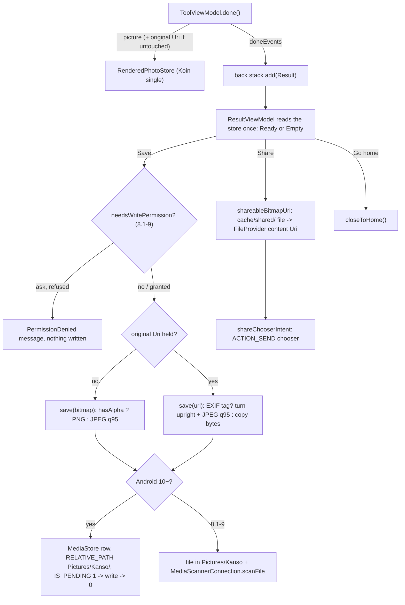

# Done, the Result screen, Save and Share

[Back to README](../../README.md)

Code links below point into `app/src/main/java/com/phongkaster/kanso/`; the link text leaves that
prefix out. Test links point into `app/src/test/java/com/phongkaster/kanso/`.

---

## What it is

**Done** on a tool screen hands the finished picture to the **Result** screen; it writes nothing
(see [The tool screen](tool-screen.md#6-done)). Result shows the picture over a blurred copy of
itself, titled "Your edit", with three actions at the bottom: a round **Share** button, a wide
**Save** button and a round **Go home** button. Nothing is in the gallery until Save is tapped:
**Save on Result is the only place Kanso writes a photo to the gallery.** Share sends a temporary
copy from the app's cache, so sharing an unsaved edit leaves no trace in the gallery.

Before Run 9, Save sat in a bar at the bottom of the tool screen, wrote the file at once and then
opened a screen named `Saved`; Run 9 replaced both with Done and Result.

| | |
|---|---|
| **Folder** | `Pictures/Kanso/` |
| **File name** | `Kanso_<yyyyMMdd_HHmmss>.jpg`, or `.png` for a picture with an alpha channel; `_1`, `_2`, ... when the name is taken. An existing file is never overwritten. |
| **Edited photo** | The picture Done handed over, at its size, never scaled back up or turned: a **JPEG at quality 95** when opaque, a lossless **PNG** when it has an alpha channel (a Remove background cut-out). |
| **Untouched photo** (no edit on Remove background, Enhance, Beautify or Artistic, or every edit undone there; no change at all on Edit) | A copy of the original file, byte for byte; or, if it has an EXIF rotation, a fresh JPEG at quality 95, turned upright, with no EXIF block. |
| **Shared copy** | A file in the app's cache, `shared/Kanso_<milliseconds>.jpg` (JPEG quality 100) or `.png` (with alpha), at the picture's size; the copy from the previous share is deleted first. |
| **Original** | Opened only for reading. Never changed. |

Limits, from the code:

- An edited photo is saved at the tool's working size (2000 px for Edit, Remove background and
  Beautify, up to 2048 px for Enhance, 1024 px for Artistic), never at the original's full size.
- On Edit, any change, even one undone later, makes Done render the settings at up to 3000 px, so the
  saved file is that render, not a copy of the original.
- One picture per Done can be saved once: after a successful save, Save reads "Saved" and is
  switched off. Back to the tool and Done again hands over a new picture that can be saved again.
- An unedited PNG or WebP with no rotation tag is copied byte for byte under a `.jpg` name with the
  type `image/jpeg`; only a rotated photo is re-encoded as a real JPEG.
- A photo too large to turn upright in memory is copied with its tag, and Result says "Saved.
  This photo is very large, so it was copied as it is and some apps may show it sideways."
- Share sends the picture only to the app you pick, with a one-off right to read that one file.
  An untouched photo is shared as the decoded copy on screen (at most twice the screen's longest
  edge), not as the original file.
- The picture waits in memory only. If Android kills the app while Result is open, Result comes
  back with "Nothing to show" and only Go home.

## How to use it

1. On a tool screen, tap **Done**. On Edit, Done shows a small spinner while it renders.
2. The Result screen opens with the picture. **Share** opens Android's share sheet. **Save** writes
   the picture to `Pictures/Kanso` (on Android 8.1 and 9, allow storage access the first time);
   a success mark plays over the photo and the line "Your photo is saved in Pictures/Kanso."
   appears. **Go home** clears everything above Home. System Back returns to the tool screen with
   the edits and Undo steps intact.

## How it works

### Handing over: Done and the store

- `ToolViewModel.done()` (see [The tool screen](tool-screen.md#6-done)) puts the picture into
  [`data/edit/RenderedPhotoStore.kt`](../../app/src/main/java/com/phongkaster/kanso/data/edit/RenderedPhotoStore.kt)
  with `put(picture, originalUri)`. `originalUri` is the photo's own Uri when the picture is that
  photo untouched, else null. The store holds one picture; a newer `put` replaces the older one.
- The navigation host pushes the key `Result`
  ([`navigation/Result.kt`](../../app/src/main/java/com/phongkaster/kanso/navigation/Result.kt)), a
  `data object` that carries nothing, above the tool screen.
- [`ui/result/ResultViewModel.kt`](../../app/src/main/java/com/phongkaster/kanso/ui/result/ResultViewModel.kt)
  is built by Koin with no parameters
  ([`di/AppModule.kt`](../../app/src/main/java/com/phongkaster/kanso/di/AppModule.kt)) and reads the
  store once, when it is built: `ResultPhoto.Ready(bitmap)` or, with an empty store,
  `ResultPhoto.Empty` ([`ui/result/ResultPhoto.kt`](../../app/src/main/java/com/phongkaster/kanso/ui/result/ResultPhoto.kt)).
  When this ViewModel is cleared (Back or Go home), it clears the store, so the bitmap does not stay
  in memory.

### The Result screen

- [`ui/result/ResultScreen.kt`](../../app/src/main/java/com/phongkaster/kanso/ui/result/ResultScreen.kt)
  is split in two: `ResultScreen` (state, the permission request, Share) and the stateless
  `ResultContent`, drawn by the previews. Back to front: a `BlurredBackdrop` of the picture filling
  the window (a cut-out PNG is shown over it, not over a checkerboard), the whole picture centred on
  it, a soft shade at the top with the title "Your edit", the success mark once Save has succeeded
  (it grows and changes shape once), and at the bottom the line saying how Save went, then Share,
  Save and Go home. The bottom block pads itself clear of the gesture zone.
- With an empty store the screen says "Nothing to show" and offers Go home alone, centred.
- The state is [`ui/result/ResultUiState.kt`](../../app/src/main/java/com/phongkaster/kanso/ui/result/ResultUiState.kt):
  the picture, `viewer`, and `save`, one of `Idle`, `Saving`, `Saved(keptOriginalOrientation)`,
  `Failed` and `PermissionDenied`. Save shows "Save" when idle, failed or refused; a small loading
  indicator and "Saving…" while it writes; a check and "Saved" once done, switched off.
- **Go home** calls `closeToHome()` in
  [`navigation/BackStackActions.kt`](../../app/src/main/java/com/phongkaster/kanso/navigation/BackStackActions.kt),
  which removes every key above Home, the tool screen included (its edits go with it).
- The same screen, for the key `EditedPhoto(photoUri)`
  ([`navigation/EditedPhoto.kt`](../../app/src/main/java/com/phongkaster/kanso/navigation/EditedPhoto.kt)),
  is the My edits photo viewer: `viewer = true`, titled "My edits", a round close button at the top,
  Share and a wide **Edit**, no Save and no success mark; the photo is decoded from the phone by
  `PhotoLoader` (twice the screen's longest edge, upright). See [My edits](my-edits.md).

### Saving

`ResultViewModel.save()` does nothing in the viewer, without a picture, while a save runs or once
it has saved. Otherwise it sets `Saving` and calls `saver.save(originalUri)` if the store held the
photo's own Uri, else `saver.save(bitmap)`. On Android 8.1 and 9, `ResultScreen` first asks for
`WRITE_EXTERNAL_STORAGE` if `needsWritePermission()` says so; a refusal sets `PermissionDenied`
("Kanso needs permission to write to your storage to save the photo. Nothing was saved."). Android
10 and later ask for nothing.

The writing itself is all in
[`data/photo/MediaStorePhotoSaver.kt`](../../app/src/main/java/com/phongkaster/kanso/data/photo/MediaStorePhotoSaver.kt)
(behind [`data/photo/PhotoSaver.kt`](../../app/src/main/java/com/phongkaster/kanso/data/photo/PhotoSaver.kt)),
on `Dispatchers.IO`:

1. **Choosing the content.**
   - `save(bitmap)` (an edited picture): `saveFormatFor(bitmap)` picks PNG when `bitmap.hasAlpha()`,
     else JPEG at quality 100 (`EDITED_JPEG_QUALITY`); extension and MIME type follow. The bitmap is
     compressed as it is and never recycled (the screen still shows it).
   - `save(uri)` (an untouched photo): `prepare` reads the EXIF orientation
     ([`data/photo/UprightJpeg.kt`](../../app/src/main/java/com/phongkaster/kanso/data/photo/UprightJpeg.kt),
     `readExifOrientation`). No tag, or orientation 1: the bytes are copied untouched, EXIF
     included. Orientations 2 to 8: the photo is decoded at **full size** (`BitmapFactory`, no
     sampling), turned with the same `Matrix` the loader uses (`uprightMatrix`, `applyUpright`),
     and written as a JPEG at quality 95 (`UPRIGHT_JPEG_QUALITY`) with no EXIF block. If that runs
     out of memory, the bytes are copied with their tag and `keptOriginalOrientation` is set.
2. **Naming.** `Kanso_` plus the time as `yyyyMMdd_HHmmss`.
3. **Android 10 and later (API 29+).** `namesTakenInMediaStore` asks MediaStore which names start
   with that base, and `uniqueName` takes the first free one (`_1`, `_2`, ...). A row is inserted
   with `DISPLAY_NAME`, `MIME_TYPE`, `RELATIVE_PATH = Pictures/Kanso/` and `IS_PENDING = 1` (hidden
   from other apps), the bytes are written through `openOutputStream`, then `IS_PENDING = 0`
   publishes it. If anything fails after the row exists, the row is deleted. No permission is
   needed.
4. **Android 8.1 and 9 (API 27 and 28).** The file is created in
   `Environment.getExternalStoragePublicDirectory(DIRECTORY_PICTURES)/Kanso/` with
   `createNewFile`, which claims a free name in one step, trying `_1` up to `_9999` (`MAX_SUFFIX`);
   a failed write deletes it. `MediaScannerConnection.scanFile` then adds it to MediaStore. The
   result is a `file://` Uri. This needs `WRITE_EXTERNAL_STORAGE`, which Result asks for first.
5. **Outcome.** `SaveResult.Saved(uri, keptOriginalOrientation)` or `SaveResult.Failed`
   ([`data/photo/SaveResult.kt`](../../app/src/main/java/com/phongkaster/kanso/data/photo/SaveResult.kt)).
   Any exception or `OutOfMemoryError` is `Failed`; Result says "The photo could not be saved. Try
   again." and Save can be tapped again. On success Result shows the saved line (or the sideways
   warning) and the mark, and stays open. The new file is in `Pictures/Kanso`, the album My edits
   and Home's Recent edits read when they next load (see [My edits](my-edits.md)).

### Share

[`ui/result/SharePhoto.kt`](../../app/src/main/java/com/phongkaster/kanso/ui/result/SharePhoto.kt),
started from `ResultScreen` in a coroutine (Share ignores taps while one is being prepared). The
picture shared is the one in the state at the tap.

**Right after Done** (nothing need be saved first):

1. `shareableBitmapUri` (on `Dispatchers.IO`): deletes any earlier copy in the cache folder
   `shared/` (`SHARE_CACHE_FOLDER`), then writes the picture there as `Kanso_<milliseconds>.png`
   when it has alpha, else `.jpg` at quality 100 (`SHARE_JPEG_QUALITY`), at its own size. A failed
   write gives null and the share sheet does not open.
2. `fileProviderUri` turns the file into a `content://` Uri through AndroidX `FileProvider`, with
   the authority `<applicationId>.fileprovider` (`SHARE_AUTHORITY_SUFFIX`; the `provider` in
   `app/src/main/AndroidManifest.xml`). `app/src/main/res/xml/file_paths.xml` lets it hand out only
   the cache's `shared/` folder.
3. `bitmapShareMimeType`: `image/png` with alpha, else `image/jpeg`. So a cut-out is shared as a
   PNG.

**In the My edits viewer** (a photo already in the gallery):

1. `shareableUri` (on `Dispatchers.IO`): a `content://` Uri is used as it is. A `file://` Uri (an
   Android 8.1 and 9 save) is looked up in MediaStore by its path (the `DATA` column); if the media
   scanner has not added it yet, the scanner is asked and Kanso waits up to **5 seconds**
   (`DEFAULT_SCAN_TIMEOUT_MILLIS`) for its content Uri. A `file://` Uri is never handed out (Android
   refuses that). With no content Uri, the share sheet does not open.
2. `shareMimeType`: the type MediaStore reports for the row if it is an image type; otherwise the
   name decides: `.png` → `image/png`, anything else → `image/jpeg`.

Both end in `shareChooserIntent`: an `ACTION_SEND` intent of that type with the Uri in
`EXTRA_STREAM` and in `ClipData`, `FLAG_GRANT_READ_URI_PERMISSION` on it and on the
`Intent.createChooser` wrapper. No app is targeted; you choose in the system sheet.

## Tests

- [`save/MediaStoreSaverTest.kt`](../../app/src/test/java/com/phongkaster/kanso/save/MediaStoreSaverTest.kt):
  a turned photo is saved upright at full size in `Pictures/Kanso`; an upright photo and one tagged
  normal are copied byte for byte; an out-of-memory decode falls back to a verbatim copy; two saves
  in the same second make two files; an unreadable photo fails and leaves nothing; no write
  permission is needed on Android 10+.
- [`save/LegacySaverTest.kt`](../../app/src/test/java/com/phongkaster/kanso/save/LegacySaverTest.kt):
  the same on Android 9 (API 28), plus the scanner call and the write permission.
- [`save/SaveEditedTest.kt`](../../app/src/test/java/com/phongkaster/kanso/save/SaveEditedTest.kt):
  an opaque edit is a JPEG and an edit with alpha a PNG in `Pictures/Kanso`; a failing stream
  leaves no row; type and extension follow the format.
- [`save/SaveButtonTest.kt`](../../app/src/test/java/com/phongkaster/kanso/save/SaveButtonTest.kt):
  the tool screen's Done hands the photo over, asks for nothing and writes nothing on Android 8.1,
  9, 10 and 15.
- [`tool/DoneResultTest.kt`](../../app/src/test/java/com/phongkaster/kanso/tool/DoneResultTest.kt):
  what each tool's Done hands over, and that the tool's ViewModel holds no saver.
- [`result/ResultViewModelTest.kt`](../../app/src/test/java/com/phongkaster/kanso/result/ResultViewModelTest.kt):
  the stored picture is ready at once and an empty store gives nothing to show; Save goes from
  Saving to Saved and writes once, an untouched photo is saved from its own file, a second save is
  ignored, a kept orientation is reported, a failure can be retried, a refused permission can be
  retried; clearing the ViewModel empties the store; the viewer loads, never saves and ignores the
  store.
- [`result/ResultScreenTest.kt`](../../app/src/test/java/com/phongkaster/kanso/result/ResultScreenTest.kt):
  the backdrop, the title and shade, the actions row and the gesture zone; the mark's place and
  single play; the saved line only after a save; failure and refusal messages; the Saving
  indicator; Share, Save and Go home after Done, Go home alone with an empty store, Share, Edit and
  close in the viewer; Save writes once and asks for the permission first when needed; Share after
  Done sends a cache copy and writes nothing to the gallery; Share in the viewer and on Android 9.
- [`result/ShareableUriTest.kt`](../../app/src/test/java/com/phongkaster/kanso/result/ShareableUriTest.kt)
  and [`result/SharePhotoTest.kt`](../../app/src/test/java/com/phongkaster/kanso/result/SharePhotoTest.kt):
  a file Uri becomes its content Uri and an unknown file gives null; PNG and JPEG types; a rendered
  picture is written as a JPEG or PNG in the `shared` cache folder, a second share leaves one file,
  and the manifest declares the FileProvider the share Uri names. (On a Windows JVM these tests pass
  `HOST_URI` from [`result/HostFileUri.kt`](../../app/src/test/java/com/phongkaster/kanso/result/HostFileUri.kt)
  instead of calling `FileProvider`.)
- [`navigation/ResultNavigationTest.kt`](../../app/src/test/java/com/phongkaster/kanso/navigation/ResultNavigationTest.kt):
  Back from Result returns to the tool screen; Go home leaves only Home.
- [`screenshots/ResultScreenshotTest.kt`](../../app/src/test/java/com/phongkaster/kanso/screenshots/ResultScreenshotTest.kt):
  recorded pictures of the Result screen.

## Known limits and open items

- The format caveat above: an unedited, unrotated PNG or WebP is saved under a `.jpg` name.
- The last shared copy stays in the app's cache (`shared/`) until the next share or until Android
  clears the cache.
- The hand-off store lives only in memory: after process death Result has nothing to show.
- **Awaiting a person, Run 7:** item 29e (pictures of this screen and of the viewer on a phone).

[Back to README](../../README.md)
