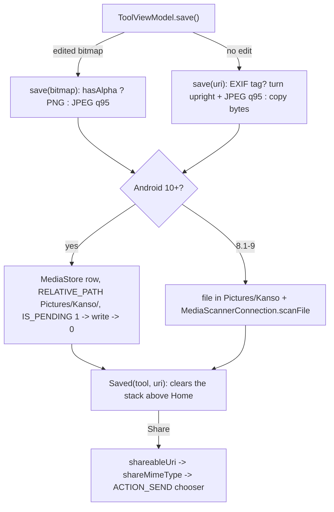

# Saving, the Saved screen and Share

[Back to README](../../README.md)

Code links below point into `app/src/main/java/com/phongkaster/kanso/`; the link text leaves that
prefix out. Test links point into `app/src/test/java/com/phongkaster/kanso/`.

---

## What it is

**Save** on a tool screen writes the photo shown on screen as a **new file** in the phone's
`Pictures/Kanso` album, then opens the **Saved** screen: the photo over a blurred copy of itself,
a small success mark, the line "Your photo is saved in Pictures/Kanso.", a round **Share** button
and a wide **Edit another** button.

| | |
|---|---|
| **Folder** | `Pictures/Kanso/` |
| **File name** | `Kanso_<yyyyMMdd_HHmmss>.jpg`, or `.png` for an edited picture with an alpha channel; `_1`, `_2`, ... when the name is taken. An existing file is never overwritten. |
| **Edited photo** | The bitmap on screen, at the size shown, never scaled back up or turned: a **JPEG at quality 95** when opaque, a lossless **PNG** when it has an alpha channel (a Remove background cut-out). |
| **Unedited photo** (no edit, or every edit undone) | A copy of the original file, byte for byte; or, if it has an EXIF rotation, a fresh JPEG at quality 95, turned upright, with no EXIF block. |
| **Original** | Opened only for reading. Never changed. |

Limits, from the code:

- An edited photo is saved at the tool's working size (2000 px for Edit, Remove background and
  Retouch, up to 2048 px for Enhance, 1024 px for Artistic), never at the original's full size.
- An unedited PNG or WebP with no rotation tag is copied byte for byte under a `.jpg` name with the
  type `image/jpeg`; only a rotated photo is re-encoded as a real JPEG.
- A photo too large to turn upright in memory is copied with its tag, and the screen says "Saved.
  This photo is very large, so it was copied as it is and some apps may show it sideways."
- Share sends the photo only to the app you pick, with a one-off right to read that one file.

## How to use it

1. On a tool screen, tap **Save**. On Android 8.1 and 9, allow storage access the first time.
2. The Saved screen opens. **Share** opens Android's share sheet; **Edit another** opens the same
   tool's gallery; the round close button (top left) or Back goes Home.

## How it works

### Saving

All in [`data/photo/MediaStorePhotoSaver.kt`](../../app/src/main/java/com/phongkaster/kanso/data/photo/MediaStorePhotoSaver.kt),
on `Dispatchers.IO`, called from `ToolViewModel.save()` (see
[The tool screen](tool-screen.md#6-save)).

1. **Choosing the content.**
   - `save(bitmap)` (an edited photo): `saveFormatFor(bitmap)` picks PNG when `bitmap.hasAlpha()`,
     else JPEG; extension and MIME type follow. The bitmap is compressed as it is and never
     recycled (the screen still shows it).
   - `save(uri)` (an unedited photo): `prepare` reads the EXIF orientation
     ([`data/photo/UprightJpeg.kt`](../../app/src/main/java/com/phongkaster/kanso/data/photo/UprightJpeg.kt),
     `readExifOrientation`). No tag, or orientation 1: the bytes are copied untouched, EXIF
     included. Orientations 2 to 8: the photo is decoded at **full size** (`BitmapFactory`, no
     sampling), turned with the same `Matrix` the loader uses (`uprightMatrix`, `applyUpright`),
     and written as a JPEG at quality 95 (`UPRIGHT_JPEG_QUALITY`) with no EXIF block. If that runs
     out of memory, the bytes are copied with their tag and `keptOriginalOrientation` is set.
2. **Naming.** `Kanso_` plus the time as `yyyyMMdd_HHmmss`.
3. **Android 10 and later (API 29+).** `namesTakenInMediaStore` asks MediaStore which names start
   with that base, and `uniqueName` takes the first free one (`_1`, `_2`, ...). A row is inserted
   with `DISPLAY_NAME`, `MIME_TYPE`, `RELATIVE_PATH = Pictures/Kanso/` and `IS_PENDING = 1` (hidden
   from other apps), the bytes are written through `openOutputStream`, then `IS_PENDING = 0`
   publishes it. If anything fails after the row exists, the row is deleted. No permission is
   needed.
4. **Android 8.1 and 9 (API 27 and 28).** The file is created in
   `Environment.getExternalStoragePublicDirectory(DIRECTORY_PICTURES)/Kanso/` with
   `createNewFile`, which claims a free name in one step, trying `_1` up to `_9999`; a failed write
   deletes it. `MediaScannerConnection.scanFile` then adds it to MediaStore. The result is a
   `file://` Uri. This needs `WRITE_EXTERNAL_STORAGE`, which the tool screen asks for first.
5. **Result.** `SaveResult.Saved(uri, keptOriginalOrientation)` or `SaveResult.Failed`
   ([`data/photo/SaveResult.kt`](../../app/src/main/java/com/phongkaster/kanso/data/photo/SaveResult.kt)).
   Any exception or `OutOfMemoryError` is `Failed`, and the tool screen says "The photo could not
   be saved. Try again."
6. **Moving on.** The ViewModel sends the Uri once through a `Channel`; the navigation host removes
   every screen above Home and pushes `Saved(tool, uri)`
   ([`navigation/Saved.kt`](../../app/src/main/java/com/phongkaster/kanso/navigation/Saved.kt)), so
   Back from Saved goes Home.

### The Saved screen

- [`ui/saved/SavedViewModel.kt`](../../app/src/main/java/com/phongkaster/kanso/ui/saved/SavedViewModel.kt)
  decodes the new photo with the same `PhotoLoader` as the tool screen (twice the screen's longest
  edge, upright), once per size.
- [`ui/saved/SavedScreen.kt`](../../app/src/main/java/com/phongkaster/kanso/ui/saved/SavedScreen.kt)
  draws, back to front: a `BlurredBackdrop` of the photo filling the window, the whole photo centred
  on it, a soft shade at the top with the close button and the title "Saved", the success mark
  (which grows and changes shape once), and at the bottom the saved line, **Share** and **Edit
  another**. A cut-out PNG is shown over the blurred copy, not a checkerboard.
- **Edit another** replaces Saved with `Gallery(tool)`; **close** clears the stack to Home.
- The same screen, with `viewer = true`, is the My edits photo viewer; see
  [My edits](my-edits.md).

### Share

[`ui/saved/SharePhoto.kt`](../../app/src/main/java/com/phongkaster/kanso/ui/saved/SharePhoto.kt),
started from `SavedScreen` in a coroutine (Share ignores taps while one is being prepared):

1. `shareableUri` (on `Dispatchers.IO`): a `content://` Uri is used as it is. A `file://` Uri (the
   Android 8.1 and 9 save) is looked up in MediaStore by its path (the `DATA` column); if the media
   scanner has not added it yet, the scanner is asked and Kanso waits up to **5 seconds** for its
   content Uri. A `file://` Uri is never handed out (Android refuses that). With no content Uri, the
   share sheet does not open.
2. `shareMimeType`: the type MediaStore reports for the row if it is an image type; otherwise the
   name decides: `.png` → `image/png`, anything else → `image/jpeg`. So a cut-out is shared as a
   PNG.
3. `shareChooserIntent`: an `ACTION_SEND` intent of that type with the Uri in `EXTRA_STREAM` and in
   `ClipData`, `FLAG_GRANT_READ_URI_PERMISSION` on it and on the `Intent.createChooser` wrapper.
   No app is targeted; you choose in the system sheet.

## Tests

- [`save/MediaStoreSaverTest.kt`](../../app/src/test/java/com/phongkaster/kanso/save/MediaStoreSaverTest.kt):
  a turned photo is saved upright at full size in `Pictures/Kanso`; an upright photo and one tagged
  normal are copied byte for byte; an out-of-memory decode falls back to a verbatim copy; two saves
  in the same second make two files; an unreadable photo fails and leaves nothing; no write
  permission is needed on Android 10+.
- [`save/LegacySaverTest.kt`](../../app/src/test/java/com/phongkaster/kanso/save/LegacySaverTest.kt):
  the same on Android 9 (API 28), plus the scanner call and the write permission.
- [`save/SaveEditedTest.kt`](../../app/src/test/java/com/phongkaster/kanso/save/SaveEditedTest.kt):
  an opaque edit is a JPEG and an edit with alpha a PNG in `Pictures/Kanso`; a failing stream
  leaves no row; type and extension follow the format.
- [`save/SaveButtonTest.kt`](../../app/src/test/java/com/phongkaster/kanso/save/SaveButtonTest.kt):
  Save calls the saver once, shows progress, explains a sideways copy and a failure, is off without
  a photo, and asks nothing on Android 15.
- [`saved/SavedScreenTest.kt`](../../app/src/test/java/com/phongkaster/kanso/saved/SavedScreenTest.kt),
  [`saved/SavedViewModelTest.kt`](../../app/src/test/java/com/phongkaster/kanso/saved/SavedViewModelTest.kt):
  the screen's parts, loading, Share opening the chooser, Edit another and close.
- [`saved/ShareableUriTest.kt`](../../app/src/test/java/com/phongkaster/kanso/saved/ShareableUriTest.kt)
  and [`saved/SharePhotoTest.kt`](../../app/src/test/java/com/phongkaster/kanso/saved/SharePhotoTest.kt):
  a file Uri becomes its content Uri and an unknown file gives null; PNG and JPEG types.
- [`navigation/SavedNavigationTest.kt`](../../app/src/test/java/com/phongkaster/kanso/navigation/SavedNavigationTest.kt):
  Edit another leaves Home and the tool's gallery; close and Back leave only Home.

## Known limits and open items

- The format caveat above: an unedited, unrotated PNG or WebP is saved under a `.jpg` name.
- **Awaiting a person, Run 7:** item 29e (Saved and viewer pictures).

[Back to README](../../README.md)
