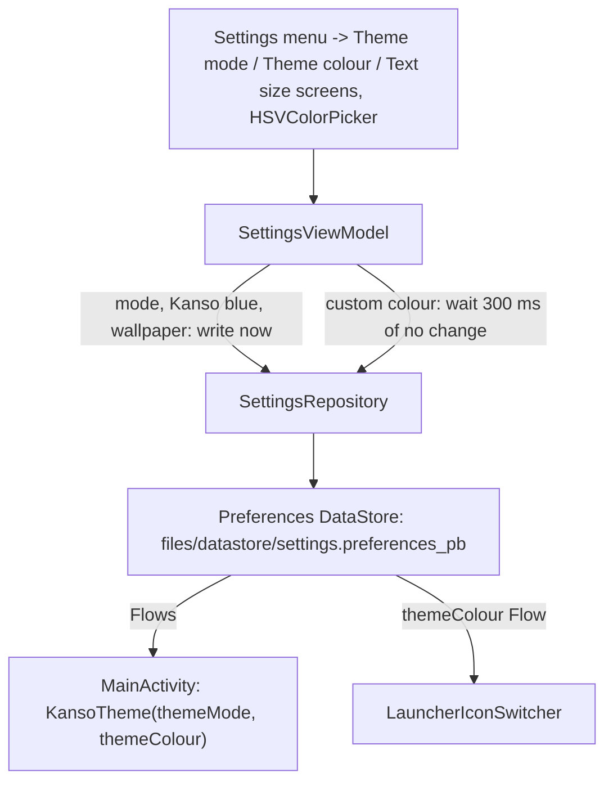

# Settings: theme mode, theme colour and text size

[Back to README](../../README.md)

Code links below point into `app/src/main/java/com/phongkaster/kanso/`; the link text leaves that
prefix out. Test links point into `app/src/test/java/com/phongkaster/kanso/`.

---

## What it is

Settings is the third tab. It is a short menu: under the title and the **Appearance** header sit
three rows, **Theme mode**, **Theme colour** and **Text size**. Each row shows what the setting
is now (the mode's name; "Kanso blue", "From wallpaper" or the custom colour's hex code with a
swatch; the percentage) and an arrow. Tapping a row opens that setting on a **screen of its own**,
with a round Back button at the top left that returns to the menu (system Back does the same). The
three screens are not tabs, so the tab bar is hidden on them. The choices they hold are:

- **Theme mode**: **System default** (follows the phone's dark-theme switch), **Light** or
  **Dark**.
- **Theme colour**: **Kanso blue** (the app's own blue, what a fresh install shows), **From
  wallpaper** (the phone's wallpaper colours, Android 12 and later only), or **Custom colour**,
  which opens a colour picker with a hue/saturation/value area and a hex code box.

A change re-colours the whole app at once, with no restart, and is kept across restarts. The
launcher icon follows the theme colour too; see [Launcher icon](launcher-icon.md).

**Text size.** Kanso ignores the phone's own font size setting (Settings > Display > Font size), so a
large system text size cannot break its layout. Instead, Settings has a **Text size** slider from
85% to 130% (default 100%), stored as `text_scale` in the settings file. The slider
is continuous (no steps; the thumb stops anywhere) and looks like the classic Material 2 slider
(thin track, round thumb; drawn by
`ClassicSlider` through Material 3's `thumb` and `track` slots) and
saves when you lift your finger; the sample sentence under it grows while you drag. The value is
applied in `KansoTheme` by providing a `Density` whose `fontScale` is Kanso's own value, so every
`sp` size in the app follows it at once. `dp` sizes do not change. Files:
`data/settings/TextScale.kt`, `SettingsRepository.textScale`, `ui/settings/SettingsScreen.kt`
(`TextSizeChoice`).

Limits, from the code:

- The only settings are theme mode, theme colour and text size. There is nothing about editing,
  quality or storage here.
- Text in system dialogs and the system share sheet still follows the phone's font size, because
  Kanso does not draw them.
- From wallpaper is not offered below Android 12; a wallpaper choice restored there reads as Kanso
  blue.
- A custom colour is always opaque; the picker hides its transparency bar.
- A custom colour is used **exactly** as `primary` (buttons, switches, the highlighted parts), in
  light and in dark. Its text colour is white when white has a contrast ratio of at least 4 with
  it, near-black otherwise. Containers, surfaces and the other roles are still generated from it,
  so they are softer shades of the same hue (`seedColorScheme(..., exactPrimary = true)`). Kanso
  blue keeps the generated primary.

## How to use it

1. Tap **Settings** on the tab bar.
2. Tap **Theme mode** and tap a mode row; Back returns to the menu.
3. Tap **Theme colour** and tap a colour row. With **Custom colour**, drag in the picker or type a
   six-digit hex code (for example `2E7D32`); a partial code changes nothing. Touching the picker
   while the hex box has the keyboard open closes the keyboard first, so dragging and typing do not
   fight. The screen keeps clear of the keyboard and scrolls. Each colour row shows a small circle
   of its colour; the Custom row shows the last custom colour even while another is chosen.
4. Tap **Text size** and drag the slider.

## How it works

1. **Storage.** [`data/settings/SettingsRepository.kt`](../../app/src/main/java/com/phongkaster/kanso/data/settings/SettingsRepository.kt)
   keeps three keys in one Preferences DataStore file, `files/datastore/settings.preferences_pb`
   in the app's private storage (built in
   [`di/AppModule.kt`](../../app/src/main/java/com/phongkaster/kanso/di/AppModule.kt) and
   [`data/settings/SettingsStore.kt`](../../app/src/main/java/com/phongkaster/kanso/data/settings/SettingsStore.kt)):
   - `theme_mode`: the [`ThemeMode`](../../app/src/main/java/com/phongkaster/kanso/data/settings/ThemeMode.kt)
     name; missing or unknown reads as System;
   - `theme_colour_source`: `KansoBlue`, `Wallpaper` or `Custom` (an old `Baseline` reads as Kanso
     blue); missing or unknown reads as Kanso blue;
   - `theme_colour_seed`: the last custom colour as an ARGB integer, kept even while another colour
     is chosen, so choosing Custom again brings it back (Kanso blue's seed, `#1A73E8`, if none was
     ever picked).

   Each is exposed as a `Flow`; a read error (`IOException`) counts as "nothing saved".
2. **The ViewModel.** [`ui/settings/SettingsViewModel.kt`](../../app/src/main/java/com/phongkaster/kanso/ui/settings/SettingsViewModel.kt)
   `combine`s the three Flows into one `StateFlow<SettingsUiState>`. Mode, Kanso blue and
   wallpaper choices are written at once. A custom colour is **debounced**: the picker reports every
   step of a drag, and each new colour cancels the save planned for the last one and plans its own
   300 ms later (`COLOUR_SETTLE_MILLIS`), so only the colour you stop on is written. A colour still
   waiting when Settings closes is written then. Choosing Kanso blue or wallpaper drops a waiting
   custom colour first.
3. **The screen.** [`ui/settings/SettingsScreen.kt`](../../app/src/main/java/com/phongkaster/kanso/ui/settings/SettingsScreen.kt)
   draws rounded groups of rows (icon in a tinted square, title, one-line description, swatch,
   radio button). The wallpaper row's swatch is `dynamicLightColorScheme(context).primary`; below
   Android 12 the row is left out. The picker is the engine's `HSVColorPicker` from
   `core/colorpicker`, with `showAlpha = false`, on a fixed white card because the picker draws its
   text in black.
4. **Applying the theme.** [`MainActivity.kt`](../../app/src/main/java/com/phongkaster/kanso/MainActivity.kt)
   reads the saved mode and colour once with `runBlocking` before the first frame (so a person who
   chose Dark never sees a light frame), then collects both Flows into
   [`ui/theme/KansoTheme.kt`](../../app/src/main/java/com/phongkaster/kanso/ui/theme/KansoTheme.kt):
   - mode: System uses `isSystemInDarkTheme()`; Light and Dark force one;
   - colour: Kanso blue and Custom are full schemes generated from one seed colour by the
     MaterialKolor library ([`ui/theme/SeedColorScheme.kt`](../../app/src/main/java/com/phongkaster/kanso/ui/theme/SeedColorScheme.kt));
     Wallpaper uses Android's `dynamicLightColorScheme` / `dynamicDarkColorScheme`;
   - everything is wrapped in `MaterialExpressiveTheme` with the expressive spring motion scheme;
     the status and navigation bar icons follow the app's light or dark choice.

## Tests

- [`settings/SettingsRepositoryTest.kt`](../../app/src/test/java/com/phongkaster/kanso/settings/SettingsRepositoryTest.kt)
  and [`settings/ThemeColourStoreTest.kt`](../../app/src/test/java/com/phongkaster/kanso/settings/ThemeColourStoreTest.kt):
  defaults, read-back, survival across a fresh store, corrupt and unknown values, the kept custom
  seed, old `Baseline`, wallpaper below Android 12.
- [`settings/CustomColourDebounceTest.kt`](../../app/src/test/java/com/phongkaster/kanso/settings/CustomColourDebounceTest.kt):
  a 50-step drag writes nothing while it lasts and the last colour once; closing writes a waiting
  colour; a later Kanso blue or wallpaper choice cancels it.
- [`settings/PickerHexInputTest.kt`](../../app/src/test/java/com/phongkaster/kanso/settings/PickerHexInputTest.kt),
  [`settings/ThemeColourHexTest.kt`](../../app/src/test/java/com/phongkaster/kanso/settings/ThemeColourHexTest.kt),
  [`settings/PickerNoAlphaTest.kt`](../../app/src/test/java/com/phongkaster/kanso/settings/PickerNoAlphaTest.kt):
  a complete hex code gives that colour, a partial one nothing, the picker shows no transparency.
- [`settings/ThemeModeSettingsTest.kt`](../../app/src/test/java/com/phongkaster/kanso/settings/ThemeModeSettingsTest.kt),
  [`settings/ThemeColourSettingsTest.kt`](../../app/src/test/java/com/phongkaster/kanso/settings/ThemeColourSettingsTest.kt),
  [`settings/ThemeSwatchTest.kt`](../../app/src/test/java/com/phongkaster/kanso/settings/ThemeSwatchTest.kt),
  [`settings/ThemeModeRestartTest.kt`](../../app/src/test/java/com/phongkaster/kanso/settings/ThemeModeRestartTest.kt),
  [`settings/ThemeColourRestartTest.kt`](../../app/src/test/java/com/phongkaster/kanso/settings/ThemeColourRestartTest.kt):
  choices re-theme the app at once and survive a restart.
- [`theme/`](../../app/src/test/java/com/phongkaster/kanso/theme/): the generated schemes, Kanso
  blue's contrast ratios, the wallpaper schemes on Android 12+, and every screen following light and
  dark (`ThemeFollowTest`).

## Known limits and open items

- **Awaiting a person, Run 7:** item 29f (Settings pictures), item 30 (typing `2E7D32` turns the
  app green on the Galaxy A13, with the box visible above the keyboard).

[Back to README](../../README.md)
