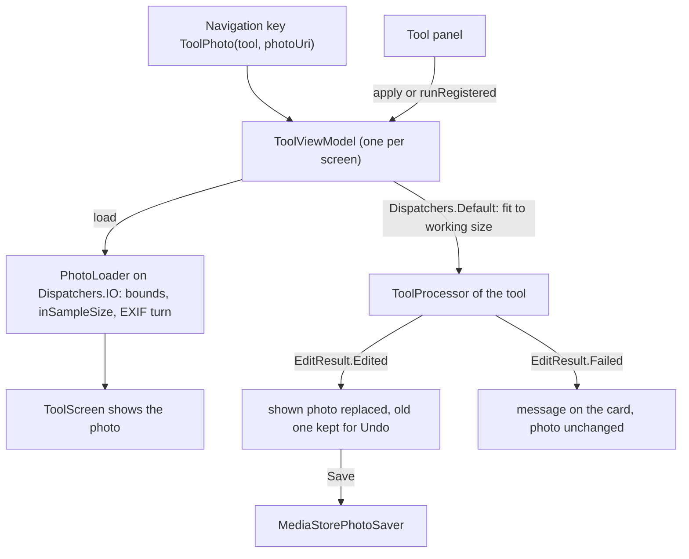

# The tool screen: what every editing tool shares

[Back to README](../../README.md)

Edit, Remove background, Enhance, Retouch and Artistic each open on a screen of their own, but all
five are drawn by one screen and driven by one ViewModel. This page explains that shared part once:
how a photo gets onto the screen, how an edit runs, how progress, Undo, Replace and failures work,
and how Save hands over to the [saving pipeline](saving-and-share.md). Each tool's own page then
only explains what is different.

Code links below point into `app/src/main/java/com/phongkaster/kanso/`; the link text leaves that
prefix out. Test links point into `app/src/test/java/com/phongkaster/kanso/`.

---

## What it is

A tool screen shows, from top to bottom:

- a round **Back** button, the tool's name in the middle, and an **Undo** button on the right;
- the photo in a large rounded **card**, over a soft blurred copy of itself (or over a
  checkerboard when a Remove background result has see-through parts), with a **Replace** chip
  floating at the bottom of the card;
- the tool's own **controls** (its "panel") under the card;
- one full-width **Save** button at the bottom.

While an edit runs, a **progress ring** fills in the middle of the card, and Save, Undo and
Replace are switched off. When an edit fails, a short message at the top of the card says why, and
the photo stays exactly as it was. Tapping the message hides it.

Limits shared by every tool:

- Every edit happens on a copy in memory. The original file is never changed.
- The photo is decoded at most at **twice the screen's longest edge** (for example 4800 px on a
  1080 x 2400 phone), never larger, and each tool then works on a smaller copy (its "working
  size", below).
- Undo keeps every earlier version in memory, for as long as the screen is open. Leaving the
  screen loses the edits unless you saved.
- Only one edit runs at a time. A tap that would start a second one while the first runs is
  ignored.

## How to use it

1. Reach a tool from Home (a carousel banner, its "Try now" button, or a round shortcut), from a
   Recent edits card (Edit only), from the camera, or from "Edit" in the My edits viewer. See
   [Home](home.md), [Gallery](gallery-and-albums.md) and [Camera](camera.md).
2. Use the tool's controls. Each finished edit replaces the photo on the card.
3. **Undo** takes back the last edit; tap again to go further back, down to the original.
4. **Replace** goes back to this tool's photo gallery to pick another photo.
5. **Save** writes the photo shown on the card as a new file in `Pictures/Kanso` and opens the
   Saved screen.

## How it works

### 1. Opening the screen

- The five tools are the enum [`navigation/Tool.kt`](../../app/src/main/java/com/phongkaster/kanso/navigation/Tool.kt):
  `EDIT`, `REMOVE_BACKGROUND`, `ENHANCE`, `RETOUCH`, `ARTISTIC`. Each has only a label and an icon.
- A tool screen is the navigation key `ToolPhoto(tool, photoUri)`
  ([`navigation/ToolPhoto.kt`](../../app/src/main/java/com/phongkaster/kanso/navigation/ToolPhoto.kt)).
  The photo travels as the text of its `content://` (gallery) or `file://` (camera) Uri. The key is
  `@Serializable` and the back stack is saved, so the same tool reopens on the same photo after a
  rotation or after Android kills the app in the background.
- [`navigation/KansoNavHost.kt`](../../app/src/main/java/com/phongkaster/kanso/navigation/KansoNavHost.kt)
  draws the key with `ToolScreen` and asks Koin for a `ToolViewModel` with the key's tool and Uri.
  The ViewModel lives in that back-stack entry's own `ViewModelStore`: it survives rotation and is
  cleared when the screen is popped.
- [`di/AppModule.kt`](../../app/src/main/java/com/phongkaster/kanso/di/AppModule.kt) builds the
  ViewModel with `PhotoLoader`, `PhotoSaver` and the `ProcessorRegistry`. The registry is one
  app-wide object holding the processor of Remove background, Enhance, Retouch and Artistic, each
  built on its engine wrapper. Edit has no registry entry; its panel builds a new processor for each
  change.

### 2. Decoding the photo for the screen

- [`ui/tool/ToolScreen.kt`](../../app/src/main/java/com/phongkaster/kanso/ui/tool/ToolScreen.kt)
  works out `displayMaxEdgePx` (twice the screen's longest edge in pixels) and calls
  `viewModel.load(maxEdgePx)`. A repeat call with the same size does nothing, so a rotation does not
  decode again.
- [`data/photo/PhotoLoader.kt`](../../app/src/main/java/com/phongkaster/kanso/data/photo/PhotoLoader.kt)
  runs on `Dispatchers.IO`:
  1. reads only the image size (`inJustDecodeBounds`);
  2. decodes with `inSampleSize` set to the smallest power of two that brings the longest edge to
     the limit or below (`sampleSizeFor`), so the full-size image is never held in memory;
  3. reads the EXIF orientation tag with AndroidX `ExifInterface` (a damaged block counts as
     upright);
  4. turns or mirrors the bitmap with a `Matrix` for orientations 2 to 8, and frees the unturned one.
- Any exception or `OutOfMemoryError` gives `null`, and the card shows "This photo cannot be
  opened. Go back and pick another one." While decoding, the card shows a `LoadingIndicator`.

### 3. Running an edit

[`ui/tool/ToolViewModel.kt`](../../app/src/main/java/com/phongkaster/kanso/ui/tool/ToolViewModel.kt)
runs every tool the same way, through the
[`data/edit/ToolProcessor.kt`](../../app/src/main/java/com/phongkaster/kanso/data/edit/ToolProcessor.kt)
interface: `suspend fun process(input: Bitmap, onProgress: (Float) -> Unit): EditResult`.

- A panel either hands over a processor it built (`apply`, used by Edit) or asks for the tool's
  registered one (`runRegistered`, used by the other four). Retouch and Artistic set their strength
  and style on the registered processor just before it runs, and only when no edit is running.
- `apply` does nothing while an edit runs or while there is no photo. Otherwise it sets
  `Processing.Running(0)` and launches a coroutine that, on `Dispatchers.Default`:
  1. picks its input: the photo as now shown (the last edit, or the original) for Edit, Remove
     background and Enhance; the untouched original for Retouch and Artistic (`fromOriginal`);
  2. shrinks it to the tool's working size with `WorkingSize.fit`
     ([`data/edit/WorkingSize.kt`](../../app/src/main/java/com/phongkaster/kanso/data/edit/WorkingSize.kt)):

     | Tool | Longest edge it works on |
     |---|---|
     | Edit | 2000 px |
     | Remove background | 2000 px |
     | Enhance | 512 px (the result is up to 4 times larger) |
     | Retouch | 2000 px |
     | Artistic | 1024 px |

     `fit` keeps the shape, filters while scaling, and makes no copy when the photo already fits.
     For Retouch and Artistic the shrunk original is made once and reused, so Artistic's model
     cache can recognise the same input;
  3. runs the processor, which moves its own heavy work to a background thread too.
- Progress values from 0 to 1 update the ring. A value that arrives after the edit has ended is
  ignored.
- On `EditResult.Edited` the result becomes the shown photo (`edited` in
  [`ui/tool/ToolUiState.kt`](../../app/src/main/java/com/phongkaster/kanso/ui/tool/ToolUiState.kt))
  and the photo shown before is pushed on the Undo history. A Retouch or Artistic re-run directly
  after another one replaces that result without adding an Undo step, so Undo takes back the whole
  slider session at once.
- On `EditResult.Failed` the photo and the history stay as they were and the failure's message is
  shown.

### 4. Failures

Each processor returns a failure value instead of throwing
([`data/edit/EditFailure.kt`](../../app/src/main/java/com/phongkaster/kanso/data/edit/EditFailure.kt)).
The screen maps each one to a message (`failureMessageRes` in `ToolScreen.kt`, words in
`app/src/main/res/values/strings_tool.xml`):

| Failure | Message |
|---|---|
| `OutOfMemory` | This photo is too large to edit on this phone. Try a smaller one. Your photo is unchanged. |
| `NoSubject` | No person or object stood out in this photo, so nothing was cut out. Your photo is unchanged. |
| `NoFace` | No face found in this photo. Nothing was changed. |
| `ModelUnavailable` | This tool could not start on this phone. Your photo is unchanged. |
| `Other` | Something went wrong and the edit was not made. Your photo is unchanged. |

An exception that escapes a processor anyway becomes `Other` in the ViewModel, an
`OutOfMemoryError` becomes `OutOfMemory`. Leaving the screen cancels a running edit; that is not
reported as a failure.

### 5. Undo and Replace

- `undo()` pops the last version off the history; with the history empty it does nothing. Undo is
  switched off while an edit runs and when there is nothing to take back.
- Replace calls `replaceWithGallery(tool)` in
  [`navigation/BackStackActions.kt`](../../app/src/main/java/com/phongkaster/kanso/navigation/BackStackActions.kt):
  if the screen below is this tool's gallery it simply goes back to it, otherwise the tool screen
  is swapped for that gallery.

### 6. Save

- The Save button is enabled once the photo is shown, and not while a save or an edit runs.
- On Android 8.1 and 9 the screen first asks for `WRITE_EXTERNAL_STORAGE` if it is not granted; a
  refusal shows "Kanso needs permission to write to your storage to save the photo. Nothing was
  saved." Android 10 and later ask for nothing.
- `ToolViewModel.save()` saves the edited bitmap if there is one (`saver.save(bitmap)`), or the
  original file if nothing was edited or every edit was undone (`saver.save(photoUri)`). The rest
  is on [Saving, the Saved screen and Share](saving-and-share.md).
- On success the new Uri goes through a `Channel` (delivered once, not again after a rotation), and
  the navigation host clears everything above Home and opens `Saved(tool, uri)`.

## Tests

All run on the computer (Robolectric, Compose UI test), with fakes instead of the native engine.

- [`tool/ToolViewModelTest.kt`](../../app/src/test/java/com/phongkaster/kanso/tool/ToolViewModelTest.kt):
  an edit sets the edited photo and allows Undo, undoing every edit returns to the original, a
  running edit reports progress and blocks Save, a failure keeps the photo, a cancellation is not a
  failure, the input is fitted to the working size, Save after an edit saves the edited bitmap, and
  `runRegistered` runs the tool's own processor.
- [`tool/ToolScreenTest.kt`](../../app/src/test/java/com/phongkaster/kanso/tool/ToolScreenTest.kt):
  the photo is asked for at twice the screen's longest edge, a turned photo is drawn upright, each
  tool has its own screen and panel, Undo is enabled only when there is something to undo, Save is
  off and the ring shows while an edit runs, and each failure shows its message over the unchanged
  photo.
- [`tool/PhotoLoaderTest.kt`](../../app/src/test/java/com/phongkaster/kanso/tool/PhotoLoaderTest.kt):
  EXIF orientations 1, 2, 3, 6 and 8, the sample size for an 8000 x 6000 photo, and `null` for a
  missing file, a non-image and a malformed Uri.
- [`tool/ToolPhotoKeyTest.kt`](../../app/src/test/java/com/phongkaster/kanso/tool/ToolPhotoKeyTest.kt):
  the key survives JSON, activity recreation and process death.
- [`tool/ToolBackdropTest.kt`](../../app/src/test/java/com/phongkaster/kanso/tool/ToolBackdropTest.kt):
  the space beside a narrow photo is a soft copy of it.
- [`navigation/ReplaceNavigationTest.kt`](../../app/src/test/java/com/phongkaster/kanso/navigation/ReplaceNavigationTest.kt)
  and [`navigation/PhotoToToolNavigationTest.kt`](../../app/src/test/java/com/phongkaster/kanso/navigation/PhotoToToolNavigationTest.kt):
  Replace and every way into a tool, double taps included.
- [`screenshots/ToolScreenshotTest.kt`](../../app/src/test/java/com/phongkaster/kanso/screenshots/ToolScreenshotTest.kt):
  recorded pictures of the tool screens in light and dark (`verifyRoborazziDebug`).

## Known limits and open items

- **Undo history is unbounded** and lives only in memory; many large edits on one screen cost
  memory (`.harness/ISSUES.md`, Run 8 Phase 1).
- **A late progress report from an earlier edit can move a later edit's ring**
  (`ToolViewModel.reportProgress`; Run 8 Phase 1).
- **The checkerboard also fills the letterbox margins** around a cut-out (Run 8 Phase 2 review).
- **Awaiting a person, Run 8:** item 24 (each tool's layout in light and dark on a phone), item 26
  (progress visible on a large photo), item 35 (all five tools on the Galaxy A13, saved result
  shown in My edits).

[Back to README](../../README.md)
