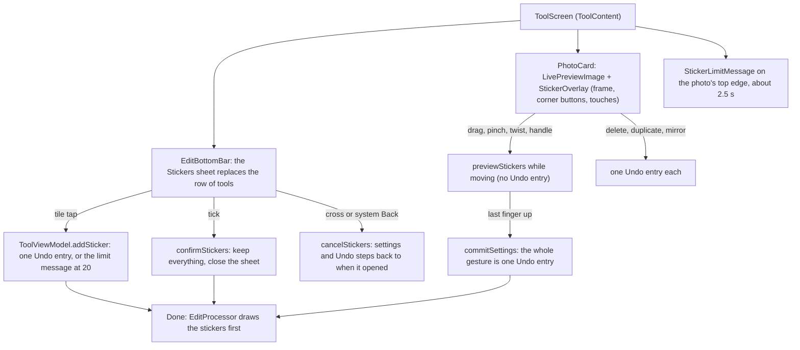
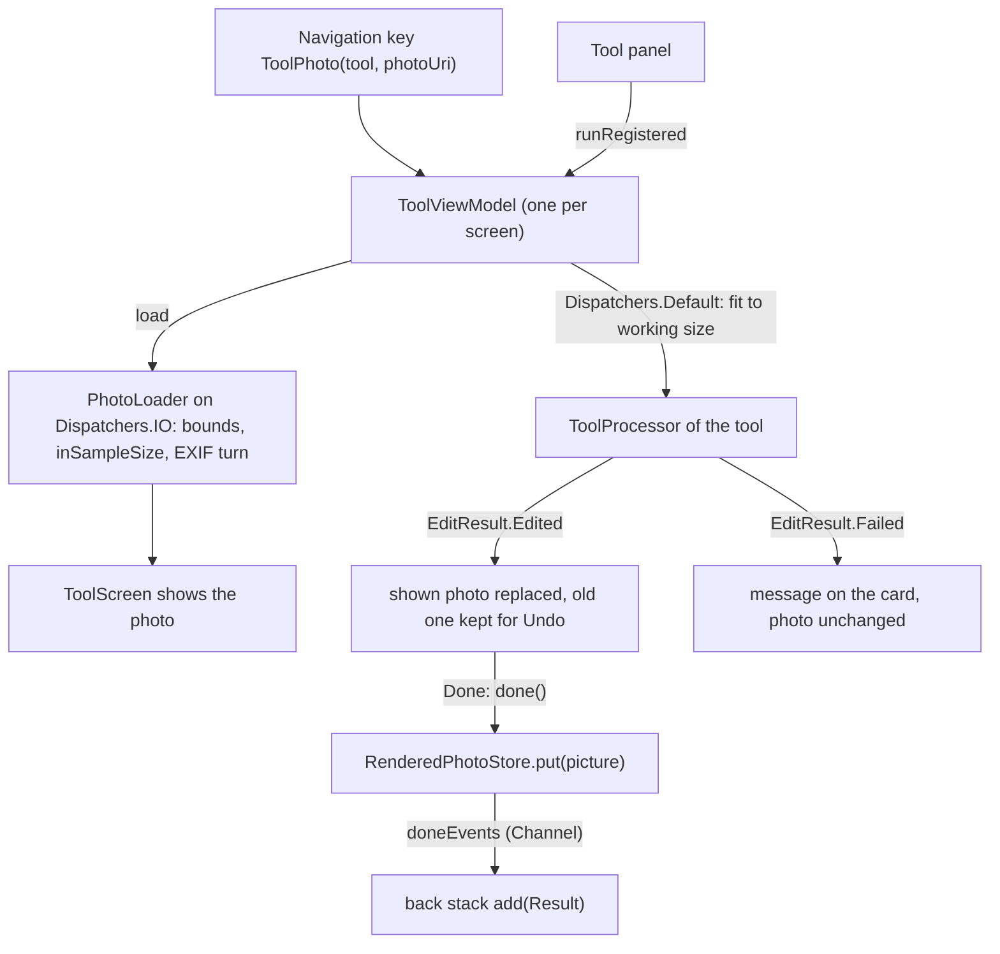

# The tool screen: what every editing tool shares

[Back to README](../../README.md)

Edit, Remove background, Enhance, Retouch and Artistic each open on a screen of their own, but all
five are drawn by one screen and driven by one ViewModel. This page explains that shared part once:
how a photo gets onto the screen, how an edit runs, how progress, Undo, Replace and failures work,
and how **Done** hands the finished picture to the [Result screen](saving-and-share.md), where it is
shared or saved. Each tool's own page then only explains what is different.

Code links below point into `app/src/main/java/com/phongkaster/kanso/`; the link text leaves that
prefix out. Test links point into `app/src/test/java/com/phongkaster/kanso/`.

---

## What it is

A tool screen shows, from top to bottom:

- a top bar: a round **Back** button, the tool's name in the middle, and at the right an **Undo**
  text button followed by a filled **Done** button (test tag `tool-done`, `TOOL_DONE_TAG`);
- the photo in a large rounded **card**, over a soft blurred copy of itself (or over a
  checkerboard when a Remove background result has see-through parts), with a **Replace** chip
  floating at the bottom of the card;
- the tool's own **controls** (its "panel") under the card.

There is no bar at the bottom: the finished picture leaves the screen through Done. The tool screen
never writes a file; saving and sharing happen on the Result screen.

The **Edit** screen is laid out differently (see [Edit](edit.md)): a row of five tools is its
`Scaffold` bottom bar, a tapped tool's sheet opens in a fixed-height area just above the row so the
photo never changes size, the photo has no Replace chip, Undo stays in the top bar beside Done, and
a Compare switch is pinned at the right of the row. The fifth tool, **Stickers**, opens
a sheet that replaces the row (the five entries and Compare are hidden while it is open); its cross, or the
system Back, restores the settings and Undo steps from when it opened, and its tick keeps them. The
"20 stickers at most" message is drawn on the photo's top edge by `ToolContent`
(`StickerLimitMessage`) and hides itself after about 2.5 seconds. `ToolContent` also passes the sticker overlay's events (select,
a gesture's new list, its end, delete, duplicate, mirror) from `PhotoCard` to the ViewModel; the
stickers are touchable only while the Stickers sheet is open, Compare is off and Done is idle.
Why stickers are part of the photo is in
[ADR-004](../adr/ADR-004-sticker-is-part-of-the-photo.md); the details are on [Edit](edit.md).

How the Stickers sheet and the photo share the screen:

While an edit runs, a **progress ring** fills in the middle of the card, and Done, Undo and
Replace are switched off. When an edit fails, a short message at the top of the card says why, and
the photo stays exactly as it was. Tapping the message hides it.

Limits shared by every tool:

- Every edit happens on a copy in memory. The original file is never changed.
- The photo is decoded at most at **twice the screen's longest edge** (for example 4800 px on a
  1080 x 2400 phone), never larger, and each tool then works on a smaller copy (its "working
  size", below).
- Undo keeps every earlier version in memory, for as long as the screen is open. Done does not end
  the session: Back from Result comes back to it intact. Leaving the tool screen (Back, or **Go
  home** on Result) loses the edits unless they were saved on Result.
- Only one edit runs at a time. A tap that would start a second one while the first runs is
  ignored, and so is Done.

## How to use it

1. Reach a tool from Home (a carousel banner, its "Try now" button, or a round shortcut), from a
   Recent edits card (Edit only), from the camera, or from "Edit" in the My edits viewer. See
   [Home](home.md), [Gallery](gallery-and-albums.md) and [Camera](camera.md).
2. Use the tool's controls. Each finished edit replaces the photo on the card.
3. **Undo** takes back the last edit; tap again to go further back, down to the original.
4. **Replace** goes back to this tool's photo gallery to pick another photo.
5. **Done** opens the Result screen with the finished picture. There, **Share** sends it,
   **Save** writes it to `Pictures/Kanso`, and **Go home** ends the session; system Back returns to
   the tool screen as it was. See [Done, the Result screen, Save and Share](saving-and-share.md).

## How it works

### 1. Opening the screen

- The five tools are the enum [`navigation/Tool.kt`](../../app/src/main/java/com/phongkaster/kanso/navigation/Tool.kt):
  `EDIT`, `REMOVE_BACKGROUND`, `ENHANCE`, `RETOUCH`, `ARTISTIC`. Each has only a label and an icon.
- A tool screen is the navigation key `ToolPhoto(tool, photoUri)`
  ([`navigation/ToolPhoto.kt`](../../app/src/main/java/com/phongkaster/kanso/navigation/ToolPhoto.kt)).
  The photo travels as the text of its `content://` (gallery) or `file://` (camera) Uri. The key is
  `@Serializable` and the back stack is saved, so the same tool reopens on the same photo after a
  rotation or after Android kills the app in the background (the edits themselves are not saved).
- [`navigation/KansoNavHost.kt`](../../app/src/main/java/com/phongkaster/kanso/navigation/KansoNavHost.kt)
  draws the key with `ToolScreen` and asks Koin for a `ToolViewModel` with the key's tool and Uri.
  The ViewModel lives in that back-stack entry's own `ViewModelStore`: it survives rotation and is
  cleared when the screen is popped.
- [`di/AppModule.kt`](../../app/src/main/java/com/phongkaster/kanso/di/AppModule.kt) builds the
  ViewModel with `PhotoLoader`, a cleared-probe, the `ProcessorRegistry` and the
  `RenderedPhotoStore`; it is given no saver. The registry is one app-wide object holding the
  processor of Remove background, Enhance, Retouch and Artistic, each built on its engine wrapper.
  Edit has no registry entry: its panel hands the ViewModel a recipe that turns the current
  settings into a processor, used for the filter preview and the final render (see [Edit](edit.md)).

### 2. Decoding the photo for the screen

- [`ui/tool/ToolScreen.kt`](../../app/src/main/java/com/phongkaster/kanso/ui/tool/ToolScreen.kt)
  works out `displayMaxEdgePx` (twice the screen's longest edge in pixels) and calls
  `viewModel.load(maxEdgePx)`. A repeat call with the same size does nothing, so a rotation does not
  decode again.
- [`data/photo/PhotoLoader.kt`](../../app/src/main/java/com/phongkaster/kanso/data/photo/PhotoLoader.kt)
  runs on `Dispatchers.IO`:
  1. reads only the image size (`inJustDecodeBounds`);
  2. decodes with `inSampleSize` set to the smallest power of two that brings the longest edge to
     the limit or below (`sampleSizeFor`), so the full-size image is never held in memory;
  3. reads the EXIF orientation tag with AndroidX `ExifInterface` (a damaged block counts as
     upright);
  4. turns or mirrors the bitmap with a `Matrix` for orientations 2 to 8, and frees the unturned one.
- Any exception or `OutOfMemoryError` gives `null`, and the card shows "This photo cannot be
  opened. Go back and pick another one." While decoding, the card shows a `LoadingIndicator`.

### 3. Running an edit

[`ui/tool/ToolViewModel.kt`](../../app/src/main/java/com/phongkaster/kanso/ui/tool/ToolViewModel.kt)
runs the four registered tools the same way, through the
[`data/edit/ToolProcessor.kt`](../../app/src/main/java/com/phongkaster/kanso/data/edit/ToolProcessor.kt)
interface: `suspend fun process(input: Bitmap, onProgress: (Float) -> Unit): EditResult`.

- A panel asks for the tool's registered processor (`runRegistered`). Retouch and Artistic set
  their strength and style on it just before it runs, and only when no edit is running. Edit never
  takes this path: `apply` does nothing on the Edit screen (its changes are settings, drawn live,
  and rendered in full only at Done).
- `apply` does nothing while an edit runs, while Done is working, while Compare is on, or while
  there is no photo. Otherwise it sets `Processing.Running(0)` and launches a coroutine that, on
  `Dispatchers.Default`:
  1. picks its input: the photo as now shown (the last edit, or the original) for Remove
     background and Enhance; the untouched original for Retouch and Artistic (`fromOriginal`);
  2. shrinks it to the tool's working size with `WorkingSize.fit`
     ([`data/edit/WorkingSize.kt`](../../app/src/main/java/com/phongkaster/kanso/data/edit/WorkingSize.kt)):

     | Tool | Longest edge it works on |
     |---|---|
     | Edit (the render at Done) | 3000 px |
     | Remove background | 2000 px |
     | Enhance | 512 px (the result is up to 4 times larger) |
     | Retouch | 2000 px |
     | Artistic | 1024 px |

     `fit` keeps the shape, filters while scaling, and makes no copy when the photo already fits.
     For Retouch and Artistic the shrunk original is made once and reused, so Artistic's model
     cache can recognise the same input;
  3. runs the processor, which moves its own heavy work to a background thread too.
- Progress values from 0 to 1 update the ring. A value that arrives after the edit has ended is
  ignored.
- On `EditResult.Edited` the result becomes the shown photo (`edited` in
  [`ui/tool/ToolUiState.kt`](../../app/src/main/java/com/phongkaster/kanso/ui/tool/ToolUiState.kt))
  and the photo shown before is pushed on the Undo history. A Retouch or Artistic re-run directly
  after another one replaces that result without adding an Undo step, so Undo takes back the whole
  slider session at once.
- On `EditResult.Failed` the photo and the history stay as they were and the failure's message is
  shown.

### 4. Failures

Each processor returns a failure value instead of throwing
([`data/edit/EditFailure.kt`](../../app/src/main/java/com/phongkaster/kanso/data/edit/EditFailure.kt)).
The screen maps each one to a message (`failureMessageRes` in `ToolScreen.kt`, words in
`app/src/main/res/values/strings_tool.xml`):

| Failure | Message |
|---|---|
| `OutOfMemory` | This photo is too large to edit on this phone. Try a smaller one. Your photo is unchanged. |
| `NoSubject` | No person or object stood out in this photo, so nothing was cut out. Your photo is unchanged. |
| `NoFace` | No face found in this photo. Nothing was changed. |
| `ModelUnavailable` | This tool could not start on this phone. Your photo is unchanged. |
| `Other` | Something went wrong and the edit was not made. Your photo is unchanged. |

An exception that escapes a processor anyway becomes `Other` in the ViewModel, an
`OutOfMemoryError` becomes `OutOfMemory`. Leaving the screen cancels a running edit; that is not
reported as a failure. A failed render at Done (Edit only) shows the same messages and keeps the
person on the tool screen.

### 5. Undo and Replace

- `undo()` pops the last version off the history; with the history empty it does nothing. Undo is
  switched off while an edit runs, while Done is working, and when there is nothing to take back.
  (On Edit, Undo steps back one settings action instead; see [Edit](edit.md).)
- Replace calls `replaceWithGallery(tool)` in
  [`navigation/BackStackActions.kt`](../../app/src/main/java/com/phongkaster/kanso/navigation/BackStackActions.kt):
  if the screen below is this tool's gallery it simply goes back to it, otherwise the tool screen
  is swapped for that gallery.

### 6. Done

- The Done button (`DoneButton` in `ToolScreen.kt`, the word from
  `app/src/main/res/values/strings_tool_done.xml`) is enabled once the photo is shown, and not
  while an edit runs or while an earlier Done is still working. It asks for no permission and
  writes nothing to storage on any Android version.
- `ToolViewModel.done()` decides the picture to hand over:
  - **Remove background, Enhance, Retouch, Artistic:** the picture shown now, at once. With an
    edit, the last edited bitmap. With no edit, or every edit undone, the decoded original, handed
    over together with its own Uri, so that Save on Result copies the original file instead of
    re-encoding the screen-sized copy.
  - **Edit:** with no change made yet, the decoded original and its Uri, as above. After any change
    (even one later undone) the current settings are rendered in full from the original photo at
    the working size (3000 px), on `Dispatchers.Default`. Meanwhile `finishing` is true in the
    state: Done shows a small spinner (`tool-done-progress`) and ignores taps, and the editing
    controls are off. A failed render keeps the person here with the failure's message; nothing is
    handed over.
- The picture goes into [`data/edit/RenderedPhotoStore.kt`](../../app/src/main/java/com/phongkaster/kanso/data/edit/RenderedPhotoStore.kt),
  an app-wide Koin `single` holding one picture (a navigation key is saved as text and cannot carry
  a bitmap). Then one item goes through `doneEvents`, a `Channel` (delivered once, not again after a
  rotation or on coming back from Result), and `ToolScreen` calls `onDone`.
- The navigation host answers `onDone` by pushing the key `Result`
  ([`navigation/Result.kt`](../../app/src/main/java/com/phongkaster/kanso/navigation/Result.kt))
  above the tool screen, only while the tool screen is on top. Done does not end the session: the
  edits, the settings and the Undo steps stay in the tool screen's ViewModel. The rest is on
  [Done, the Result screen, Save and Share](saving-and-share.md).

## Tests

All run on the computer (Robolectric, Compose UI test), with fakes instead of the native engine.

- [`tool/ToolViewModelTest.kt`](../../app/src/test/java/com/phongkaster/kanso/tool/ToolViewModelTest.kt):
  an edit sets the edited photo and allows Undo, undoing every edit returns to the original, a
  running edit reports progress and blocks Done, a failure keeps the photo, a cancellation is not a
  failure, the input is fitted to the working size, Done after an edit hands over the edited
  bitmap, a failed Done render hands nothing over, Edit's Done hands over the rendered settings (or
  the original with nothing changed), the Edit screen ignores `apply`, and `runRegistered` runs the
  tool's own processor.
- [`tool/DoneResultTest.kt`](../../app/src/test/java/com/phongkaster/kanso/tool/DoneResultTest.kt):
  Edit's Done renders at full working size, the ViewModel holds no saver so Done writes nothing,
  each other tool hands over its result, a second tap while Done runs is ignored and Result opens
  once, the edits and Undo steps are intact after Done, and Done before the photo is shown does
  nothing.
- [`save/SaveButtonTest.kt`](../../app/src/test/java/com/phongkaster/kanso/save/SaveButtonTest.kt)
  (the file kept its old name): Done hands the photo over and calls `onDone` once, is off with a
  spinner while Edit renders, is off without a photo, and asks nothing and writes nothing on
  Android 8.1, 9, 10 and 15.
- [`tool/ToolScreenTest.kt`](../../app/src/test/java/com/phongkaster/kanso/tool/ToolScreenTest.kt):
  the photo is asked for at twice the screen's longest edge, a turned photo is drawn upright, each
  tool has its own screen with Back, its name, the card, Replace, its strip and Done, Undo is
  enabled only when there is something to undo, Done is off and the ring shows while an edit runs,
  each failure shows its message over the unchanged photo, and the controls clear the gesture zone.
- [`tool/PhotoLoaderTest.kt`](../../app/src/test/java/com/phongkaster/kanso/tool/PhotoLoaderTest.kt):
  EXIF orientations 1, 2, 3, 6 and 8, the sample size for an 8000 x 6000 photo, and `null` for a
  missing file, a non-image and a malformed Uri.
- [`tool/ToolPhotoKeyTest.kt`](../../app/src/test/java/com/phongkaster/kanso/tool/ToolPhotoKeyTest.kt):
  the key survives JSON, activity recreation and process death.
- [`tool/ToolBackdropTest.kt`](../../app/src/test/java/com/phongkaster/kanso/tool/ToolBackdropTest.kt):
  the space beside a narrow photo is a soft copy of it.
- [`navigation/ReplaceNavigationTest.kt`](../../app/src/test/java/com/phongkaster/kanso/navigation/ReplaceNavigationTest.kt)
  and [`navigation/PhotoToToolNavigationTest.kt`](../../app/src/test/java/com/phongkaster/kanso/navigation/PhotoToToolNavigationTest.kt):
  Replace and every way into a tool, double taps included.
- [`navigation/ResultNavigationTest.kt`](../../app/src/test/java/com/phongkaster/kanso/navigation/ResultNavigationTest.kt):
  Back from Result returns to the tool screen; Go home leaves only Home.
- [`screenshots/ToolScreenshotTest.kt`](../../app/src/test/java/com/phongkaster/kanso/screenshots/ToolScreenshotTest.kt):
  recorded pictures of the tool screens in light and dark (`verifyRoborazziDebug`).
- [`screenshots/StickerScreenshotTest.kt`](../../app/src/test/java/com/phongkaster/kanso/screenshots/StickerScreenshotTest.kt):
  the tool row with Stickers (69, 70), the Stickers sheet's Food, Mood, Quote and Emoji tabs
  (71 to 78), a selected sticker (79, 80), and stickers under a crop and a filter (81, 82), in
  light and dark. The sticker tests themselves are listed on
  [Edit](edit.md).

## Known limits and open items

- **Undo history is unbounded** and lives only in memory; many large edits on one screen cost
  memory (`.harness/ISSUES.md`, Run 8 Phase 1).
- **A late progress report from an earlier edit can move a later edit's ring**
  (`ToolViewModel.reportProgress`; Run 8 Phase 1).
- **The checkerboard also fills the letterbox margins** around a cut-out (Run 8 Phase 2 review).
- **The hand-off store does not survive process death.** If Android kills the app while Result is
  open, Result comes back saying "Nothing to show", and Back returns to a tool screen that decodes
  the photo again without the edits.
- **An untouched photo shared from Result is the screen-sized decode**, not the original file
  (Save copies the original; Share sends the in-memory picture).
- **Awaiting a person, Run 8:** item 24 (each tool's layout in light and dark on a phone), item 26
  (progress visible on a large photo), item 35 (all five tools on the Galaxy A13, saved result
  shown in My edits).

[Back to README](../../README.md)
